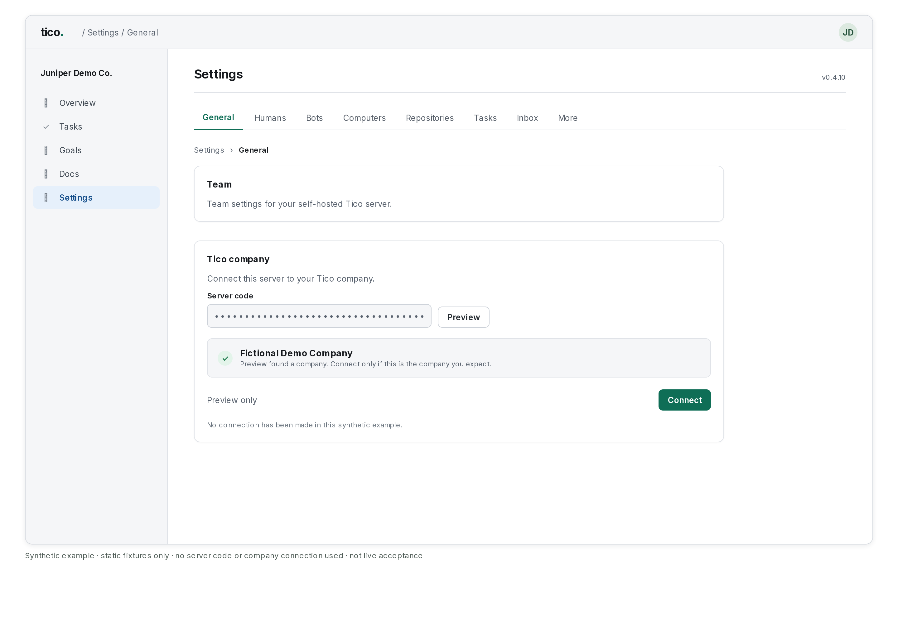

# Tico AI Gateway

The Tico AI Gateway is Tico's own model service. With a gateway key from Tico, your bots can run on a **pick**: a
department, a level (Low, Medium or High), Fast or not, and a version. Decide asks the Gateway with the same key. You
connect it once, in **Settings → Computers → Models**; **Settings → Gateway** shows what is in use. How runs reach the Gateway, for developers, is in
[Harnesses](harnesses.md#the-tico-ai-gateway).

## The picks

A pick is a name, not a model: Tico can change what runs underneath it. Every department has the same levels.

| Level | Version 1.0 runs | Fast runs | For |
|---|---|---|---|
| Low | Claude Haiku 5.5 · $0.15 / $0.75 per 1M | DeepSeek V4.1 Flash · $0.45 / $1.80 | Sorting, triage, short replies, routine checks |
| Medium | Claude Sonnet 5.5 · $2.50 / $12.50 | Claude Opus 5.5 in fast mode · $10 / $50 | Writing, analysis, most turns |
| High | Claude Opus 5.5 · $5 / $25 | Claude Opus 5.5 in fast mode · $10 / $50 | Hard problems, long plans, careful work |

Prices are input and output, USD per 1M tokens. A Low request whose prompt is over 100,000 tokens costs the whole request
at $0.75 input, $0.075 cached input and $3.75 output, and **Usage** estimates it that way.

Images a bot sends go to the models that read them: every pick except Low Fast.

The ids are `tico-<department>-<level>` with `-fast` for Fast: `tico-sales-medium`, `tico-engineering-high-fast`. The
departments are General, Product, Engineering, Marketing, Sales, Finance, Legal, Science, Operations and Data (the list
is Tico's and can grow). A bot's department comes from its group on the org chart: Support and People bots use Operations,
Leadership uses General. That id always means the tier's **current version**. Add the version to pin it:
`tico-sales-medium-1.0` keeps its model and price when a newer version ships. Settings pins the current version by
default and also offers older versions and **Auto (always latest)**. Tico publishes the list at
`GET <gateway url>/catalog`; the server asks for it at most once an hour while the Gateway is connected, ignores an answer
it cannot read, and otherwise uses the list shipped with its release.

The first picks, **Tico Cheap 1.1**, **Mid 1.0** and **Power 1.0** (and Cheap 1.0), are the **old lineup**. A bot, a
default or a fallback already on one keeps it, runs on it and pays its old price, shown as "Mid 1.0 (old lineup)". Nothing
new can pick them.

## Choose how bots get their models

At the top of **Settings → Computers → Models**, and in the first step of setup, the owner picks one of four choices:

- **Your Claude and ChatGPT subscriptions, plus Tico Gateway** (recommended). Bots do their main work on your Claude
  and ChatGPT subscriptions. Personal plans are fine. Sign in with your own Claude and ChatGPT accounts in
  **Settings → Computers**, and don't share one login across your team. Until you sign in, bots run on Tico Mid 1.0
  through the Gateway, and they move to your subscriptions on their next turn once you do, with no restart. When a
  plan runs out, the bot finishes on the Gateway, after any other provider signed in on its computer. Decide and
  update drafts run on the Gateway.
- **Your Claude and ChatGPT subscriptions only**. Bots wait until a Claude or ChatGPT account is signed in on their
  computer, and never spend the gateway key unless you pick a Tico model for them.
- **Tico Gateway only**. Bots run on the Tico models you pick for them. A bot whose plan runs out finishes on the
  Gateway too.
- **Your company's plans or API keys**. Bring your own: tick the providers, then sign in or add API keys in
  **Credentials**. As with subscriptions only, the gateway key is spent only for a bot you put on a Tico model.

Tico's installer sets the recommended choice (`TICO_MODELS_PRESET=subscriptions-gateway` in the server's environment)
until the owner saves another one here.

While the recommended choice waits for a sign-in, the owner sees one **Needs you** item, "Sign in to Claude and
ChatGPT, or add API keys", with **Open Settings → Computers**. It goes away by itself once both are signed in on a
computer. Gateway work runs only on a computer that runs bots as their own user (Tico's Docker runner, see
[below](#pick-a-tico-model-for-a-bot)). When no computer here can, the item also says "This computer can't run Gateway
work without the Docker runner; sign in to Claude and ChatGPT or add API keys", and bots wait for a sign-in instead of
running on the Gateway. They never fail for it. The missing sign-in is the only thing the Gateway stands in for: a bot
whose checkout is missing, whose settings differ from the server's, or whose computer doesn't have pi waits as before,
and Health says which.

When a used-up login has its bots on the Gateway, **Settings → Health** says so in one line, for example "Team box's
Claude login is used up. Bots are on Tico Gateway until it resets." When the bot's computer can't run Gateway work,
Health says the bot stopped and what to do: sign in another login, or add a Docker runner. When the gateway key reaches
its monthly cap, the Gateway work stops and Health says **Gateway cap reached** ([What the card says](#what-the-card-says)).

## Connect the Gateway

Only the owner can do this.

1. Open **Settings → Computers → Models**. The **Tico AI Gateway** card is under the providers.
2. Paste the key Tico gave you in **Gateway key**.
3. Leave **Gateway URL** empty to use the default, `https://updates.tico.team/v1/gateway`. Enter another only if Tico gave
   you one; it starts with `https://` (plain `http://` only for `localhost`). A URL set in the server's environment
   (`TICO_GATEWAY_URL`) follows the same rule, or the key is not sent and the card says **Not working**.
4. Press **Connect**.

The card shows **Connected**, and Tico Cheap 1.1, Mid 1.0 and Power 1.0 appear in the bot model list. The key field empties as
soon as you press **Connect**, and the key is never shown again: the field shows only a short preview, its first and
last three characters. If the card says **Not working** or **Not ready**, see [What the card says](#what-the-card-says).

Once connected, the card has three buttons:

- **Save**: saves a new key or URL. Leave the key field empty to keep the saved key.
- **Check now**: asks the Gateway about the key again.
- **Clear key**: removes the key. Bots on Tico models stop until a key is saved again, and the Tico models leave the
  model list.

If the server's environment sets the key (`TICO_GATEWAY_KEY`), that key wins: the card shows **Connected**, says the
key is set by the server's environment, and has only **Check now**. Change it where the server is configured.

People other than the owner see only whether the Gateway is connected.

### Connected automatically

When Tico invites your company, the install command carries an invite code (`TICO_GATEWAY_INVITE`). The server then
gets its own gateway key from Tico when it starts, with nothing to paste, and the card says **Tico AI Gateway: connected
automatically**. Nobody types or sees the code or the key. The server replaces the key with a new one every 30 days by
itself. The invite is only needed for this first sign-up: after it, the server keeps its key with no invite in the
environment.

### Connect a self-run server through your Tico company

A self-run server can get its Gateway key through its company on [app.tico.dev](https://app.tico.dev/), without an invite code or a pasted key.
Sign in directly as an owner or admin to link the server:

1. Get a server code from your company on app.tico.dev.
2. Open **Settings → General → Tico company** in your Tico.
3. Paste the code into **Server code** and press **Preview**.
4. Check the company name, then press **Connect**.

*Synthetic example of the preview step. No server was connected.*

The card shows your company and its credit. For example, connecting to Acme shows **Acme** and that company's balance.
With automatic connection enabled, the server asks for a Gateway key immediately, then retries hourly while it has none.
Gateway use spends that company's credit.
The owner sees **Tico AI Gateway: connected automatically** on the card in **Settings → Computers → Models** once it has the key.

If linking fails, check the error beside the form. Tico must be able to reach your server's
[connection proof](install.md#cloudflare-tunnel). If the Gateway remains disconnected, check **Settings → Health**;
the company Gateway endpoint also needs to be available at Tico HQ.

An existing key stays in use when you link the server. A pasted or environment key takes precedence over automatic enrollment.
To unlink the server, press **Disconnect** on the **Tico company** card and confirm.
Disconnecting the company removes a key obtained through that link; a pasted key stays.
Reconnecting lets the same install ask for its company key again.
The server also reports its version daily and within an hour after an update, when HQ is reachable.

### Automatic key maintenance

When the key rotates, a running bot keeps its previous key for up to 24 hours, with the same install spending cap.
Turning the install off still stops all its keys immediately. A run that could exceed that grace is limited to just
under 24 hours, including any fallback; its run details explain the shorter limit.

- A key you paste on the card, or one the server's environment sets, wins over the automatic key.
- **Clear key** removes the automatic key, and the server does not get a new one by itself. **Connect automatically**
  on the card turns it back on.
- If Tico turns the Gateway off for your install, Health says "Tico AI Gateway was turned off for this install by
  Tico. Contact support." Decide and bots on Tico models stop, and the server stops asking for a key.
- If the invite code doesn't work (expired, used by all the installs it allows, or cancelled), Health says so. Ask
  Tico Team for a new code and run the install command again with it, or paste a gateway key on the card.

The Gateway counts each call against the install, its key, the model and the bot. It gets an id for the bot that only
your server can make, never the bot's name.

## Changing where an integration sends

A saved Gateway key goes only to the **Gateway URL** it was saved with. Before you change that URL to another service,
Tico asks what to do with the key. It asks when the new address differs in scheme (`https` or `http`), host or port.
Going back to the default, `https://updates.tico.team/v1/gateway`, counts as a change too. Changing the key alone does not
ask.

The question shows the old and new scheme, host and port, and the name of the saved key. It never shows the key. Pick one:

- **Keep and send to the new address**: the saved key goes to the new address. Models and **Connect automatically** stay on.
- **Clear and re-enter**: the key is removed and the new address is saved in the same step. Models and **Connect
  automatically** turn off, and Tico sends no check. Paste a key for the new address to turn them back on.
- **Cancel**: nothing is saved. The old address and key stay.

Only the owner can change the Gateway, so the owner decides. If BotOps makes the change for you, it asks in a Confirm card
in your BotOps chat, and only you can tap it.

Each move is recorded once in Tico's audit log as `integration.destination_changed`: who made it and when, the old and
new scheme, host and port, and whether the key was kept or cleared. The key never appears in it. Settings > History does
not list it.

## Pick a Tico model for a bot

While the Gateway is connected, choose **Tico AI Gateway** as a bot's harness / provider in **Settings → Bots**
([Harness, model, effort and fallback](creating-bots.md#7-harness-model-effort-and-fallback)). The Model list then gives
way to four controls: **Department** (the bot's group's, marked "(from group)"), **Level** (Low, Medium, High), **Fast**
and **Version**. One line under them says what runs and the price, for example "Claude Sonnet 5.5 · $2.50 / $12.50 per
1M". Effort, Fallback and Tasks work as for any model. The same controls appear for a fallback or a task model.

A bot on the Gateway with no model of its own, for example one that waits for a sign-in, runs on its department's Medium
pick at the current version. A template can start a bot on another level: its `bot.yaml` may hold
`gateway: {level: low, fast: true}` ([Creating bots](creating-bots.md#7-harness-model-effort-and-fallback)).

**Settings → Computers → Models** has **Decisions**, the level Decide runs at: Low (the default, the fast and cheap
`tico-decide-1.0`), Medium or High (`tico-decide-medium-1.0`, `tico-decide-high-1.0`: Claude Sonnet 5.5 at $2.50 / $12.50 and Claude Opus 5.5 at $5 / $25 per 1M, with up to 30
seconds per try instead of 8). Higher costs more per question and answers slower.

No bot ever holds the gateway key. For a bot on a Tico model, or with a Tico model as its own fallback, the computer
running it fetches the key and passes the bot's model calls on to the Gateway. The bot gets a pass that works only for
that run and only for model calls. That is why Tico models need a computer that runs bots as their own user: Tico's
Docker runner does, and says so when it checks in. On the current Docker runner, every Tico model turn (including
a fallback to a Tico model) gets a separate OS user from a pool of 64. Other bots cannot read its live environment,
open file descriptors or private temporary files, or use its Gateway connection, and it can enter only the checkouts
its turn runs in. Workspace files remain shared through the bot group; subscription sign-ins and turns on other providers keep their existing boundary. At turn
end the connection is revoked, remaining processes are killed and temporary files are cleaned before the user is
reused. If all 64 users are busy, a new Gateway turn waits, before it starts, until one is free. Update the image as well as the runner binary;
an older image without the user pool cannot start a Gateway turn. On a computer that says it runs bots as itself (a Mac), the model
list marks the Tico models **not on this computer** and Tico doesn't save one for a bot there: the reason says
"<computer> can't run Tico Gateway work (it needs Tico's Docker runner)". A runner from before it said either way is
treated the same, with "<computer> hasn't said it can run Tico Gateway work": update its runner. A bot already on a
Tico model there doesn't start and doesn't fail: its work waits in the queue, and Health says why, until you pick
another model, move the bot or update the runner. A Tico fallback is left out there: the bot's own model's outcome
stands.

If a runner refuses a Tico turn anyway (it said it runs bots as their own user, but can't when the turn starts), the
bot stops once with "Tico models need a runner that runs bots as their own user (Tico's Docker runner). This computer
can't, so pick another model or move the bot", and the run is saved for later rather than tried again. The bot's
status and **Needs you** say so.

## What the card says

Tico asks the Gateway about the key when you save it, when you press **Check now**, when the owner opens the page
(at most once a minute) and every hour. The card shows the Gateway's last answer, and **Settings → Health** shows the
same warnings to the owner, with **Open Models**.

| The card says | What it means | What to do |
|---|---|---|
| **Connected** | The key works. | Nothing. |
| "This key has used 80% of its monthly Gateway cap. Bots stop at 100% until next month." | The key is near its monthly cap. The number is the share used. | Nothing yet, or ask Tico for a higher cap. |
| **Gateway cap reached** | The key has used its monthly cap. Bots on Tico models stop until next month, or until Tico raises the cap. | Wait for the next month (UTC), or ask Tico to raise the cap. |
| **Not working**: key not recognised | The Gateway doesn't accept the key: it was revoked, or it was mistyped. | Check you pasted the whole key, or ask Tico for a new one and save it. |
| **Not ready** | The Gateway at that URL doesn't serve Tico models yet. | Check the **Gateway URL**, or wait until Tico turns the models on. |
| "Not checked: the Gateway did not answer." | The Gateway was unreachable. This says nothing about the key. | Nothing. Bots keep trying; check again later. |

## When the Gateway refuses a bot's run

The bot's status says why, in plain words, and the run waits or is saved for later. The same holds when a Tico model ran as the bot's own fallback:

| The bot's status says | What happens to the run |
|---|---|
| **Gateway cap reached** | Waits until the next month (UTC). |
| The Tico AI Gateway key is not working; save a new one in Settings > Computers | Waits for a new key. |
| Tico models are paused: this company is out of credit | The company's credit is at its minimum ([Credit and the minimum balance](#credit-and-the-minimum-balance)). The bot runs on its other models meanwhile and tries Tico models again after a minute. The Gateway can take up to five minutes to refresh its balance after credit is added. |
| Tico AI Gateway rate limited | Retries after the Gateway's requested wait, for the key's minute rate window or an address block. When the bot's other model finished the turn, the bot tries Tico models again after a minute. Update the server and its computers to use that wait; older computers without it wait at least an hour. |
| The Tico AI Gateway doesn't offer this model | Saved for later, not retried. Pick another in **Settings → Gateway**'s list, or in the bot's Model controls. |
| The Tico AI Gateway refused the request as sent, with the Gateway's reason | Saved for later, not retried. |
| No Tico route for this request | Saved for later, not retried. |
| The Tico AI Gateway doesn't serve Tico models at its URL yet | Saved for later, not retried. Check the **Gateway URL**. |
| Tico AI Gateway is unavailable, try again | Back in the queue if nothing ran yet: tried up to three times, waiting a minute, then two. After the third try, or if the run had already acted, saved for later. |

If the Gateway cuts a reply off after the bot started answering, the bot posts what it had written, with a note
saying the Tico AI Gateway cut the reply off.

## Settings → Gateway

One flat page for the owner and admins: a line saying whether the Gateway is connected and this month's spend against its
cap; **Picks in use** (name, model, version or Auto, number of bots, price); and **Services**, with each service's status
(Live, On request, Coming soon), price and the tools that use it. The key and the connect controls stay in
**Settings → Computers → Models**, one link away.

Services today: **Decide** and **Classify** (live), **Inbox** email addresses (live) and numbers (on request), **Search** and **Fetch**
(live), with transcription, sending email, enrichment, voice and physical mail coming soon. Bots and agents read
the same list with the `hub_gateway_catalog` tool and search the web with `hub_gateway_search` (`hub gateway catalog [query]`,
`hub gateway search QUERY`, `hub gateway fetch URL`); search is billed like Low tokens plus $0.00875 per answered search, from the same cap. `hub_gateway_fetch` reads a page or PDF by URL, billed like Low tokens plus $0.00125 per page. The
skill is `skills/gateway/SKILL.md`.

## Images

`hub gateway image PROMPT --category C --out PATH` makes an image through the Gateway and saves it. The categories:

- **storyboard**: a fast model that keeps people and places from `--ref` images, for frames (about 4 to 8 US cents an image).
- **photo**: for photographic images.
- **character**: keeps a person or character from the `--ref` files (up to 4, PNG, JPEG or WebP, 2 MiB each).
- **graphic**: best for text and layout.

`--size WxH` asks for the nearest aspect ratio, `--count N` makes up to 4 images. The first image is saved to `PATH`, the
others beside it as `name-2.png`, `name-3.png`. Each image gets a sidecar `PATH.json` with its prompt, category, model,
cost, the reference names and their sha256. An existing file is never overwritten.

Each image is billed at what the image model costs plus 25%, from the same cap as the other Gateway services; the price
varies with the model and size, so it is not one number. The catalog lists the service (`hub gateway catalog images`).
Bots use the same thing with the `hub_gateway_image` tool, which runs on the computer and answers the saved paths, never
the image bytes.

## Webhooks through the Gateway

With the Gateway connected, an incoming webhook can have a second address at Tico HQ (Settings → Webhooks → Through Tico
Gateway). It keeps what senders post while your server is off or asleep, hands it over within seconds of the server being back,
and wakes a server Tico hosts that is asleep. The same key brings notices from Tico Team. See [Webhooks](webhooks.md#through-tico-gateway).

## Credit and the minimum balance

Gateway use is charged to your company's balance once an hour: one charge for each model price line used in that hour.

Each Gateway process caches the company’s balance for at most five minutes and subtracts its own metered call costs between refreshes.
It does not read the database for every request. The hourly debit is the ledger record, not the stop-check interval.

Companies approved through the waitlist have the balance enforced:

- When the balance reaches the minimum, Tico models stop. The minimum is $0 unless Tico staff set another. The next
  call is refused with "out of credit", and each bot falls back to its other models. Use can run over the minimum by
  up to about 5 minutes before the stop takes hold.
- A company is paused at the minimum exactly: $0.00 with a $0 minimum is paused. It runs only while the balance is
  above the minimum.
- Add credit, or ask Tico staff to lower the minimum, and Tico models work again within about 5 minutes.

Companies that are only recorded are never stopped; their use is charged to the balance and nothing more.

The stop sends no email by itself. The out-of-credit email is a separate feature, Credit notices.

*Credit timing checked 2026-10-23: waitlist spec v3.4, Answer 14 and tests 9/11/12h; services#119 cached-balance behavior. Bot retry interval and Gateway balance refresh are separate.*
