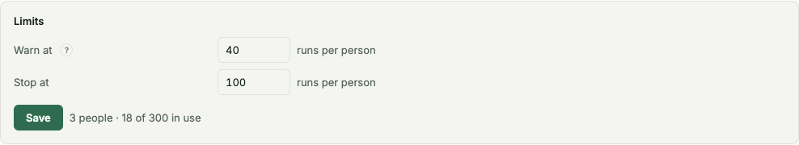

# Computers

A computer runs your bots. **Settings → Computers** lists every computer: its bots, which subscription Claude Code and
Codex use there, the other AI tools' logins, and what it is doing now. To add a computer, click **Add computer** or see
[Install](install.md#add-computers-to-run-your-bots).

**Settings → Models** holds the company's model settings:

- **Subscriptions**: the company's Claude and ChatGPT plans and API keys, each given to the computers that use it.
- **Tico Gateway**: one switch, **Use when a computer has no subscription, or a plan runs out**. The
  [Tico AI Gateway](ai-gateway.md) key, address and spend are under **Advanced**.
- **Defaults**: **Default model**, **Decisions**, **Meeting model**, **Fall back when a plan runs out** and **Check model**.
- **Limits**: the [company turn levels](#change-the-company-turn-levels).

Owners and admins change subscriptions and limits; the owner changes the Gateway and defaults; everyone else sees them.
Old links to AI providers, Subscriptions or the Models card on Computers open Models.

## Subscriptions

A subscription is a login or key the company saves once and gives to computers. A bot doesn't pick one: it runs on its
computer, and a run uses, in order, that computer's subscription for the run's AI tool, the login signed in on the
computer, then Tico Gateway when it is on. Otherwise the run waits.

1. Open **Settings → Models** and click **Add subscription**.
2. Pick the **Kind**: **Claude plan**, **ChatGPT plan**, or an Anthropic or OpenAI API key, and enter a **Name**, such as
   *Claude Max*.
3. For a plan, click **Connect**, open the link and sign in with the account that has the plan (paste back the code the
   page shows, or enter the code Tico shows). Tico saves the result. Or paste it and click **Save**: the token from
   `claude setup-token`, or Codex's `auth.json`. An API key is always pasted.
4. Open **Settings → Computers** and pick the subscription in the computer's **Claude Code** or **Codex** column.

Switching a computer's subscription stops that tool's running tasks on that computer and starts them again, and every
session of that tool there starts fresh. When tasks are running, Tico asks first and says how many. Removing a
subscription does the same on each computer that had it. A computer on an older Tico says **Needs update** instead of a
picker until it updates.

Each row shows how many computers use it and its usage: the share of the 5-hour or weekly window used, or an API key's
cost this month. **Reconnect** means the saved login stopped working; connect again or paste a new one from the row's menu. A new value
restarts the running tasks on each computer that has the subscription, as a switch does, so no run goes on with the
old one. The page asks first and says how many.

Tico model turns on the current Docker runner each use a separate temporary OS user. Other bots on the computer
cannot read the turn's live environment, open file descriptors or private temporary files, or use its Gateway
connection. Workspace files stay shared through the bot group. This does not separate subscription sign-ins or
turns on other providers. See [the Gateway boundary](ai-gateway.md#pick-a-tico-model-for-a-bot) and
[Docker runner setup](install.md#linux-or-cloud-server-docker).

## Turn counts

The computers list, each computer's pop-up and **Settings → Health** show four counts:

| Count | What it means |
|---|---|
| **Running** | The turn has started. |
| **Starting** | The computer has reserved a place and is preparing the turn. |
| **Waiting** | The turn needs a login, quota, a free lane or another pre-start requirement. Each reason shows its count and oldest wait. |
| **Queued** | The work is in line to be picked up. |

For example, **3 running · 2 starting · 7 waiting for quota (oldest 2 h) · 5 queued** separates work from its waits.
The counts describe the computer's total load, including work belonging to other people. Wait reasons never name
bots, tasks, people or accounts. The bot list still follows each viewer's access.

On an upgraded runner, only running and starting turns occupy a place. A login, quota or other pre-start wait holds
none, so unrelated work can start. Waiting for a lane or login releases the place; continuing requires a fresh atomic
reservation. Two turns cannot take the last place together. Codex's shared ChatGPT login does not normally queue
turns ([sharing a sign-in](#bots-sharing-one-chatgpt-sign-in-run-side-by-side)).

A starting turn reserves a place for up to **3 minutes (180 seconds)**, including active Git and runtime preparation.
Keeping that preparation active does not extend the deadline. If the turn has not started, its place is released and
its work returns to the queue without changing the task. After 10 missed starts for one job since the server last
started, Tico reports a pre-start failure instead of retrying forever. Check the computer named in the failure.

CPU or memory strictly above **90% for 5 minutes** holds new starts on that computer with **waiting: computer busy**.
This includes turns with a reservation that have not started yet. Running turns continue. New starts resume when
the sustained overload clears. A person's own message to a bot (a chat, a message in its task) still starts, ahead of
the waiting turns, when the computer has a free turn; Tico's notices and messages between bots wait. This brake does
not change your account, model or computer size.

During an update, server and runner negotiate the start rules through heartbeat and claim. Older runners retain
their existing delivery leases, including preparation already underway, until they update. Those starts have no new
three-minute deadline. Legacy waiting turns retain their place too, because those runners cannot obtain a fresh
reservation before starting. Update the runner to release those places safely and enable the new capacity rules
for its turns. Upgraded runners opt in after a successful heartbeat and keep the older rules against an older server.

### The turn fixer

A built-in system routine, **Turn fixer**, checks every computer every 10 seconds. It is plain code: no AI and no
cost. It frees only turns that are proven dead: a start a person stopped, or a turn whose lease is lost and whose
computer no longer runs its bot (the computer was removed, or its latest claim does not list the bot). A slow reply or
a healthy wait keeps its place. The task and its history stay, and the task gets a note: **Tico freed a dead start,
will retry.** A dead turn that may have pushed, sent or paid is not retried blindly: one that only read runs again,
and any other is held for BotOps with the tools it used.

When the company reaches its warning level, **Settings → Health** shows one **Company turns** finding for the
incident: the counts by wait reason, the oldest waits, the last progress of each running turn, each computer's CPU
and memory, and the likely bottleneck in one sentence. Later runs update the same finding, and when the count drops
below the warning level it says when the incident resolved. If the incident is still open after 5 minutes, BotOps
gets exactly one task with the finding (the Support bot where there is no BotOps). The owner gets one notice, only when
the incident is still open after an hour or its main wait needs a person: a login, quota or money.

## Company turn levels

Company turn levels apply across **all computers**, separately from each computer's capacity and CPU or memory brake.
The company count includes running and starting turns, plus waiting turns already admitted to run. It is not the sum of every displayed **Waiting** count.
Queued work blocked on quota, spending, computer readiness or a paused bot does not count. Neither does work held by the company stop itself.

Each level is multiplied by the number of people who can sign in to Tico, with a minimum of one person.
Guests, hidden or departed people, and people whose sign-in is disabled do not count.
This counts people with sign-in access, not the number currently online or the AI tools' logins.

| Level | Default per person | What happens at or above it |
|---|---|---|
| **Warning** | **40** | New turns can still start. **Settings → Health → Company turns** records the crossing as an incident. Tico sends no “no more slots” alert to a bot. |
| **Stop** | **100** | New turns wait with “Your company is at its limit; Tico is fixing what's stuck.” Running turns continue. |

For example, four people who can sign in, plus one guest, give a warning at **160** and a stop at **400**.
One person, or no people with sign-in access, gives **40** and **100**.

Just below the stop, while the count is still at or above the warning, work that waited through the stop keeps first claim on each freed place, in order across computers. Below the warning that list is cleared and each computer starts from its own queue again. Work still waiting for a login, quota or computer remains held for that reason.
Below the warning level, Health marks the incident resolved and records the time. Crossing the warning again opens a new incident.
The Health record works even when the optional [Health Monitor](health-monitor.md) is off.

These settings provide the warning record and start limit. See [The turn fixer](#the-turn-fixer) for automatic recovery.
The company-limit message does not confirm that an automatic repair has run.

### Change the company turn levels

You must be the owner or an admin. The server rejects changes from anyone else.

Example owner/admin view of **Settings → Models → Limits**, using synthetic data.

1. Open **Settings → Models**.
2. Find **Limits**.
3. Enter **Warn at** (runs per person).
4. Enter **Stop at** (runs per person).
5. Click **Save**.

Both values must be whole numbers from **1** to **10,000**, and warning must not exceed stop.
For example, enter **45** and **110** for four people. After saving, the card shows **Warn at 180 · stop at 440 company runs**.
Before a save, it shows the people count and runs in use against the company stop level.

Saved values apply to the current company count. Lowering stop to or below that count holds new turns; running turns continue.
Raising stop above the count lets eligible waiting work resume. Raising warning above the count resolves an active warning incident.
To restore the defaults, enter **40** and **100** and click **Save** again.

If saving fails, read the error beside the button and correct the values before trying again.
If the card is missing, ask an owner or admin to change the levels.
Check **Settings → Health** for the company count and **Settings → Computers** for individual wait reasons.
Changing the levels does not add computer capacity or clear a login, quota or overload wait.

## Connections

A **connection** is one login an AI tool on a computer runs on. It is one of:

- **The computer's login**: the tool's own sign-in on that computer, a plan login (a ChatGPT or Claude plan) or an
  API key. A computer has exactly one login per AI tool, and every bot on it that runs that tool uses it: a bot has no
  sign-in of its own. Claude Code, Codex and Cursor can each be signed in on one computer; use **Switch account** on a
  line to change its account. To run bots on a different account for the same tool, add another computer (another
  runner, which can be on the same machine; see [Install](install.md#add-computers-to-run-your-bots)).
- **An API key**: the computer's login can run on a model API key instead of a plan (Codex, Claude Code, Cursor Agent
  and Muse Code take one). The key is the computer's own (added from Tico), a shared key, or a key set on
  the computer itself. See [API keys on a Computer](#api-keys-on-a-computer).

Plan logins stay on the computer that holds them. Tico stores each connection's name, sign-in state, the account it
reports and its usage readings, never the login itself. A key added from Tico is kept sealed in Tico's credential vault
for that computer alone.

Named subscriptions that an earlier release signed in on a computer are no longer used or shown. Bots that ran on one
now run on the computer's login for that tool, which must be signed in for them to run
([Subscriptions from earlier releases](#subscriptions-from-earlier-releases)).

Before upgrading from separate bot subscriptions, check the computer's login for every tool its bots use.
When the runner identifies a primary connection's login as an API key, its connection shows a warning: API billing is separate from a subscription's
allowance, and Tico does not check the API credit balance. Paid API use remains available. If you intend to use
a subscription, choose **Switch to subscription** and sign in to that plan on the computer. **Health** also warns about
API-key computer logins used by bots, and flags a missing, failed or rejected login used by an active bot's
primary or fallback model, even before it has queued work. Computers that are offline keep their last report;
the login check resumes when they report again.
An unknown account type gives no API-key warning; a retained named login may need its next account report first.
When a tool cannot write its data folder, Health names the reported folder problem for the computer operator.

**Shared connections.** A model key stored under Credentials can be shared with **Every computer** or with computers
by name. It signs in each computer that has no login of its own for that tool ([Install](install.md#add-computers-to-run-your-bots)).
Each computer it serves shows it as a chip, its pop-up line marked **Shared** and listing those computers, even before
the computer has used it. Only credential administrators see the key's name and preview; an operator sees which
computers it serves. Replacing or clearing it from one computer asks whether to change **This computer only** or **All
listed computers** ([Shared keys](#api-keys-on-a-computer)).

### Which connection a bot runs on

A bot runs its tool with its computer's subscription for that tool, if the computer was given one
([Company subscriptions](#company-subscriptions)), else the computer's own login for that tool (a key it is given counts
as that login), else the Tico AI Gateway when the company's models choice allows it; with none, the turn waits. To put
a bot on a different account, give its computer another subscription or move the bot to another computer. When a plan
runs out, a bot can move to its fallback model; that is set in Models and per bot ([How it works](how-it-works.md)),
not here.

### Company subscriptions

A **subscription** is one of the company's model logins or keys, saved once in Tico rather than on a computer: a
Claude setup-token (from `claude setup-token`), a ChatGPT login (the `auth.json` from a computer where `codex login` is
signed in, usually `~/.codex/auth.json`), or an Anthropic or OpenAI API key.

**Connect** signs a plan in without pasting. Tico picks an online computer on the latest release with that tool
installed, the person's own first, and runs the sign-in there: `claude setup-token`, or `codex login` in a folder of its
own. That computer's own login stays as it was. The page shows the link and any code, never the result, which the
computer sends straight to Tico and keeps no copy of. With no such computer, **Connect** is off and pasting still works.
Connecting a saved subscription is **Reconnect**, and asks first as a pasted value does. It belongs to the company; the list says
who added it. Owners and admins add, rename, reconnect and remove them in **Settings > Models**; anyone who sees that
page sees the list (name, kind, status, computers, usage), never a value.

Give a computer at most one subscription per tool (Claude Code, Codex). One subscription can be given to many
computers. Every bot on that computer then runs that tool on it.

- Giving, switching or taking off a computer's subscription, reconnecting it, or removing one in use, restarts that tool there: its
  running turns stop and go back in the queue (a turn that may already have acted outside Tico is held for review
  instead), and every session of that tool on that computer starts fresh. The page asks first and says how many.
- It works on any computer it is given to, a new cloud machine included: nobody signs in there. The turn reads it from
  Tico with its own run token, next to its credentials; it is never written into the bot's repository. A Claude token
  or Anthropic key is set in that turn's environment. A ChatGPT login or OpenAI key gets a Codex home of its own on
  that computer; its `auth.json` is there only while a turn on it runs, and when Codex refreshes the login there, the
  refreshed login is sent back to Tico. Each token in it is masked in what the turn leaves.
- A usage limit met on a subscription holds it on every computer it is given to until the reset. Meanwhile it is
  passed over: turns there run on the computer's own login, else the Gateway under the company's models choice,
  else wait.
- If the provider refuses it, it shows **Needs reconnect** and is passed over (the computer's own login, then the
  Gateway) until someone saves a new value with **Reconnect**. The computer's own login is left alone.
- A computer on an older runner does not take subscriptions; its bots run as before until it updates.

One computer is one trust group ([SECURITY.md](../SECURITY.md#bots-on-one-computer-share-a-trust-boundary-on-purpose)):
while a turn runs on a subscription, another bot's turn on the same computer could read it.

### Bots sharing one ChatGPT sign-in run side by side

Codex bots on one Computer using the same ChatGPT sign-in run turns at the same time, just as Claude bots do. This applies to every bot on the Computer's login and to separate tasks of the same bot. They share the plan's usage allowance; that allowance is the limit, and a busy login does not make another turn wait. When the allowance runs out, the usual usage-limit and fallback rules apply ([how it works](how-it-works.md#one-turn-per-chatgpt-login)). Bots on an OpenAI API key also run side by side. Tico uses the original login in its own home and never copies a login file into another bot's home: copies can rotate apart during token refresh.

### What "% left" means

Usage always reads as the share of the plan's weekly allowance that is **left**, never used. It is the provider's own
reading for that account, so **use outside Tico counts too**: someone chatting in ChatGPT or Claude on the same account
lowers it. Tico never estimates it from its own token counts. A reading has a reset time and an age ("as of 2 min ago");
one older than a day is marked as possibly out of date, and after its reset it reads as the previous week, never as a
fresh 100%. An API key has no plan, so it shows "No plan usage (API key)". Details are in
[Signed-in account and usage windows](#signed-in-account-and-usage-windows).

## The computers list

One row per computer. On a phone the table scrolls sideways inside its card.

| Column | What it shows |
|---|---|
| **Computer** | A status dot (hover for online, or offline · last seen *when*) and its name, with **Update** when an update is waiting and **Waiting** while a connection it was given is not reported yet. |
| **Bots** | How many bots run on it. |
| **Claude Code**, **Codex** | A picker: the company's subscriptions for that tool, then **Signed in here** when the computer has its own login, else **Gateway** (or **None** with the Gateway off). Owners and admins change it. |
| Other AI tools | One chip per connection the computer reports, under that tool's column: its state (**Signed in**, **Sign in**, **Signed out**, or a problem such as **Expired**), then a thin bar and "N%" left when there is a reading. A small **red dot** means bots depend on it and it needs attention. A click opens the computer's pop-up. |
| **Now** | What it is doing: for example **1 running · 55 queued**, **idle**, **asleep** (a cloud computer stopped to save) or **offline**. The full queue line, with wait reasons, is in its pop-up. |

**Show revoked (N)** under the list shows computers that were revoked. **No computers yet** means none is
registered: choose **Add computer**.

## A computer's pop-up

Click a row to open its pop-up. Its sections, top to bottom:

1. **Connections**: one line per AI tool, the computer's login for it: the tool, "Computer's login" (or "Shared key"),
   the signed-in account and plan, sign-in state, usage (weekly and, where the tool reports one, the 5-hour window) and
   the bots using it. Each line has its actions: **Sign in**, **Switch account** and **Sign out** for a plan login;
   **Add key**, **Replace key** and **Clear key** for a key. **Add connection** at the end opens its own pop-up to sign
   in an installed tool or add a key.
2. **Screen**: an on/off switch, then **View** or **Control** when enabled (Beta). Enabling a screen that needs setup reveals the runner command, as described in [Install](install.md#screen).
3. **Internet**: **Share internet with bots**, then the bots that may use it and the **Daily cap (GB)**, and today's
   total, which opens to the sites that went through. Only on your own computer; an admin sees only the switch, to turn
   it off. See [Share internet with bots](#share-internet-with-bots).
4. **Bots on this computer**: each bot, read-only, with a red pill when its connection has a problem. **Assign on the
   Bots page** opens Settings → Bots, where a bot's computer is chosen.
5. **Versions and updates**: Tico, the OS and runner, each AI tool's version with **Installed** and **Enabled**, and
   **Installation and updates**.
6. **Settings**: **Keep for inbox bots only**, **Accepts members' bots** (admins), **Turns at once** (owners and admins:
   empty is the computer's own capacity, 1 to 256 otherwise), **Performance diagnostics** and
   **Performance**, and **Revoke computer** at the bottom.

When the computer is offline, the pop-up says "Computer is offline" and its sign-in, usage refresh, screen and update
actions are disabled until it is back. So are a connection's **Sign out**, **Switch account**, **Replace key**,
**Clear key** and the switches between a subscription and an API key: they stay on the line, greyed, and say "Computer
is offline" on hover; nothing is queued for later.

### Who sees and changes what

Every member sees every working computer, its connections, their sign-in state, and the bots on it they may see. Only an admin or the computer's operator also sees the signed-in accounts, the usage of the
computer's own login and key previews (others see which kind of key it is, not the preview), sees revoked computers, and
gets the change controls: sign in and out, Add connection, screen, tools, performance,
inbox-only and Revoke computer. The API refuses anyone else ([Permissions](permissions.md)). BotOps cannot sign a login
out, because that stops bots.

## Share internet with bots

A bot's browser can reach the web from another computer's internet connection: your laptop's home IP instead of a
cloud machine's. Sites that block data-center addresses then see an ordinary home connection. No proxy service is
involved.

1. On your own computer's pop-up, turn on **Share internet with bots**, tick the bots that may use it, and set the
   **Daily cap (GB)** (5 GB by default). Only the computer's operator can turn it on or pick bots; it is off until they
   do.
2. In the bot's settings, set **Browse through** to that computer (owners, admins and the bot's managers). Only
   computers that share with that bot are offered.

The bot's browser then goes out through that computer for every site. Both runners connect out to Tico's relay, as for
the computer screen; neither needs an open port. The browser's encrypted traffic passes through unread: Tico sees the
site name and how many bytes, never the pages.

What each side guards against: the sharing computer protects its owner from any bot, so its rules below (home
network, router, its own addresses, ports, the cap, the owner's choice of bots) hold whatever the bot does. The bot's
side (its proxy, the browser wrapper, failing closed) keeps a bot from browsing directly by accident. It is no wall
against a bot set on going around it, which could only reach the web from its own computer's address anyway.

What the sharing computer allows:

- Ports 80 and 443 only.
- Public internet addresses only. The sharing computer looks the name up itself and refuses its own addresses
  (including its home's public address, as Tico's relay sees it), its home network (`10.*`, `172.16-31.*`,
  `192.168.*`), loopback, link-local, `100.64.0.0/10`, multicast, private IPv6 and the other special-purpose ranges
  IANA lists, and checks the address it actually connects to. It also refuses every device on the networks its
  interfaces are on (on IPv4 a `/16` or narrower; on IPv6 the `/64` of each of its addresses, where home devices
  have public addresses), the far end of a point-to-point link, and its router.
  It asks the relay for its public address over IPv4 and over IPv6 when it connects and every 5 minutes; while the
  IPv4 answer is missing, it refuses IPv4 sites, so an IPv6-only computer reaches no IPv4 site, NAT64 included.
- Up to the daily cap. Crossing it closes that day's connections through it until midnight UTC. Bytes count on the UTC
  day they pass, so a connection open across midnight counts on both days.

When the computer is offline, stops sharing with the bot, was removed or reached its cap, the bot's browser connection
fails, and the proxy's answer says why ("Ana's MacBook is offline"; also at the `TICO_BROWSER_PROXY` address in a
browser). It never falls back to going out directly. On a computer whose runner is too old for this, the bot's work waits
("Update Office server to use Browse through"). Changing a bot's
**Browse through**, or turning sharing off, closes the connections already open.

The day's total on the pop-up opens to a table of what went through: day, bot, site and bytes, kept 30 days. The
computer's operator and admins see it.

In turns of a bot with **Browse through** set, the runner sets `TICO_BROWSER_PROXY` (a proxy on `127.0.0.1` for that
bot), adds `--proxy-server` to `CHROMIUM_FLAGS`, and puts `google-chrome`, `chromium` and their usual names first on
`PATH` so a browser started by name goes through it. A browser started another way takes the proxy itself, for example
Playwright's `chromium.launch({proxy: {server: process.env.TICO_BROWSER_PROXY}})`. A browser started by name gets
the bot's own profile (`~/.tico/browser-exit/<bot>`; any other `--user-data-dir` is refused), and refuses to start
when a browser it didn't start through the proxy is open on that profile, or when a flag would skip the proxy (with
one dash or two, spaces around it, or a bare `--`). `localhost` stays local: the browser reaches the bot's own computer directly, never
through the exit.

The proxy asks for no password, because a browser can't send one for every connection. Under turn isolation (Linux
runners with `TICO_RUNNER_BOT_UID`), it takes connections only from the OS users that bot's turns run as. Without
isolation, as on a Mac or a cloud machine, bots on one computer share one OS user and are one trust group: any of them
can use another's proxy.

API: `GET/POST /api/v2/computers/{id}/browser-exit`, `GET /api/v2/computers/{id}/browser-exit/usage`,
`GET/POST /api/v2/bots/{bot}/browser-exit` ([OpenAPI](openapi/v2.json)). Hub: `hub computer browser-exit` and
`hub bot browser-exit`.

## Add a connection

### Subscription or API key?

Choose **Subscription** when you pay for a plan, such as ChatGPT or Claude:

- You sign in with the plan's account in the browser. There is no key to copy.
- The plan pays for the runs. The chip shows how much of the week's allowance is left ("N% left"), and use of the same
  account outside Tico lowers it too ([What "% left" means](#what--left-means)).
- When the plan runs out, bots move to a fallback model until it resets, or stop if none is ready
  ([How it works](how-it-works.md)).
- It is the computer's login for that tool, one per computer, used by every bot there on that tool. A team that
  needs a second account for the same tool adds another computer for it.

Choose **API key** when you pay the provider for each use:

- There is no weekly allowance to run out. The chip shows only its state, with no "% left"; its line in the
  pop-up reads "No plan usage (API key)". The provider bills each run.
- Use it for a tool that has no subscription sign-in here (**Subscription** is greyed out), or when a plan's weekly
  limit is too small for your bots.
- Bots on one OpenAI API key run side by side, as do bots on one ChatGPT sign-in
  ([sharing a sign-in](#bots-sharing-one-chatgpt-sign-in-run-side-by-side)).
- Where the key goes:
  - **Add key** gives this computer a key of its own, for Codex, Claude Code, Cursor Agent and Muse Code. Only this
    computer uses it.
  - **Credentials** holds a key that several computers share (the company's key given to **Every computer**), and the
    key of a tool whose key belongs to each bot, such as the Gemini CLI. **Add connection** offers **Open Credentials**
    for those.

### Add one

In a computer's pop-up, **Add connection** (at the end of Connections) opens its own pop-up:

1. **Which AI tool?** The tools installed on that computer. **Install another tool** goes to **Versions and updates**,
   where the owner installs one.
2. **Subscription** or **API key** ([which to choose](#subscription-or-api-key)). A tool with no subscription sign-in from the browser has Subscription greyed out.
   A tool that signs in only from a terminal shows the command to run on the
   computer here, with **Copy**.
3. - **Subscription**: signs in the computer's login for that tool. The provider's sign-in follows in the same pop-up:
     the browser relays the provider's link and code, and the provider writes the login on the computer. A tool
     already signed in here has **Subscription** greyed out: change its account with **Switch account** on its line,
     or add another computer for a second account.
   - **API key**: for a tool that takes a key of the computer's own, **Add key** opens the key pop-up (see
     [API keys on a Computer](#api-keys-on-a-computer)). A credential administrator can set **Shared with:** to other
     computers, or pick a key that is already shared instead of pasting one. An operator adds a key for this computer
     only. If a key already signs the tool in here, **Replace key** is on
     its line instead. For any other tool, **Open Credentials**, where model keys are added and shared with computers.
4. The new connection's chip appears on the computer's row once the computer reports it; the computer does not need a
   restart.

The computer must be online ("Computer is offline" otherwise). Every bot on the computer that runs that tool uses the
new login from its next turn.

| Tool | Sign in from Tico | Sign-in state |
|---|---|---|
| Grok Build | Open the link and enter the device code shown in the pop-up | The computer checks Grok's local login store |
| Cursor Agent | Open the browser link shown in the pop-up and finish signing in | The computer runs Cursor's status command |

Both tools support **Sign out** and **Switch account**, keeping the old login until a new account is confirmed.
Cursor uses a file login so the computer's default login home stays separate on macOS as well as Linux. If Cursor
was signed in through the macOS Keychain, sign in once from Tico to create this login; the Keychain entry stays untouched.
A computer login with a custom auth-folder override must sign out and sign in to change accounts; **Switch account**
refuses before it starts. See [harness sign-in details](harnesses.md#supported-harnesses).

On an isolated Docker Computer, Grok's default `~/.grok` folder belongs to the bot user so sign-in,
token refresh and session saves work. This includes its credentials, `config.toml` and session history:
bots using the computer login share that whole folder, including an existing personal Grok login there.
Use a dedicated team login on that Computer. The runner repairs ownership in place at startup, sign-in,
and before starting or resuming a Grok thread; it does not copy login files between bot homes or change
file modes. A very large CLI folder is handed over shallowest first: if one pass (20,000 entries or 2 seconds)
cannot finish it, the runner log says so and the rest continues in the background; if that still cannot finish,
the next handover of the folder retries it. The same applies to the other harness login folders, Muse Code and
Gemini homes, and subscription profile homes. Grok's sign-in status check follows no link a bot could have made
anywhere in the auth file's path. A named profile uses its own runtime home; a shared-operator profile uses the
computer home.
Custom auth-folder overrides never select a folder for this ownership repair.

A new computer whose team signs in with a plan needs its own sign-in: a plan login cannot be copied between computers.
Settings > Health shows "*computer name*: sign in to Codex" (or Claude Code) until it is done.

## Change or clear a login

These are on each connection's line in a computer's pop-up, for the computer's operator and admins.

### Signing out and switching accounts

In a computer's pop-up each signed-in Codex, Claude Code, Grok Build or Cursor Agent login has **Switch account** and **Sign out** on its line.
The same people who may sign a login in see them: the Computer's operator, owners and admins. The Computer must be online
and on a current runner; an older one answers `Update <computer> to sign out from here` and is never asked.

- **Sign out** first names the bots that stop: the active bots assigned to that Computer whose runtime is that login. The button stays off until they are named; if they can't be looked up, the dialog says so and offers
  **Try again**. The Computer then runs the CLI's own logout (`codex logout`, `claude auth logout`, `grok logout`, `cursor-agent logout`) as the user that
  signs in, and checks the login again. If it is still signed in, the sign-out fails and the login is as it was. A
  shared-key sign-in already running there is waited for (up to 40 seconds) so it cannot sign the login back in; if it
  is still running, the sign-out fails with "try again in a minute". Bots and assignments stay: those bots wait, as for
  any signed-out login, until someone signs in again.
- **Switch account** is a sign-in on the side. The Computer signs the new account in to a private folder inside the
  login's home (`.tico-switch-<id>`, 0700, with copies of the files the CLI keeps beside the login). Once the new
  account is signed in there, the dialog reads **Putting the new account in place**: the Computer asks Tico to go
  ahead, and from Tico's yes the switch can no longer be cancelled (it gets two more minutes of its own to finish).
  Only then does it move the new login files in, keeping the old ones until it has checked the login again; if moving
  a file or that check fails, the old files go back. Cancelling before that point, failing or running out of time leaves
  the old account working, and the side folder is removed (kept, and named in the message, only if the old files could
  not be put back). Runs that start afterwards use the new account. The account and usage readings of the old account
  are cleared.
- A **Computer's own login that someone signed out stays signed out**. The company's model key given to **Every
  computer** does not sign it back in: the server does not hand it out for that runtime, the runner neither applies it
  again (its ten-minute retry included) nor puts it in turns, and Claude Code no longer reads "ready" because of it.
  Signing in again, or **Use the shared key** next to it, ends that.
  A signed-out login reads **Signed out · Sign in** and its chip has a red dot, with or without bots on it. The
  confirmation names the bots in a line: "Reviewer 1, QA and 2 more will stop running until this is signed in again"
  (every name on hover).
- **Switch to subscription** sits on a Computer's own login that runs on an API key (the shared key, the Computer's
  own key or one set in its terminal): in place of **Switch account**, or next to **Replace key** and **Clear key**. It
  is the same sign-in on the side: until the subscription is signed in and in place the key stays in use, and
  cancelling, failing or running out of time leaves it so. Once the subscription is in place the key is removed as
  **Clear key** removes it (the Computer's copies, and its own key in the vault), and no key reaches that login again:
  not readiness, not the ten-minute key login and not a turn's environment, so the next turn runs on the subscription.
  The server stops handing it the **Every computer** key too. Unlike a sign-out, a later sign-in or Switch account does
  not bring a key back; **Add key** or **Use the shared key** does. Bots keep the connection. After **Clear key** or
  **Sign out** there is no key to keep, so a switch started from a page drawn before it is refused ("has no API key
  to switch from … Sign in instead") rather than run as a plain sign-in whose cancel would leave no login. Not offered for Claude
  Code on a Mac (Keychain), and it needs a runner that knows it (`Update <computer> to switch to a subscription from
  here` otherwise).
- **Switch to API key** is the way back: it sits on a Computer's own login on a subscription, next to **Switch
  account** and **Sign out**, for Codex and Claude Code. The key is pasted once and kept in the vault as the Computer's
  own key (like **Add key**). The subscription stays signed in and in use while the Computer checks the key with the
  provider, in a home of its own with no login so the subscription cannot answer for it (Codex signs in with the key;
  Claude Code asks Anthropic for one short reply). **Cancel switch**, closing the dialog, a key that doesn't work or
  running out of time deletes the key and leaves the subscription as it was. Once the key works there it is put in place, the marks **Switch to subscription** and **Clear
  key** left are lifted so the next turn runs on the key, and then the subscription is signed out. Codex keeps both
  logins in one file, so its key login has already replaced the subscription's and nothing more is signed out; Claude
  Code keeps them apart, so its login files are kept aside, its subscription is logged out and the key stays. If any
  step after the check fails, or the sign-in check gives no answer, the Computer puts back everything it changed and
  the subscription stays in use; when it cannot put something back, the dialog says what and where, not that the
  subscription is in use. Bots keep the connection. Not offered for Claude Code on a Mac, where the subscription is in
  the Keychain and a logout could not be undone (sign out, then **Add key**). It needs a runner that knows it
  (`Update <computer> to switch to an API key from here` otherwise).

None of this restarts the runner. `POST /api/v2/runners/{runner_id}/logouts` with `{"runtime":"codex"}` (and
`"profile"` for a named subscription left from an earlier release) signs out; `GET /api/v2/runners/{runner_id}/logouts/bots?runtime=codex` lists the
bots it stops; `POST /api/v2/runners/{runner_id}/logins` with `"switch": true` switches (with `"to": "subscription"`,
switches the Computer's own login off its API key); `POST /api/v2/runners/{runner_id}/keys` with `"switch": true`
switches it from its subscription to the key in `secret`; `POST
/api/v2/runners/{runner_id}/shared-key` with `{"runtime":"codex"}` lets the shared key back. Each is followed like a
sign-in, with `GET /api/v2/runners/{runner_id}/logins/{id}` (`kind` says which; a sign-out ends `signed_out`). BotOps
cannot sign a login out, because it stops bots. A turn already running when the account changes is not stopped and
may finish on the old account. On a Mac, Claude Code keeps its login in the Keychain rather than in files, so there is
no side to sign in on: Switch account isn't offered for it there (the server and the runner refuse it too); sign out,
then sign in. Codex switches on a Mac as anywhere.

After a sign-in, switch, sign-out or **Use the shared key**, the page looks again until the Computer has reported since
the change finished (its heartbeat; `readiness_at` on the computer in `GET /api/v2/operations`) and that report shows
the change, redrawing **Settings → Computers**, for about a minute.

### API keys on a Computer

A Computer's own login can run on a model API key instead of a subscription (Codex, Claude Code, Cursor Agent and
Muse Code take one). Its line in the computer's pop-up says whose key it is, by its preview only (`sk-…xyz`): **this
computer's key** (added from Tico), **a shared key** (a credential shared with this computer by name or with **Every computer**), or **a
key set on the computer** (its environment or `secrets/_shared.env`). The same people who may sign it in (the Computer's
operator, owners and admins) see **Replace key** and **Clear key** in place of **Sign out**, and **Add key** next to a
login with none. The Computer must be online and on a current runner; an older one answers `Update <computer> to …`.

- **Add key** and **Replace key** take the key in a password field. It goes once to Tico's credential vault, sealed
  like any other credential, for that Computer alone, and is never shown again in full. The Computer fetches it over its
  own connection (the sign-in queue never carries a key) and checks it (Codex signs in with it; the others read it on
  each turn). Until the check passes and Tico agrees the key goes in, the old key stays in use for runs and in the
  Computer's key files, and the Computer's regular key fetch leaves them alone. From Tico's yes the change can no longer
  be cancelled: the key it replaces is deleted from the vault, and a key set on the computer is taken out of
  `secrets/_shared.env`. A key that does not work, a cancel, or a check that runs out of time deletes the new key and
  leaves the old one in use (for Codex, signed in again with it). Runs that start afterwards use the new key; for Claude
  Code, a key added here is used even when the computer also has a browser login.
- **Clear key** first names the bots that stop, like **Sign out**. The Computer then deletes the key from its key files
  (and, for Codex, logs out a login the key made; a browser or subscription login is not the key's and stays), and
  Tico deletes this computer's key from the vault. Bots and assignments stay. Afterwards the line reads **No key ·
  Add key**, with **Sign in** and **Use the shared key** beside it, and its chip has a red dot: like a sign-out, a shared key does not sign it back in (the server does not hand it
  out, and the runner's ten-minute re-apply skips it) until someone adds a key, signs in or chooses **Use the shared
  key**.

**Shared keys.** A key in **Credentials** can be shared with **Every computer** or with computers by name; only a
credential administrator can do either, in Credentials or from **Add connection**. Several rules decide which key a
computer uses:

- A key shared by name comes before the **Every computer** key.
- Picking or sharing a key for a tool on a computer replaces the key shared with it before.
- A computer that was cleared, or switched to a subscription, from here takes the shared key again when it is given one.
  That is refused, naming the computer, while it is offline.

Replacing or clearing a shared key from one Computer first asks **This computer only** or **All listed computers**,
naming every Computer it signs in and which of them are offline. The second choice warns that it changes every one.

- *This computer only*: Replace gives this Computer a key of its own, which signs it in before the shared one; Clear
  stops this Computer using the shared key. The others keep it.
- *All listed computers*, Replace: the shared credential's value is replaced, in **Credentials** too. Only someone who may manage
  credentials can do this. Online Computers fetch it at once; an offline one gets it when it is next online. Claude
  Code takes an OAuth token or an API key, each its own credential: the **Kind** chosen is the one replaced (by default
  the one this Computer runs on), and a kind that is not shared is refused rather than written into the other.
- *All listed computers*, Clear: offered only to someone who may change every Computer listed (otherwise Tico names the ones they
  may not). Each online Computer clears its copy as above. **An offline Computer keeps its copy only until it is next
  online**: Tico marks it cleared at once, so its first key fetch when it comes back (at start-up, then every ten
  minutes) tells it to clear the key, and it does, with no one needing to act. That needs a current runner: while any
  Computer listed, online or offline, runs one too old to clear its key, **All listed computers** is not offered and Tico answers
  `Update <computer> to clear its key from here, or delete the shared key in Credentials`. A computer that
  joins later still gets the shared key, which stays in **Credentials**.

A Computer's own key is also a credential in **Credentials**. Deleting it there: the Computer falls back to the shared
key at its next key fetch (Codex signs in again with it). With no shared key, the deletion is **Clear key** on that
Computer: its next key fetch deletes its copies and logs out the login the key made, and the line reads **No key ·
Add key**. A key a Computer is still checking cannot be deleted there; cancel **Replace key** or let the check
end first.

`GET /api/v2/runners/{runner_id}/keys?runtime=codex` says which key signs it in (`source`, `preview`) and, for the
shared key, the Computers it serves. `POST /api/v2/runners/{runner_id}/keys` with `{"runtime":"codex","secret":"…",
"scope":"this"}` adds or replaces a key and returns a `use_key` row to follow with `GET …/logins/{id}` (it ends `done`
or `failed`); `"scope":"all"` replaces the shared key. `POST /api/v2/runners/{runner_id}/keys/clear` with
`{"runtime":"codex","scope":"this"}` (or `"all"`) clears it and returns each Computer's `clear_key` row, or `waiting`
for one that is offline.

## Subscriptions from earlier releases

Earlier releases let a computer sign in named subscriptions besides its own login, and let a bot choose one. Each
computer now has one login per AI tool for all its bots. Upgrading deletes the bots' choices (the bot then runs on its
computer's login), and nothing signs a named subscription in or runs on one. A computer that still has some keeps
reporting them, unread and unshown, for one release; their folders stay on the computer. The computer's operator or an
admin can take one off with `POST /api/v2/runners/{runner_id}/removals` (`{"runtime":"codex","profile":"team-chatgpt"}`,
online computers on a runner that knows it, `model_remove_v1`) or sign it out with `POST
/api/v2/runners/{runner_id}/logouts` (`{"runtime":"codex","profile":"team-chatgpt"}`).

The server and runner negotiate this change with `computer_logins_v1` in config, assignments and attempts, and an
acknowledgement in the runner's capabilities and readiness. An updated runner keeps an older server's
existing account selections until that server supports the change; it also keeps the login home pinned across a
turn's primary and fallback work. On an updated server, an older runner reporting a bot on a named login waits with
an **Update** explanation, and changes to that tool's computer login wait too. Older runners with only unnamed
computer logins keep working. Update the named-login runner to resume on its configured `default_profile` (or the
operator's login without one); no credential files or model and harness choices are changed. The acknowledged
readiness report names that physical home as `computer_profile`, so its existing usage holds and readings still
belong to the same login, including after a runner restart.

## Usage readings

### Stale and missing readings

Sign-in status, weekly allowance and refresh status are separate. Failed or unsupported
reads keep the last successful reading, with its original timestamp. An elapsed reset
never means a fresh allowance or a repaired sign-in. Claude and other runtimes without
a supported standalone weekly read use observations from normal runs or a manual
provider reading. Missing percentages remain unknown, not zero.

Starting a new sign-in, a switch or a sign-out through Tico invalidates earlier readings and in-flight refresh
results for that profile/runtime. Replacing credentials outside Tico under the same
local profile cannot currently be detected: refresh and confirm the provider reading
after such a change. Usage reported by a turn that was already running during sign-in
can also refer to its earlier account; avoid replacing an active profile while turns
are running. This is approximate monitoring, not a spending limit.

## Reference

The rest of this page is for administrators and integrators: where readings come from, the API, and how a computer keeps its logins.

### Signed-in account and usage windows

Weekly reports are scoped to a Computer, profile and runtime. Codex reports its seven-day window when its running host emits one. Claude Code may report the seven-day reset and limit state without a percentage; that percentage stays unknown. No API calls or token-to-percentage estimates are used to invent a provider balance. Usage elsewhere on the same provider account counts toward that allowance.

The last provider report includes its observation time and reset. Reports older than a day are labelled as possibly out of date. After reset they stay labelled as the previous week and never read as a fresh allowance. Reports survive a runner restart on the server. An updated computer can refresh Codex weekly usage directly; other providers need a supported subscription-backed run or a manual reading. An unnamed computer-default login has no named subscription snapshot; it remains unknown rather than being assigned to another profile. When that default login keeps stopping on a usage limit, **Settings → Health** says it is out of quota ([Health Monitor](health-monitor.md), `default_login_limited`).

Computers report the account each login is signed in to: email, plan and organization from `claude auth status --json`, and email and plan from Codex app-server's `account/read`, always requested with `refreshToken: false`. A Codex turn's or refresh's `planType` keeps the plan current. This deliberately reverses the earlier rule that Tico kept no account records: it is the first stored account identity, so the page can show which account each Computer and profile uses (`signed in as <email> · <plan>`). Credential files and `codex login status` output are never read for it, only allow-listed fields are kept, and a value that looks like a key or token is dropped on the computer and refused by the server, without affecting the sign-in state. The account is read alongside the existing one-minute sign-in probe; Codex's app-server read runs in the background at most every ten minutes. A signed-out login shows no account. An account stays one login's report: two profiles that show the same email are not merged.

Only owners and admins and the Computer's operator see accounts in `GET /api/v2/operations`, `GET /api/v2/computers` and `GET /api/v2/subscriptions`; other members see sign-in state only, and bots never see accounts. No new grants or permissions are added. A current server tells the runner it takes accounts in the heartbeat reply (`subscription_accounts`); until then, and against an older server, the runner leaves them out so the Computer reads as before.

Next to the weekly window, a profile reports Codex's 5-hour window (`five_hour`, from the same rate-limit events) with its own reset and observation time. A 5-hour reading whose reset is more than 5 hours 10 minutes after it was taken (10 minutes for clock skew) is unknown; the weekly window keeps its 8-day limit. The computer's pop-up shows both windows on each connection line as "% left" bars with the reading's age; each tool's installed version and Enabled switch are under **Versions and updates**. Tools without an account or usage source (Gemini CLI, Cursor Agent, pi, Grok) read "unavailable", never empty or full.

The Computer's own login (the one its bots use when no profile is assigned) reports the same two windows on its runtime row in readiness (`weekly`, `five_hour`), checked against the same limits and shown to the same people as its account. Claude reads them from each turn's `rate_limit_event`: Claude Code 2.1.30x sends both windows in `unifiedWindows` with a 0–1 `utilization`, which becomes the percentage used (the page shows what is left). That field is undocumented, so a missing or out-of-range value reads "percentage unavailable", never 0% or 100%, and an older CLI reports only the reset as before. Until a Claude turn runs on that login, the line says "Weekly usage unavailable · reported after a Claude Code turn on this computer": Tico never starts a turn just to read usage. Codex's windows come from the same background app-server session that reads its account (at most every ten minutes, `account/rateLimits/read`, no turn and no paid request), for the own login and each named profile; an API-key login has no plan usage and is not asked. A server from before this change refuses the two runtime fields; the runner then leaves them out for ten minutes and sends the rest.

### A bot's connection in the API

A bot runs on its computer's login ([Which connection a bot runs on](#which-connection-a-bot-runs-on)); there is no
assignment to make. `PUT /api/v2/subscriptions` is gone (405), the upgrade deletes the per-bot choices an earlier
release saved, and a runner ignores a `bot_profiles` entry in its runner.json. `GET /api/v2/subscriptions` returns
`profiles_by_computer`: the named subscriptions computers still report from earlier releases. `GET
/api/v2/bots/{bot}/subscription` returns the login a bot runs on (`source` is `"computer"`), its Computer and sign-in
state. Unknown sign-in state is `null`.

### Sign-in and profiles on the computer

The Computer operator can manage sign-in on their own Computer; owners and admins can manage it on any Computer. A
sign-in, switch or switch to a subscription is for the Computer's login: `POST /api/v2/runners/{runner_id}/logins`
with `{"runtime":"codex"}` (or `claude`). One with a named `"profile"` is refused (422 `one_login`), and so is
`tico-runner profile login <name>` for any profile but the computer's own. The browser relays the provider's link and
code; the provider writes its credentials locally. A Computer's login can itself be a profile folder: the one named
`default_profile` in its runner.json (`profiles/<name>`), whose HOME (Claude Code) or CODEX_HOME (Codex) every bot's turn
uses. On an isolated Docker Computer the sign-in and turns run as the bot user, so each runtime's home in that profile
belongs to the bot user, while the profile folder and `profile.json` stay the supervisor's (the folder is traversable
only).

A current runner retries a rejected heartbeat without only the unsupported report: subscriptions, worktrees or repository clones. Other reports stay intact, and unrelated errors retain their original message. Invalid local profile names are omitted from reports. Provider sign-in probes are cached for one minute and refreshed after sign-in or a rejection. Turns and watcher
scripts use the cached sign-in state without probing at every start. A probe timeout leaves sign-in unknown and allows a
turn to try. A rejection affects only that runtime on that Computer; on a runtime that signs each bot in with its own key (pi, the Gemini CLI), only the bot whose key was refused stops until its key or grants change or the recheck passes. Completion and usage records include the profile
a turn ran in when it is a named one; empty profile fields are omitted.

Each run pins its selected local profile directory before preparing the provider environment. Changes to the local default or a profile directory affect later runs, not an in-progress primary or fallback attempt. Environment, host setup, session reuse, usage and rejection attribution use the same binding; fallback still checks its runtime eligibility and known sign-in state. A run started on the unnamed operator login does not acquire a newly configured profile midway through execution. Changing a profile directory starts a separate provider session. The first run after upgrading to directory-bound session keys also starts a fresh provider session for named profiles; the Tico conversation remains intact. This pins the login slot, not the provider account inside it: avoid replacing credentials in a slot while it has active runs.

Profile directories separate provider logins. Browser-created profiles live outside the bot workspace, with directories set to 0700 and owned by the same user that runs sign-in, probes and turns. Linux Docker harnesses that keep shared sign-in files (every one but pi) retain the existing shared bot Unix user; profiles do not yet provide a Unix permission boundary between groups. Do not rely on profiles to isolate files from another bot on the same Computer.
