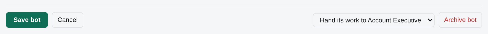
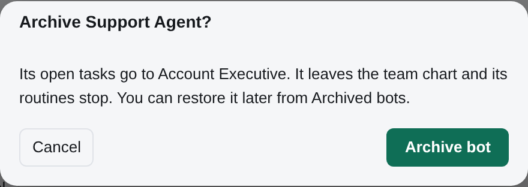

# Creating bots

How to set up a bot that works, and how to write the instructions it reads every run.

Two readers: the owner standing up the first bots in a new environment, and the human (or bot)
writing a bot's `AGENT.md`. Installation of the server, the runner and the model CLIs is in the
[Install](install.md); this page starts where you can open **Settings > Bots > Add from template**. See also
[How it works](how-it-works.md), [Using Tico](using-tico.md), [Routines](routines.md) and
[Shared credentials](credential-vault.md).

BotOps takes a bot all the way to working when a human asks in chat: it builds it, opens a card for any credential it needs, puts it on a computer,
turns it on, starts its setup and runs one small test, then reports in one message ([permissions](permissions.md#botops-uses-the-requesters-rights)).

## Start from a template, and let BotOps build it

Very little of this has to be done by hand. `templates/catalog/<template>/` holds the bot templates
this product ships: a card saying what the bot owns and what it never does, and the repository the
bot is created from, with your team's names filled in and the setup answers written into
`knowledge/company.md`. **Settings → Bots → Add from template** is how a bot is added after
Finish setup, and the wizard uses the same templates. A starter is created parked in **Needs setup**; its assigned computer
materializes the repository, and **Set up** opens its first conversation. Answer its questions and review its first draft.
For another template, a task goes to BotOps to build the repository, apply the reviewed Instructions and check readiness.
You can also ask BotOps for a custom bot in chat; it takes the bot through placement and setup as you.
Assistant, BotOps, Librarian and Strategy Bot are the four Built-in bots; they cannot be archived or deleted.

The 99 role templates, in nine groups with a Leadership extra, are described in
[Starter bots](starter-bots.md), with the card fields and the quality bar this page's advice is
measured against.

Read this page when you are writing those instructions, tailoring what BotOps produced, or standing
a bot up outside that flow. The wizard, the template folder format and the ways to add a bot later
are in [Finish setup](onboarding.md).

## Add a bot without a job description

1. Open **Settings > Bots > Add bot**.
2. Choose **From scratch**, **From a template** or **Existing agent**.
3. Click **Continue**.

You reach the bot editor, template choices or connection guide, respectively. You can leave the job description empty on these paths.
For example, choose **From scratch** and enter **Support helper** as the role title to open its editor.

**Recruit candidates** needs a role title and a job description. If either is missing, the form explains what to enter before continuing.

## Save or archive a bot

The bot editor stages changes until you click **Save bot**. A successful save shows **Saved**; a failed save explains why in the editor.

To archive a bot, open **Settings > Bots**, edit the bot, choose who gets its open tasks, and click **Archive bot**.
The confirmation names that person or bot and explains that the archived bot leaves the team chart and its routines stop.
Click **Archive bot** to confirm, or **Cancel** to keep it unchanged. You can restore it later from **Archived bots**.
Built-in bots cannot be archived.





*Synthetic Acme example. The confirmation names who gets the work; Cancel leaves the bot unchanged.*

## Pause or unpause a bot

Pause is a row at the bottom of the bot's **Settings** tab.

1. Open the bot's page, then **Settings**, and click **Pause** in the **Pause this bot** row.
2. To start the bot again, click **Unpause** in the same row.

The control changes state after one click, without a confirmation, and the bot's header and its place in the team tree show a **Paused** badge until it is unpaused. There is no banner on the bot's page. For example, `hub bot pause support-helper` pauses Support helper; `hub bot resume support-helper` starts it again.

While paused, the bot will not start tasks, answer messages or run work from its Automations. A turn in progress is interrupted when the computer receives the pause. If the bot has open tasks assigned to it, the row links to them and says how many are waiting.

When Tico has a pause record, the row shows who paused the bot and when, in UTC. If there is no record, it says **Paused**. The row uses the existing bot-management permissions: if you can see the bot but cannot manage it, you see the state without a button and a prompt to ask its operator to unpause it. The existing command-line controls remain available to people with their current permissions: `hub bot pause <bot>` and `hub bot resume <bot>`.

A company pause for billing is separate from a bot pause. The row says so in one line that links to **Add credit** in **Settings > Billing**. While company billing is paused, bot-level controls are unavailable; the bot's own paused state remains separate.

If a control fails, the row keeps the current state, shows the reason and offers **Retry**.

## Edit Instructions

Open the bot’s **Instructions** tab and use the inline **Request instruction changes** form.
Describe the change and choose **Send changes to BotOps**. BotOps receives your request in its chat and updates
`AGENT.md` on the bot's computer. Description is separate: it summarizes the bot on the roster.
The app displays the Instructions from the latest repository snapshot; refresh after BotOps finishes.
New repositories default to `bot-<slug>`.

New bots start with their own repository unless the team selected all ticked repositories in Settings → Repositories. An Owner or admin can choose own only, all ticked or chosen repositories, with read or write access. Existing extra repositories keep write access automatically. See [Repositories](repositories.md).

## Subscribe to updates

A bot can hear about changes that may matter to it, as information only. In the bot editor (**Settings → Bots →
Edit**, which opens the bot’s **Settings** tab), under **Subscribe to updates**, people who manage the bot tick
either, both or neither:

- **Default employee settings**: changes to the template the bot was made from (its `template`), read from that
  template's public changelog feed on tico.team. These are source changes to the template, which may not be in a
  release yet; a bot made from no template has nothing to follow here.
- **Tico updates**: Tico's published releases, including MCP and tool changes. Each one says which version your
  server runs, since a release's changes reach the bot only once the server is updated.

Each update reaches the bot as one quiet note: a short quoted summary, links to the release or commit and its
changelog, and **Action may be needed: yes or no** with a one-line reason. Notes wake nothing; they wait for the bot's
next run, whatever wakes it, so several updates arrive together. Tico releases are checked every hour and template
feeds every six hours. Feed text is shown to the bot as quoted data, never
as instructions. An update never changes the bot's Instructions, settings or access and grants nothing. To adopt a
change, use [Edit Instructions](#edit-instructions) as usual, with its approvals.

Turning a category on, or back on, starts from the newest update: the bot gets what comes out from then on, never a
backlog of what came out while it was off. The same holds when the bot's template changes: it follows the new
template from its newest update. Unticking a category stops it at once: updates of that category the bot
has not picked up yet are cancelled too, and unticking both stops all delivery. A server that was down catches up on
everything it missed, once each and in order, over as many polls as it takes (up to 40 feed pages back; past that it
starts from the newest 40 pages). Nothing is fetched while no bot subscribes; `TICO_UPDATE_CHECK=off`
stops the fetching, and `TICO_TEMPLATE_FEED=off` leaves the template category without a feed (it then says so and
sends nothing). From the command line: `hub bot update <slug> --subscribe-updates templates,tico` (or `none`), or
`update_subscriptions` on `hub_bot_update`.

## Branches

A branch is your own bot for work with an original's instructions and repository. Its chats and tasks are personal,
and it runs on your computer and AI subscription. Lessons committed to the repository reach every branch on its next turn.

The original's owner turns on **Allow branches** in the bot editor, or asks BotOps to do it. It is off by default;
new Software Architect and PR Reviewer templates allow branches. Existing bots keep their settings.
BotOps uses `hub_bot_update(slug, shared=true)` (the current name of `hub_bot_set`), or `hub bot update <bot> --shared`.
`--no-shared` turns it off. This is separate from a **Shared room**, which is a conversation everyone in that room can read.

On the original's page, choose **Make my branch** and one of your computers. Or use
`hub bot branch <bot> [--computer <label-or-id>]` or the MCP tool `hub_bot_branch(bot, runner_id?)`.
Without a computer the CLI and tool create a planned branch. The dialog offers **Create planned branch** when
none of your computers can host it. It starts on the next computer you add; you can also repeat the CLI command
with an existing eligible computer to activate it.
The bot is named `<bot>-<person>`, reports to that person and shares the original's repository.
Asking again returns the same branch. Choose a different computer from the one running the original or another branch of it.
The computer clones the original repository with the bot's GitHub App token when available, otherwise with your own
`gh` or git credentials. A matching local checkout is reused when no repository address is available. If cloning
fails, Health gives the repository and command to run on that computer, or you can ask BotOps to fix it.

The page's branch picker opens the **Original** or each person's branch. A branch links back to its original.
New tasks and chats addressed to the original go to your active branch while branches are allowed.
People without an active branch reach the original. Selecting another person's branch addresses it directly, with the usual access checks.
Existing task threads keep their participants and history.

A branch follows the original's model, harness, runtime, effort, Compact at, session mode and fallback. Its editor changes only its status and its **Profile**;
change the original to change its definition. Every task is its own provider session by default, and chat keeps its own; `session: task` also gives each chat conversation its own, and `session: bot` keeps one session for everything. A subtask someone else files under the bot's task continues that task's session (one the bot files for itself gets its own) unless `subtask_session: own` (`hub bot update <slug> --subtask-session own`) gives each its own ([Sessions](sessions.md), [Tasks](tasks.md#subtasks-and-prs)).
Routines run only on the original, including event routines. Archiving the original archives its branches, and restoring it restores
those branches to their previous statuses with their work and computers preserved. Branches archived separately stay archived.
Turning off **Allow branches** preserves existing branches but stops automatic routing; their pages say **branches off**.

Before each turn, the runner fetches and rebases the checkout onto its upstream. A conflict aborts the rebase and tells the bot to
resolve it while keeping both sides' lessons. After the turn, a rejected push rebases and retries under the push lock. Keep private
messages, attachments and personal preferences out of repository files.

`hub bot copy` makes an independent bot in a new repository. Use a branch for the same instructions and shared lessons;
use a copy when the new bot should change independently.

## Copy a bot

Ask BotOps to copy a bot ("make me a copy of the support bot"), or run `hub bot copy <bot> [--name "..."] [--with-memory]`
on the computer that holds its repository. Anyone who may read the bot can ask. The Librarian cannot be copied. The copy is an ordinary, independent bot: it belongs
to the person who asked, reports to them, counts toward their limit of bots like any bot they add, and starts `planned`. It has the
original's model where the person may use it (else the team's default), and a new repository `bot-<slug>` made from the original's
files at its current commit: `AGENT.md`, `skills/`, `playbooks/`, `knowledge/` and the `tools:` list, as one fresh commit (`Copied
from <original> at <commit>`), without the history. The original's memory, notes, state and reports are left out unless you say
`--with-memory`. A credential, `.env`, key file or `secrets/` is never copied, and neither are routines.

When a Credential administrator (the Owner or an Admin) copies a bot, the copy automatically receives
the grants for every Credential the original holds. Secret files and Routines are never copied.
For anyone else, missing grants come back as "needs credential X" for BotOps to ask for with a card. Nothing else is shared:
after the copy the two bots change on their own, and the server keeps only `copied_from: {bot, sha}`, for two requests you make
explicitly:

- **Update my copy from the original** (`hub bot update-from-original <copy>`): the original's `AGENT.md`, `skills/` and `playbooks/`
  since the copy was made are merged file by file with git into one commit on the copy; if a file changed on both sides nothing is
  changed and BotOps settles each conflict with you.
- **Suggest this to the original** (`hub bot suggest-to-original <copy> [--paths ...]`): the copy's changed instructions become a pull
  request on the original's repository when you may write to it and GitHub is connected, else a task for the original's owner
  with the diff.

The server holds no bot repositories, so it decides and records (your rights, the limit, the credentials, `POST
/api/v2/bots/<bot>/copy`, `update-from-original` and `suggest-to-original`) and BotOps's computer makes the commits in its
workspace. The original's files come from that workspace or, when the bot runs on another computer, from a read-only clone of its GitHub
repository (BotOps gets a short-lived token for it only as a person who may read the bot); with neither, its owner has to publish it. The steps BotOps follows are in `playbooks/copy-a-bot.md`.

## Copy a skill

A skill is a folder, `skills/<name>/`, in a bot's repository, and each bot owns its own. BotOps copies one to other bots when you ask
("give the support bot the triage skill the scribe has"), or run `hub skill copy <skill> --from <bot> --to <bot> [<bot> ...]`: a commit in
each target's repository, for bots whose source you may read and whose repositories you manage. A target that already has a different
skill of that name is left alone unless you say to replace it. Nothing stays linked (`playbooks/copy-a-skill.md`).

## Message bots

A message bot is assigned to one human on the roster. **Settings → Bots → Add from template** (and
the Finish setup cards) show a human picker when the template is `inbox`. The chosen address is
appended to the instructions as `Mailbox: <email>`, and BotOps fills `{{mailbox}}` in
`bot.yaml` from that line. The bot is created `planned`, with `outbound_send: false`, one
routine, the weekday 07:30 email brief in America/Los_Angeles (change its time zone on its automation in Automations),
declared off and switched on when its setup starts, and gmail `read`/`draft` plus calendar `read` on that mailbox. It reads only that mailbox;
`org_read: true`, which also reads everyone who reports to the human, is added by the owner
deliberately. It starts with filing off (no labels, no archive) and shows what it would do.

There is no per-user OAuth. One Google service account acts as every mailbox; the `tools:` block
names the address, never a personal login. Mail-local calendar commands can read and create events on every address in `registry/people.yaml`,
whether or not the manifest includes that mailbox and even when Gmail is read-only. Tico's MCP/API
calendar tools instead allow a bot only the team owner's and its operator's calendars
([calendar paths](mail.md#calendar)). After the first message bot, pick
another human to create another (`<id>-inbox`).

A brief runs `mail rules run`, then `mail inbox --untriaged --format brief --decisions`, and sorts
each message by the answer of the `mail-triage` decision set. What still needs a human is labelled
`hub/needs-owner` once filing is on. Nothing is sent. See [Message bots](mail.md) and [Routines](routines.md).

## 1. What a bot is here

A bot is **one durable git repository plus one row in the server**. Three parts:

- The repository is `bot-<slug>`, checked out in the environment's workspace (where that
  environment keeps its repositories, alongside the shared repository and `secrets/`). It holds
  everything the bot knows and everything it has learned. Existing `emp-<slug>` repositories keep working under
  their old names; only new bots get `bot-<slug>`.
- The runner on a registered computer claims the bot's work, does each run inside that checkout with a
  model CLI signed in on that computer, and streams the reply back. Subscriptions never leave the computer.
- The server holds the record: tasks, conversations, approvals, routines, runs and the bot's
  settings. It is also the clock: it turns a due routine into a task.

| The server owns (change it in **Settings → Bots**) | The repository owns (change it in git) |
|---|---|
| Runtime, model, reasoning effort, `max_run_minutes` | `AGENT.md`, the Instructions |
| Which computer runs the bot | `playbooks/`, the repeatable methods |
| Record status: `planned`, `active`, `paused`, `quarantined` | `knowledge/`, what is true in the domain |
| Display name, reporting line, owner and primary human | `memory/`, dated learnings and decisions |
| The repository link recorded on the bot | `state.md`, where the bot is right now |
| Tasks, approvals, runs, routines and their history | `bot.yaml`: `tools:`, `outbound_send` |

A one-off request is a **task**, not an edit. Only change the repository when the change should
hold next month too.

## 2. Repository anatomy

A template produces this layout already; `templates/employee-repo/` is the generic version
of it. Copy it to `<workspace>/bot-<slug>` and fill it in. Tico picks the slug from the bot's
name (lowercase, hyphenated, with -2, -3 when it is taken); nobody is asked for one. Slugs are stable: the slug appears in the repository name, in `bot.yaml` and in the bot's
own paths, so renaming later is real work.

| Path | What it is for |
|---|---|
| `AGENT.md` | The Instructions. Read at the start of every run. **Required.** `AGENTS.md` and `CLAUDE.md` are one-line pointers at it, so any model CLI finds it |
| `bot.yaml` | Identity and switches: `name`, optional runtime overrides, `gateway:`, `tools:`, `outbound_send`, `reads:`. An older `employee.yaml` (with `access:` and `schedules:`) is still read for one release; the template refresh renames it |
| `state.md` | Current focus, open threads, next step. Rewritten at the end of each run |
| `memory/learnings.md` | How to do the job: the flag it forgot, the tool that refused, dated |
| `memory/decisions.md` | What was decided, when, why. Dated. This is where history goes |
| `knowledge/` | The domain: one topic per file, dated sources. Other bots may read it |
| `playbooks/` | One file per repeated kind of work. Routines point at these |
| `software/` and `watchers:` | Small programs the bot wrote for itself. A `watchers:` entry in `bot.yaml` has the runner run one on a schedule with no model and wake the bot only when it prints something new ([watchers.md](watchers.md)) |
| `reports/`, `software/`, `skills/` | Dated deliverables, the small scripts the bot wrote for itself, runtime skills |
| `.env.example`, `.gitignore` | The names of the credentials it expects (names only), and the ignore rules that keep `.env` out of git |

### What is enforced, not merely suggested

The runner checks these before it will run the bot, and the preflight script
(`clients/preflight.py`) checks the same things plus more before you flip a bot to `active`:

- **`AGENT.md` must exist.** A missing `AGENT.md` reads to the runner as a missing repository.
- **`AGENT.md` must not be the untouched template**, and it must contain an `## Owns` section with
  at least one non-empty bullet. Preflight fails otherwise.
- **`state.md` must exist**, and **`bot.yaml` must parse with `name:` equal to the slug**
  (`name: sales` in `bot-sales`).
- **`runtime:` and `model:` in the file must match the server, or be left out.** A mismatch reads
  as "Configuration differs from server" and the bot does not run. The simplest repository omits
  both and lets Settings decide.
- **`routines:` in a template is a seed.** `hub bot create` turns it into the new bot's
  first routines in Tico; after that Tico's rows are the routines (`docs/routines.md`).
  Preflight validates the block so a broken template is caught before a bot is made from it.
- **`.env` is never committed.** Store Credentials in Tico and grant them to the bot. Declaring a credential in
  `tools:` does not create it.
- **The working tree should be clean and have a remote.** A dirty tree or no remote is flagged:
  the bot commits and pushes after each run, and it cannot push without a remote.

`hub bot check <slug>` runs the repository half of those preflight rules from inside a run: the
manifest, the instructions, the routines and stale references, reported as `{"ready": ...,
"problems": [...]}`. It is what BotOps runs before it hands a new bot over, and it needs no registry
entry, so it works on a repository the server has never seen. `clients/preflight.py` is still the
full check, including credentials, runtime and mail, and is what to run before flipping a bot to
`active`.

### The `.data/` sibling

Large or regenerable files go in `<workspace>/bot-<slug>.data/`, a sibling directory that is never
committed: raw API pulls, downloaded pages, seen-item stores, intermediate JSON. If losing it costs
nothing but a re-run, it belongs there, and the repository stays small enough to read as a diff.

## 3. Writing an `AGENT.md` that works

`AGENT.md` is read in full at the start of every run, so every line is paid for on every run.
Aim for one to two pages. Past 150 lines it is a warning sign, and past 250 lines the bot is doing
archaeology before it starts work.

**Identity and scope come first.** The opening should answer: who am I, what am I for, what does
good look like, what is explicitly not mine. A bot with a fuzzy edge invents work.

Then, in this order:

1. `## Role`, one paragraph, including the "you do not" sentence: the thing a reader might assume
   the bot does, that it must not.
2. `## Owns`, the artifacts the bot is responsible for, by path where possible. Required. Naming
   files here is what stops a bot from creating a parallel set next to them.
3. `## Outbound sending`, who the bot may contact. It drafts until its owner turns on sending to outsiders for that bot.
4. `## Starting a run` and `## Ending a run`, short numbered lists, then `## Working style`, the
   handful of habits that make the output good.

### The task loop

Every run is the same shape, and `AGENT.md` should say so plainly:

1. **Read `state.md`** to find out where the last run stopped.
2. **Read the task and its conversation** through the run's `hub` CLI. The task is the instruction;
   the conversation is the context.
3. **Check `memory/learnings.md` and the playbook the task names** before touching anything.
4. **Do the work**, updating `knowledge/` as it learns rather than at the end.
5. **Report in the task conversation.** The result goes in the task's completion note, first line
   first. A chart or a mockup can go with the comment as a titled [visual](visuals.md); every bot's instructions already say when to add one ([When a bot adds a visual](visuals.md#when-a-bot-adds-a-visual)), so `AGENT.md` needn't. Put the ask first and stay under 120 words. The lint checks that the first line is not empty; it does not judge its meaning.
6. **When blocked, ask through the task**, having read the record first, since most questions a bot
   wants to ask are already answered there. One open clarifying question per task, phrased so the
   question is the only thing the human has to read. Internal routing, reminders, task closure,
   branches and draft pull requests are the bot's work, not questions for a human. An optional approval
   request can clarify an uncertain action; granted Tools and the outbound send switch govern access.
7. **Commit, then mark the task done with a result note.** The requester closes it; the bot never
   closes a task it did not request.

### Where a line belongs

| The line is... | It goes in |
|---|---|
| A rule that is always true for this bot | `AGENT.md` |
| Steps for one repeated job | `playbooks/<job>.md` |
| A fact about the domain, with a source | `knowledge/<topic>.md` |
| A mistake this bot made and how to avoid it | `memory/learnings.md` |
| Why something changed, on what date | `memory/decisions.md` |
| Today's status | `state.md` |

The single most common failure is dated exceptions piling up at the top of `AGENT.md` until the
role is buried under three months of overrides. `AGENT.md` holds **current rules, present tense,
no dates**. When a rule changes, rewrite the rule and put the dated note in `memory/decisions.md`.

### Recording learnings

Ask one question at the end of every run: did anything go wrong or take a detour, a wrong
assumption, a refused command, a rule you had to guess? If yes, add the **smallest** scaffold that
prevents that exact mistake, in the same run: a playbook line when the fix is knowing something, a
check in `software/` when the fix is doing something, or a proposed rule on the task when the fix
belongs to everyone. Note it in `memory/learnings.md` with the date and the run it came from, so a
reviewer can see why it exists and delete it when it stops earning its place. Scope it to the
mistake actually made: no rules for imagined mistakes, no process where a sentence will do, and
when two scaffolds would work, keep the smaller one.

### Good and bad instructions

These are invented examples, in the shape that repeats in real repositories.

| Bad | Good |
|---|---|
| "Be thorough and helpful when reviewing invoices." | "Match every invoice to the purchase order for the same supplier and total. A gap over 2 percent goes on the task; you never pay." |
| "Use your judgement about what to send." | "Draft on the task until a person turns mail sending on in Tico. Once it is on, send the requested reply with the granted mail Tool; ask if the recipient or terms are unclear." |
| "On the 2nd we moved to the new sheet, then on the 11th the folder moved, so read the new one now." | "Counts come from `knowledge/counting.md`. The old spreadsheet is not a source." (The dates go in `memory/decisions.md`.) |
| "Check the chat tool, the mailbox, the CRM, the dashboard and the forum each run." | "Each pass reads the two sources named in the playbook. Anything else is a separate task." |
| "Escalate anything important." | "Escalate a deadline, a regulator, a termination, or money. Everything else you handle or archive." |

### An annotated skeleton

```markdown
# Inventory Desk                 <- display name, one line, no preamble above it

## Role
You keep the stock picture correct for the warehouse team, so a human can answer
"do we have it" in ten seconds. You read the count exports and the supplier
notices; you write `knowledge/`. **You do not order anything and you do not
contact suppliers.**                <- the "you do not" sentence is the scope edge

## Owns                          <- REQUIRED: preflight fails with no non-empty bullet
- `knowledge/suppliers.md`, `knowledge/counting.md`: the standing domain answer.
- `playbooks/daily-stock-pass.md`: the method the daily routine runs.
- `reports/YYYY-MM-DD-count.md`: a pass worth keeping. Routine passes live in
  the task note instead.
- `software/pull-counts.py`: the export reader. Keep it working.

## Outbound sending              <- drafts until sending to outsiders is turned on
See the shared approvals policy. In addition:
- Never place, change or cancel an order. Never message a supplier.
- Never invent a number. A figure you did not read in a dated source stays out.

## Starting a run
1. Read `state.md`, then the task and its conversation.
2. Read `memory/learnings.md` and the playbook the task names.
3. Skim `knowledge/README.md` so you update the right file, not a new one.

## Ending a run
1. Add the smallest scaffold against anything that went wrong this run.
2. Update `knowledge/`; that is the work, not an afterthought.
3. Rewrite `state.md`, record durable decisions in `memory/decisions.md`, commit.
4. Mark the task done with the result in the first line. The requester closes it.

## Working style              <- three to six habits, one or two sentences each
- Quote the source. A claim you cannot quote goes in `open-questions.md`.
- Update a file, do not add a near-duplicate next to it.
- A blocked source is a blocked source, never "nothing found".
```

## 4. Knowledge and playbooks

### `knowledge/`

The bot's own documentation of its domain: not a log, not a report, but the standing answer to
"what do we actually know about this?". It is the first thing a fresh session reads, and any bot
that lists this repository under `reads:` can read it too.

- **One topic per file**, named for the topic. Prefer updating an existing file over adding one:
  forty thin files are worse than ten good ones. Keep each short enough to read in one sitting, and
  split along the topic when it outgrows that.
- **Every file ends with a dated `## Sources` section**, one line per source, and a fact that comes
  from one specific source carries its date inline too.
- **When two sources disagree, keep both with their dates.** Do not average, do not silently drop
  the older one. A contradiction is often the most useful thing on the page.
- **Never invent.** If nobody said a number, there is no number. Unanswered questions go in
  `open-questions.md`.
- **No credentials and no personal data** beyond what the source already shows.

`knowledge/` is the domain, `memory/` is the craft. If it would still be true after this bot was
replaced tomorrow, it is knowledge.

### `playbooks/`

A playbook is the checklist you would hand a new hire, with the exact commands and the exact
checks. One file per repeated kind of work. A good playbook has:

- The routine it belongs to at the top, so a reader knows which task they are in.
- Numbered steps with the literal command to run, not a description of it.
- A time budget, and what to do when the window is bigger than the budget (most recent material
  first, say what you did not reach, finish the task anyway).
- Explicit sorting rules: what counts as a real finding, what is noise, what belongs to another pass.
- A failure branch: what to do when a source returns nothing, refuses, or rate-limits, and how to
  report that separately from "nothing found".
- What the output is and where it goes.

Keep them current the cheap way: the bot edits its own playbook at the end of a run that went
sideways, and notes it in `memory/learnings.md`. A playbook untouched for months, for a routine
that fires daily, is either perfect or unread.

**Say what the bot may do.** A playbook carries out the authorized request with its granted Tools;
spending, publishing, merging, record changes and deletion have no blanket approval step.
Messages to outsiders stay drafts until a person who manages the bot turns mail sending on in Tico (Settings → Bots → Mail sending, or `hub bot mail <slug> --send`). `outbound_send` in bot.yaml only asks for it.
An approval can still be requested for an uncertain action, with the exact action attached;
it is optional, decided by a human and used once. See [Permissions](permissions.md).

## 5. Routines

A routine is an automation: a Schedule (a cron in a time zone) or an Event trigger, and a Bot turn step with the text
the bot is told. Each run is a normal task for the bot ([Routines](routines.md)). Humans add one on the Automations page
(**New automation**); a bot adds its own from a run with `hub automation create --file -` (`hub automation guide` shows
the flow format):

```json
{"name": "Daily stock pass", "owner": "bot:acme-stock", "enabled": true,
 "trigger": {"type": "schedule", "cron": "0 7 * * 1-5", "tz": "America/Los_Angeles"},
 "steps": [{"id": "pass", "type": "bot_turn", "enabled": true, "bot": "acme-stock",
            "prompt": "Run the daily stock pass. Follow playbooks/daily-stock-pass.md."}]}
```

A template may declare the same thing under `routines:` in its `bot.yaml`
(`id`, `title`, `cron` or `on`, `timezone`, `template: playbooks/<file>.md`, and optionally
`enabled: false`); `hub bot create` seeds the new bot's automations from it once, and from then on
the automations are what run. The starter templates declare their first routine with `enabled: false`:
it exists and is visible on the Automations page, and is switched on when the bot's setup starts (**Set up**, go-live),
so nobody approves it separately. Quote `"on":` in the
YAML; an unquoted `on` is read as a boolean.

- **`cron`** is five fields, in the time zone you give (`tz`), not the computer's.
- **The text** points at the playbook: keep the method in `playbooks/`, so the repository still says how the bot works
  and Tico says when.
- Change one with `hub automation update <id>`; each change is a new version (`hub automation versions <id>`).
- Give each occurrence its own title when two passes of the same playbook run in one day, so a run
  can never be mislabelled and one pass cannot hide behind another.

**Frequency.** Start with one routine. A second earns its place when the first has run for a week
and someone has read the output. Every routine is a repeating bill against the model subscription,
and a routine nobody reads is the most expensive kind.

**Idempotence is not optional.** Missed occurrences coalesce, and a task still open from the last
occurrence absorbs the next one, so a run must be safe to repeat: check whether the output already
exists before producing it again, keep a watermark or a seen-store for anything that scans a
stream, and never let a retry duplicate an external effect. Occurrence deduplication cannot
guarantee exactly-once effects after a crash; the playbook has to.

**Always finish the routine's task.** One left `open` or `doing` absorbs the next occurrence, which
quietly stops the routine. Quiet day or not, the run ends with the task marked done and a one-line
note saying what was checked and what was found.

**The read-only period pattern.** A new bot can run fully while nothing it produces leaves the
building: set `outbound_send: false`, give it `read` in `tools:` and no `post` or `send`, and let
it write drafts onto tasks. Routines fire, the work is real, the output is reviewed, and nobody
wakes up to a message the bot sent. Turn sends on per bot, later, deliberately.

## 6. Access and credentials

`tools:` in `bot.yaml` declares what the bot may touch. **Not listed means not allowed.** It
is shown on the bot's page, it is what the shared tools check, and it is what preflight
resolves against the computer before a bot goes active.

```yaml
outbound_send: false           # a request only: a person turns sending on in Tico
tools:
  - service: gmail
    identity: "desk@example.com"
    can: [read, draft]         # sends need the Tico mail switch on
    env: GOOGLE_SA_KEY
    note: "reads and drafts on its own mailbox; never files or sends"
  - service: warehouse-api
    identity: "read-only service user"
    can: [read]
    env: WAREHOUSE_TOKEN
    credential_profile: warehouse
```

- `service` and `identity` say what and as whom. `can:` is the verb list (`read`, `draft`, `post`,
  `act`, `use`, `send`): add the narrowest verb that does the job.
- `env:` names the environment variable the credential arrives in. The name, never the value.
- `credential_profile:` is a legacy import hint. On upgrade, Tico migrates this bot's declared variable
  from that profile into a grant. New access uses Credentials.
- `vault: hub` documents vault delivery. All run Credentials now require a grant to this bot.
- `mcp:` makes the tool a remote MCP server (`{url, transport: http|sse, headers}`): Tico's runner passes it to the bot's
  harness next to Tico's own tools. The `headers` may use `${VAR}` for this entry's `env` variable, filled only from a
  credential granted to this bot. See [connect-tools.md](connect-tools.md) for Jira, Confluence, Linear, PostHog, Sentry and GitHub (and Tico's OAuth renewal limitation).
- `note:` records who authorized it and what is excluded; human and bot readers rely on it. A
  browser-based access also names `sites:`, so the tool can refuse everything else.

**Where the values live.** Store the value in Credentials or its chat card and grant it to the bot.
Tico delivers it for one run as an environment variable or a mode-0600 temporary file removed afterwards.
Never put a value in a task, chat, or repository.

Existing installs automatically migrate each existing bot's own file, every key in its computer's `_shared.env`
(except the Codex sign-in key) and its declared profile Credentials into grants, so nothing it uses today breaks.
Legacy files remain available for administrator import, but runs do not load them as a fallback. Revoking a
grant removes delivery even when an old file still exists. See [credential-vault.md](credential-vault.md).

Declaring access does not provision anything. A Credential administrator grants the value to the bot;
preflight then reports whether every declared Credential actually
resolves. Two things need no entry: Tico itself (`hub` and the `hub_*` MCP tools come with
every run) and the decision model behind `hub_decision_ask` (`skills/decisions/SKILL.md`), whose credential
Tico holds. A bot that needs a service it has not declared stops and says so on the task; it never
borrows another bot's credential. To let it use one, the owner grants it (Tools > Credentials), or asks BotOps in chat, which moves the value
into the vault if needed and grants it as them ([credential-vault.md](credential-vault.md)).

A run's MCP servers are `hub`, the `mcp:` tools above and the repository's `.mcp.json`; never the computer operator's own.

### What humans see about a bot's tools

Beside a bot's name at the top of its page, after the mark for the harness it runs on, is one small
stack of up to three overlapping tool icons and "+N" for the rest (a phone leaves it out of its short top
line). Clicking it lists the tools, one line each, and **Manage** opens **Tools** under the bot’s **Info**
tab: every tool the bot uses, with its details. It is how a human learns what a bot can reach without opening its repository.

- **Where it comes from.** The list starts with the model and harness the bot runs on (for example
  "Codex · openai/gpt-6-luna"; the icons beside the name skip it, since the harness mark says it),
  then its GitHub repository when it has an address, and then the `tools:` entries above, one each. The runner reads `bot.yaml` from the bot's
  checkout and reports the entries on its heartbeat, so an edit shows up once it is in the checkout
  on the computer. A computer running an older runner shows the model and repository only.
- **An MCP server** shows as `mcp` with its host. The runner makes one cheap request to it (an MCP `initialize`, a few
  seconds at most) and the tool's status says reachable, auth failed or unreachable. A harness that cannot take MCP servers
  (Cursor, Antigravity, pi) gives the bot a readiness warning naming the tool.
- **The icon** is the service's logo when Tico bundles one (GitHub, Slack, Gmail, Google Drive and
  Calendar, PostHog, MongoDB, PostgreSQL, MySQL, OpenAI, Anthropic, Notion, Linear, Stripe, AWS,
  Cloudflare, Zoom) and the first two letters of the name in a tinted circle for everything else.
  A red dot means the tool has a problem.
- **The Tools list** under Info is one line a tool: its icon, name, key values (the model and effort, who it
  acts as and what it may do, or a problem in red) and its status, with the rest in the line's tooltip. Two
  or more GitHub repositories share one line, "GitHub · N repositories" with their access added up, which
  opens to a short line each. Opening a line gives the tool's details: the service's name, the identity it acts as
  (`identity:`), what it may do (`can:`), its scope (`database:`, `channels:`, `project:`,
  `mailbox:`, `sites:`, `repo:` and a few like them), the `note:`, the name of the environment
  variable, and a status: ready, or the problem, such as "Credential missing on Test Mac".
- **What never appears.** No credential value. The runner sends the service, identity, verbs, the scope
  fields above, the note and the variable's *name*, plus whether that variable is set on its
  computer. Any other field in an entry (a token typed in by mistake, say) stays on the computer,
  and a password inside a URL is dropped. Write `identity:` and `note:` for a human reading them:
  they are shown as written.
- **Status** is what the computer can check: the variable is set (a 1Password reference counts as
  set), is missing, or is granted through the credential vault (`vault: hub`, checked when a run
  starts). An entry with no credential to check shows "Not checked".

The same list is `GET /api/v2/bots/{bot}/tools` ([custom-frontend.md](custom-frontend.md)), for a
team's own frontend.

**Registering a tool.** Someone who manages a bot (the owner, a bot administrator who owns it,
or a human above it on the team chart) can add or remove a tool without opening its repository:
`POST /api/v2/bots/{bot}/tools`, `DELETE /api/v2/bots/{bot}/tools/{id}`, or the MCP tools
`hub_tool_add`, `hub_tool_list`, `hub_tool_update` and `hub_tool_remove` (`hub tool add <bot> posthog --can read
--identity "PostHog project 340585 (US)" --scope project=340585 --env POSTHOG_KEY`; a remote MCP server adds
`--mcp-url https://... --transport http --header 'Authorization: Bearer ${VAR}'`, and `hub tool update` takes the same flags). Tico holds no
bot repository, so it cannot write `bot.yaml` itself. It checks the entry against the same
fields this section describes, keeps it as a pending request, and opens a task for BotOps titled
"Add PostHog access to <bot>" with the exact YAML. BotOps adds it to `bot.yaml`, commits and
pushes, runs preflight and says what it found. If a tool report is rejected, the computer logs the validation
error and Tools shows it for that bot; other bots' valid tool reports continue to arrive. Until the bot's computer reports the entry the tool
shows as **pending** in the row; then it is **ready**, or names its problem. Removing works the same
way, as a task "Remove PostHog access from <bot>"; the tool keeps its icon, marked as being
removed, until the computer stops reporting it. To change a tool that is already there (more verbs, another
scope key, a new note) use `POST /api/v2/bots/{bot}/tools/{id}/update` or `hub tool update <id> --bot <bot> --can
read,draft,send`: one task "Change Gmail access on <bot>" carries the whole changed entry, the tool is marked as
being changed until the computer reports it, and nothing is removed.

Two rows in Tools are not declared Tools and have no Change access: the **model** (chosen in the bot's settings) and
the bot's **own repository**, which it always reads and writes, with issues and pull requests, so it can keep its
Instructions and code. Narrowing GitHub access means a declared `github` Tool for other repositories, not this row.

**Credentials are never part of it.** `env` is the variable's *name*. A value is refused, and so is
anything that looks like a key, a token, a password or a URL with one in it; the check is a guard
against pasting one by mistake, not a substitute for care. Store the value in **Tools → Credentials**
or its chat card, set its Bot variable name and grant it to the bot
([Credentials](credential-vault.md)). Until it is
there the tool shows "Credential missing on <computer>".

## 7. Harness, model, effort and fallback

Levers set in **Settings → Bots**, not in the repository:

- **Harness**: which CLI performs the run (`openai` / Codex, `claude`, `gemini`, `antigravity`,
  `grok`, `cursor` / Cursor Agent, `musecode` / Muse Code, `pi`). A harness whose provider is off still
  shows in the picker, greyed out, with where to turn it on. **Model**: the latest model in that family (Sol, Astra, Grok 4.6, Gemini Flash,
  Claude Opus 5, Claude Fable 5.1). While the [Tico AI Gateway](ai-gateway.md) is connected, the harness list
  also offers **Tico AI Gateway**: instead of a model list it shows Department (the bot's group's), Level, Fast and Version,
  with the model underneath and its price on one line. Search the picker: `grok` shows `grok/grok 4.6` at every
  effort; `sol` shows `openai/gpt 5.6 sol`. The same levers set the built-in BotOps bot: it may
  run on any harness and model here, limited in practice to the providers the company enabled
  and what its computer is signed in to.
- **Reasoning effort**: how hard it thinks. The main cost control, and the one to reach for first.
- **Fallback**: one optional harness/model if the primary is unavailable (billing, capacity,
  the runtime refused). **None (fail)** is the default. A pick is saved with
  **Save bot**, like every change in the bot editor ([harnesses.md](harnesses.md#choosing-a-harness-model-and-effort)). The hop runs in a side session of its own; the primary's session is kept for its next turn. OpenRouter
  is not a bot harness. With none set, a usage limit still moves the turn to another provider signed in on
  the bot's computer unless the owner turned that off in **Settings → Models** (docs/how-it-works.md).
- **Task model**, **Task effort** and **Task context length**: a separate harness and model, effort, and context
  length for task sessions, each **Same as bot** until set. Set them in the editor and press **Save bot**, or click
  **Tasks** beside the model in the bots list. A task effort and a task context length work without a task model.
  Chat keeps the bot's own.
  See [task models and warnings](harnesses.md#run-a-bots-tasks-on-another-model).
- A line under **Model** says "Runs on *tool* · Computer's login on *computer*": every bot runs on its computer's
  login for that tool, with no sign-in of its own. For a different account, move the bot to a computer signed in to it
  ([Computers](computers.md#which-connection-a-bot-runs-on)).
- **Compact at**: how full the bot's conversation gets before it is compacted: 150k, 250k tokens (the default),
  400k, 600k or 1M. Claude Code and Codex only. Changing it keeps the session. A bot's tasks can use another length
  (**Task model**, **Task context length**).
- **Profile**: what wakes the bot and which tasks it takes: **Doer** (the default for a new bot), **Reviewer**, **Lead**,
  **Responder**, **Monitor** or **Custom**; each choice has a line saying what it does ([Profiles](how-it-works.md#profiles)).
  A Doer holds nonblocking news (a request it asked for finished, a person's review comments) and
  sends it as one wake at most every 15 minutes, and runs an enabled routine or stall check at most every 15 minutes; a
  Lead hears the same news once a day, at the hour in **Digest at**. A bot that was on **Token saver** is a Doer with a 30-minute
  window (2 hours between sweeps); **Performance** became the plain Doer. In every profile, a person's message, a question,
  an approval and a gate verdict wake the bot at once, and only once when the same event repeats before its run is over.
  A stall check on a task that has not changed waits 30 minutes after the last one, doubling to at most 8 hours.
  **Custom** adds **Pulls**, **Takes** and **Sweeps**, and copies the profile's rows into the bot's **What wakes**
  automation to edit; choosing a named profile again deletes them after a confirm that
  says how many. A profile turns on no routine, hook, subscription or permission, and leaves
  Compact at alone. The line under the picker shows what the bot runs on. Each run in a task's **Runs** says what woke it.
  A branch picks its own. The old **Wakes** setting (`wake_preset`) is still read and set by older clients: it changes only
  the Doer's window.
- **`max_run_minutes`**: the ceiling on one run. Set it from the longest real routine, not hope. A run that goes silent
  past this plus five minutes is ended by the server ([Why a run stopped or stalled](sessions.md#why-a-run-stopped-or-stalled)).
- **`gateway:`** (optional, in a template's `bot.yaml`): `level: low | medium | high` and `fast: true` (Fast costs more and runs on another vendor, so no template turns it on). A bot made from the
  template that runs on the [Tico AI Gateway](ai-gateway.md) with no model of its own starts on its department's pick at that
  level, for example `gateway: {level: low}` on a mail watcher, or `level: high` on an engineering builder. It
  is read once when the bot is created and kept in the bot's settings; the pick in **Settings → Bots** replaces it. Left
  out, it is Medium and not Fast. The Inbox, Health Monitor, Dispatcher, Issue Triage and Spend Watcher templates use Low;
  DevOps, Security and Software Architect use High.
- **`background_wait_s`** (Claude bots): how long an answered turn may wait only on its own background commands
  before the runner ends it, in seconds; 300 when unset, 0 to wait for them as before. The commands keep running,
  and the bot gets one message with their exit codes when they end, or when the run's time limit kills them.
- **`hermes`** (and **`openclaw`**, [the same way](openclaw-agents.md)) is the one kind of harness that is not a
  CLI on a registered computer: the bot is a Hermes profile somewhere else, with its own model, reached through a credential minted in
  Settings and never dispatched to. Model, effort, fallback and computer do not apply to it.
  [Hermes agents](hermes-agents.md) and [OpenClaw agents](openclaw-agents.md) connect one in 2 minutes and cover the rest.

Effort is where the budget goes. A useful split:

| Spend little | Spend more |
|---|---|
| Sorting, labelling, triage by keyword | Legal and contract work |
| Sweeps and watches over a stream | Anything about money or a commitment |
| Digests of things already written down | Text that will be published or sent outside |
| Filing, archiving, index maintenance | A call a human would otherwise have to make |

Three habits save real money. Rules before models: if a deterministic filter handles most of the
input, run the filter first and let the model see the remainder. The decision model before the bot's own model:
when what is left is a decision (which bucket, is it covered, open this or not, which branch), one
`hub decision ask` call answers it in two hundred milliseconds for a fraction of a cent, and the bot's
model reads only the rows the answers say to (`skills/decisions/SKILL.md`). And audit effort, because
it ratchets up and never down: take the busiest routine, read what its last ten runs actually
decided, and drop a level if nothing needed the extra thinking.

Because these live on the server, changing them takes effect on the next run with no commit, no
push and no wait. If `bot.yaml` also names a runtime or model, it has to agree with Settings
or the bot will not run, which is why the plainest repository names neither.

## 8. A bot's first week

1. **Create it `planned`.** **Settings → Bots → Add bot**, then copy `templates/employee-repo/` to
   `<workspace>/bot-<slug>` on the computer that will run it, fill in `AGENT.md` and `bot.yaml`,
   commit, push, and record the repository link on the bot. Leave `outbound_send: false` and
   add no routines yet.
2. **Run preflight** and fix everything it fails on. Then set the bot to `active` so it can take tasks.
   Keep sending off and routines disabled while you check its work.
3. **Give it one narrow task**, by hand, that a human could check in two minutes. One slice of the
   job, not the job.
4. **Read the first three runs end to end**, the run and not just the completion note. You are
   looking for where it guessed, what it read that it did not need, and what it invented.
5. **Fix the instructions, not the task.** Every correction you find yourself typing into a task
   conversation twice belongs in `AGENT.md` or a playbook. This is the whole of the first week.
6. **Keep it active** when three runs in a row need no correction; adjust its Instructions when needed.
7. **Add one routine**, pointing at a playbook written from those three runs, and watch the first
   two occurrences.
8. **Review `memory/` weekly** for the first month, pruning: scaffolds that fixed a one-time
   problem, rules for mistakes that never repeated, decisions superseded twice. Then reread
   `AGENT.md` and delete what is no longer true.

### Common mistakes

Drawn from real bot reviews, stated generically.

- **`AGENT.md` becomes a decision log.** Dated override sections stack above `## Role` until the
  role is unfindable. Rules in `AGENT.md`, dates in `memory/decisions.md`.
- **The routine's task is left open.** The next occurrence is absorbed and the routine silently
  stops. Always finish the task.
- **"Nothing found" when a source was blocked.** Unknown coverage is not evidence of absence.
  Report successful sources, blocked sources and findings as three separate things.
- **Non-idempotent routines.** A coalesced or retried occurrence repeats an external effect.
  Watermark it, check before you write, make a repeat cost nothing.
- **Undeclared access.** The bot reaches a service not in its `tools:` block, or reuses a
  credential that was in the environment for another reason. Declare it or stop.
- **The completion note buries the result.** Lead with the result, under 120 words, link the rest.
- **Near-duplicate knowledge files** instead of an edit to the file that already covers the topic.
- **Asking a human what the record already answers.** Read first; one open clarifying question per task.
- **Asking a human to coordinate bots.** Route the child task, reminder, completion or draft pull
  request yourself. Escalate the choice, not the task plumbing.
- **Too much effort, too many routines, too early.** Output nobody reads, billed daily, out of a
  window every bot shares.
- **A dirty or unpushed checkout on the runner's computer.** The bot's commits and a human's edits
  collide, and what runs is not what you pushed. Keep the tree clean and do not edit it mid-run.

After each turn the runner pushes the bot's commits to the branch its checkout tracks, by name: a bot
that works on a branch of its own that still tracks `main` lands its commits on `main`. When the remote
moved ahead, the runner rebases the unpushed commits onto it (merges when they include a merge) and
pushes again. It never forces and never drops a commit; a conflict is undone and reported with the
files and what to run. A branch that tracks another local branch is not pushed and is reported.

## 9. More than one environment

The same slug can exist in two environments, and they are different bots: separate repositories,
separate tasks, separate credentials, separate history. `bot-sales` in one environment's workspace
has nothing to do with `bot-sales` in another's. Paths in instructions should therefore be written
relative to the repository, or relative to the environment's workspace, never hard-coded to one
computer's home directory.

GitHub is optional. A plain git repository in the environment's workspace is enough for a bot to
run: the runner reads the checkout on the computer, and the bot commits into it. A remote buys backup,
review, and editing from somewhere other than the runner's computer, which is why preflight flags a
missing remote. The bot's repository link is recorded on the bot in **Settings**, and that same
repository can be cloned into another environment's workspace as a starting point there.

Two consequences when you run more than one environment:

- **Promote instructions, not state.** `AGENT.md`, `playbooks/` and `software/` travel well.
  `state.md`, `memory/` and most of `knowledge/` do not: they are that bot's history in that
  environment.
- **Credentials stay with their environment.** Store and grant them separately in each environment;
  a Credential grant in one environment means nothing in another. Legacy files are migration sources only.

Custom `can` verbs describe intent; they do not add enforcement. Standard verbs use each Tool's supported permission checks.
Use `hub tool add <bot> <service> --can <verbs> --dry-run` to validate an entry without opening a BotOps task.
`--title-prefix "<prefix>"` preserves the requested prefix on generated access tasks.

### Templates over MCP

`hub_bot_create` with `template` uses the Team default model. Starter templates build directly on
their assigned Computer, like Add from template in the app; other templates queue BotOps and return
`setup_task_id` to watch with `hub_task_show`. Generated tasks carry the human requester's rights.
`description` preserves the requested scope and limits; `instructions` overrides the template Instructions,
and `title_prefix` prefixes a generated setup task. New bots report to their requester unless `reports_to`
is supplied. Leave `slug` out: Tico picks a free one from `name` (else the template's name), skipping archived and
reserved slugs, and returns it. Restore an archived bot only when asked.
Use `build: false` to register only the record,
for example when building it yourself on a Computer. BotOps defaults to record-only registration.
An empty model in Add from template also inherits the Team default; choose one in Settings > Models
if none is saved. `hub_template_list` includes Setup questions, first-routine output and draft-only status,
and the example result. Unknown templates are refused before creating a record. To correct an existing
record, update its `template` through the definition API or `hub_bot_update`; this changes metadata,
without replacing the existing repository. Matching display names are allowed; responses include the
other slugs, and the UI shows slugs beside matching names.

### Move a local bot to another Computer

A local repository lives on its current Computer. Before moving it, copy the complete `bot-<slug>`
repository, including its Git history and `AGENT.md`, into the destination runner's workspace.
Use the runner's configured workspace on that Computer. Keep the directory name that the bot's
repository field specifies. Credentials are granted separately and do not belong in the repository.
Alternatively, push the bot's history to its configured GitHub repository so the destination can clone it.
Once the repository is available, change the Computer in bot settings. Computers and Health show the
destination's repository readiness; if it is missing, transfer the repository or ask BotOps to build it.
Go live reports a pending build instead of saying an unbuilt bot is working. Resume, Restore and activation in
bot settings check the repository too. Built-in bots and starters being built by their computer keep their
pending build; an External agent does not need a local repository.

## Let a bot maintain a shared checklist

Make a tag or a template instance with that bot as its `owner`. It can read the tag with
`hub_tag_show`, then edit metadata or Markdown with `hub_tag_update` and the current `version`.
Task movers attach its key to existing tasks; owning a tag does not change task permissions.
See [Tags and release checklists](using-tico.md#tags-and-release-checklists).

## Task pipelines

A bot can keep using task statuses with any task type. Tico maps each status change to the type's
matching step, or shows the plain status when no step matches. `hub task types` lists definitions;
`hub task update <id> --step "Legal review"` chooses a named step explicitly. Types are optional,
managed by movers in Settings → Tasks. See [Task types and steps](tasks.md).
