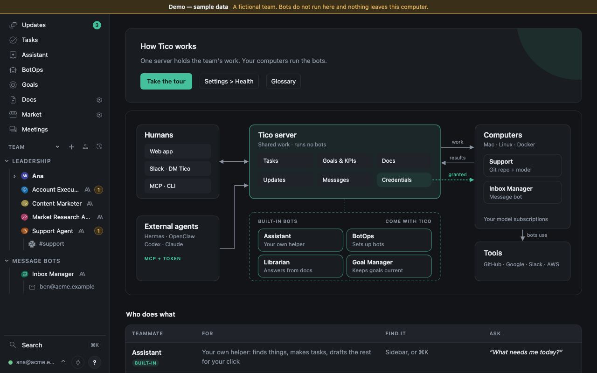

# How Tico works

One Tico server holds the team's shared work, and your computers run the bots. Humans reach the server from the web
app, Slack (DM Tico) or MCP and the CLI; each computer's runner asks it for work, runs the bot on that computer's own
model subscriptions and sends the results back. The in-app Help page (**?** in the sidebar) is kept short and links here.



- **Tico server**: tasks, goals and KPIs, docs, updates, messages and Credentials. It runs no bots
  ([Architecture](architecture.md)).
- **Computers**: your Macs or Linux and Docker machines, with the runner. Each bot is a Git repository with its
  Instructions and memory, on one computer.
- **Team**: humans and bots are teammates on one team chart, in groups.
- **Built-in**: four bots every team gets. The [Assistant](assistant.md) is each human's own helper and their one chat,
  the owner's too; the other three are helpers it hands work to. BotOps sets up and
  fixes bots, computers, Tools and Credentials; the [Librarian](librarian.md) answers from the team's docs and the Tico
  manual; the [Strategy Bot](goals-and-kpis.md#the-strategy-bot) keeps KPIs and goal status current. The [Task Manager](task-manager.md)
  and the [Health Monitor](health-monitor.md) are built-in helpers outside the chart: once an hour they look for tasks
  that stopped moving and for install faults, and wake only when they find something.
- **Message bots** work a human's email or a Slack channel. **External agents** (Hermes, OpenClaw, Codex, Claude) connect
  over MCP with a token ([Connect an external agent](connect-an-agent.md)).
- **Tools and Credentials**: a bot gets only the Credentials granted to it, and drafts to outsiders until its send switch
  is on.

### Who does what

| Teammate | For | Find it | Ask |
|---|---|---|---|
| Assistant (built-in) | Your own helper: finds things, makes tasks, drafts the rest for your click | Sidebar, or ⌘K | “What needs me today?” |
| BotOps (built-in) | Sets up and fixes bots, computers, Tools and Credentials | Sidebar | “Add a bot that answers #support” |
| Librarian (built-in) | Answers from your docs and the Tico manual, with sources | Ask the Librarian on Docs and on Strategy's Market tab | “What is our refund limit?” |
| Strategy Bot (built-in) | Keeps KPIs and goal colours current | Top of Goals; ask your Assistant | “Why is this goal yellow?” |
| Task Manager (built-in) | Tidies tasks hourly on weekdays: closes what is done, fixes drifted steps, one Needs-you line per department | Its “Task check” tasks; Settings → System | `hub task-manager status` |
| Your bots | Do the team's work from their Instructions | Team in the sidebar: chat or a task | “Draft replies to the open tickets” |
| Message bots (Beta) | Work a human's email or a Slack channel | Message bots in the sidebar | “Sort today's email” |

Claude Code, Codex, Hermes and OpenClaw (Hermes and OpenClaw are Beta) agents can join the same shared work from their own apps
([Connect an external agent](connect-an-agent.md)).

The rest of this page is the current system in detail. For a teammate's questions read [Using Tico](using-tico.md).
Words are defined in the [Glossary](glossary.md).

## The six nouns

- **Bot** — an AI teammate (teammates are humans or bots) with its own `bot-<slug>` repository, run on one registered computer,
  or run by an external agent such as a Hermes profile that reaches Tico with its own
  credential and is never dispatched to ([Hermes agents](hermes-agents.md), [OpenClaw agents](openclaw-agents.md)).
  Record states: `active`, `paused`, `planned`, `quarantined`. Live status while it works:
  `idle`, `running`, `waiting_human`, `waiting_bot`, `blocked`, `limited`, `crashed`, `paused`,
  `quarantined`.
- **Task** — a unit of work with a requester, an owner (bot or human), a title, a body and a
  note; a `lane` (`company` or `product`), a `rank` in its owner's queue, labels, links (a pull
  request first), and relations to other tasks (a parent, blockers, related, duplicates, follow-ups). States: `open`, `doing`,
  `waiting`, `review`, `ready`, `done`, `closed`, `declined` (`review` and `ready` belong to the
  product lane). The owner marks it `done`; only the requester, a person who can edit it, or the person it waits on closes it. Every
  task has a comment thread, on the record with the author.
- **Message** — one line in a conversation. Kinds: `say`, `ask`, `answer`, `notice`, `steer`. How it reaches a bot
  is one of three ways ([Steer, queue or defer](using-tico.md#steer-queue-or-defer)): **Steer** goes into the bot's
  turn running in that conversation now (when the harness can steer, `steer` in its manifest; otherwise right after
  it; a person's default), **Queue** goes right after that turn or now when the bot is idle, and **Defer** wakes
  nobody until the bot's next turn there or a deadline. Chat says which, and Stop and redirect ends the turn so the next
  one starts with that message. A requesting bot steers its delegated task's running turn with
  `hub message send --steer --ref task:<id>`.
  A bot's `ask` to a human is what lands in **Needs you**.
- **Approval** — a human's yes or no to one exact action. Kinds: `send`, `spend`, `publish`,
  `merge`. A bot may request one when uncertain about a specific action; authorized work needs no separate
  approval. Only a human decides; an approval is spent once and does not turn outbound sending on. Rules: `policies/approvals.md`.
  Each one records when its exact payload was ready (`ready_since`, when the request passed its checks) and whose decision
  it is (`decision_owner`, the person it was sent to); reads add `age_s`, and its card says "Ready 2 h 10 min, waiting on
  Sam". A release's publish approval waiting over an hour is a [Health Monitor](health-monitor.md) finding.
- **Routine** — a cron schedule owned by a bot: `id`, `title`, `cron`, `timezone`, `template`
  (a playbook file) or inline `instructions`, `labels`. Each occurrence becomes a task.
- **Goal** — what a human or a bot is for: a title, an owner (`company`, a human or a bot), the goal it
  supports (`parent_id`, optional) and a colour with a one-line note. The colour is set automatically
  from the goal's KPIs (or its owner's check-ins and tasks) by the built-in **Strategy Bot**; a human
  may override it, and it stays theirs until they hand it back. `done` or `dropped` when it ends. A task
  may name the goal it serves. Bots read theirs with `hub goal list`; nothing is pushed into a run.
- **KPI** — a measure that stands on its own: a name, definition, unit, direction, cadence and one owner.
  A goal links to zero or more KPIs and the target lives on the link (an improvement by a deadline, or a
  range to stay inside). Readings are facts with a period, evidence and a quality; they are never edited,
  and a correction is a new reading. A KPI with no fresh data is gray, never zero. Every bot also has
  automatic KPIs computed from Tico's own data. See [Goals and KPIs](goals-and-kpis.md).

The rules for all six live in the backend's write layer, not in prompts: a bot acts only as
itself; it may message only active bots and humans; at most 20 bot-to-bot messages per
conversation per hour and 10 unsolicited messages per human per bot per day
(`TICO_UNSOLICITED_PER_DAY`); one open clarifying question per task; the requester closes; an approval
is optional, decided by a human and consumed once. Bot requests to a human are linted:
a verb at the front of the title, a nonempty first line and under 120 words outside quoted drafts. A
problem is a warning: the task or message is written, and the response's `warnings` (also the task's
history) says what to fix next time; `TICO_STYLE_LINT=refuse` turns them back into refusals, `off` drops
them. A daily update's shape is checked the same way (`warning` on the posted update). Put the ask
first; the first-line check does not judge whether it is an ask. Replies to the human's own message are exempt from this
request-format lint, and so is a task on a custom type, which is a ticket on that type's board
rather than a request ([Tasks](tasks.md)); title and Credential checks apply separately. Refusals open a
review task at 3 a day. A refusal counts toward the pause only when it repeats one the bot already had that day (same
rule, same words): at 10 such repeats the bot is paused for an hour and resumes by itself. A bot's first try at
something new that is refused is recorded, not counted, until 30 refusals of any kind in a day, which also pause it
for an hour (a loop over new targets). A refused label change (rule `label`, which says who may make it instead)
counts once per task an hour, however often the bot retries it. Words that name another bot's folder or a `secrets/` path are written
as they are: naming a path opens nothing, so it is never refused or counted, only recorded (`path.mentioned`).
A message or task comment to a paused or quarantined bot, from a person or a bot, is kept and runs when it is back;
the reply's `warning` says so and when that is. Bot sends are bounded while it is held: once the messages from bots
waiting for it reach 200 items or 2 MiB in all, or 50 items or 512 KiB from one sender (`TICO_HELD_QUEUE_ITEMS`,
`TICO_HELD_QUEUE_BYTES`, `TICO_HELD_QUEUE_SENDER_ITEMS`, `TICO_HELD_QUEUE_SENDER_BYTES`), a bot's next message,
comment or notice to it is refused as `queue_full`. Every waiting message resume would hand over counts, whether
it waits as a job, a carry-note or in an external agent's inbox; a quiet one nothing carries does not. What was
already accepted is kept, a person's messages and system notices are never refused, and `queue_full` opens no review
and never counts as a repeat. A message Tico sends for a bot on its own (a finished run's answer to the held bot's
question) is only withheld (`reply.withheld`, reason `queue_full`): the run still completes with its text. A note is kept the same way when a person leaves it, or, to a
quarantined bot, its manager bot (the bot it reports to on the org chart). A new task or hand-off to a paused,
quarantined or planned bot is refused as `target_inactive`, with when the bot is back, and so is any other bot's note.
That refusal is the target's state, not the sender reaching too far: it opens no review and never counts as a repeat,
so one bot's quarantine does not spread to the bots that work with it. It does count toward the 30 a day, so a bot
retrying it in a loop still stops. When a quarantine lifts, by the cooldown or by a person or BotOps clearing it, Tico
leaves the bot a quiet note that its next run carries ahead of any older notes: the refusal that stopped it, and "Do
not retry this action; leave a note for a person if you still need it."

## The three places

**hub.acme.example** — the record, the interface and the clock. A FastAPI backend (`backend/`) on one
EC2 instance with SQLite on an encrypted EBS volume, attachments in a private S3 bucket, backed up
to S3 twice over (Litestream replicates about every minute; a verified bundle of the database and
every attachment is taken daily and restore-tested), behind Cloudflare Access. It holds every task, message, approval, routine, run and
bot setting, serves the web interface (`ui/`), and runs the scheduler that turns due routines into
tasks. It never runs a bot. It runs from the Docker image ([install.md](install.md)). Beside it
on the same host, the Slack gateway (`backend/slack_gateway.py`, its own unit) turns a DM to
Tico or an `@Tico` in a channel into a message for the bot the decision model routes it to, posts the
reply back under that bot's name, and stores everything else said in the channels Tico is
in so that each channel's readers see it within the hour (`docs/slack-gateway.md`).
Pages: **Tasks** (where the app opens), **Meetings** (imported transcripts, source sync status, Import, and each meeting's
action items), **Docs**,
**Tools**, **Changelog**, the **Team** tree, and under your email **Settings**
and, for the owner and admins, **SQL**. Tasks has List, Board and Done; Routines and wake rules are **Automations**.
Credentials are in **Tools → Credentials**. See [Navigation](navigation.md). A bot's page has **Chat**,
**Tasks**, **Docs** and **More**. The assistant (Tico, `coo`), BotOps, the Librarian, the Strategy Bot and the Task Manager are built in and cannot be archived or deleted (`409 system_bot`); the assistant
and the Librarian work in the background and are not listed for humans. Each human has one private **Assistant** chat, opened by **Ask** on every page
(also its own page, `#/assistant`, and the first tab on their own page): it looks things up at once, does low-risk things as that human, and
proposes anything with a side effect for their own click ([The Assistant](assistant.md)). The owner's chat is the
Assistant too: it hands strategy and goal work to the Strategy Bot, research to the Librarian and bot work to BotOps. There is no shared
Tico chat page and no Tico Live; humans can also act across Tico through their own external agent over Tico's
MCP ([Connect an external agent](connect-an-agent.md)).
The database itself is readable with plain SQL (`hub sql`, the SQL page, `POST /api/v2/sql`):
one `SELECT` at a time, each caller seeing only what the JSON API would show it, credentials never
([Querying Tico with SQL](hub-sql.md)).

**Your Mac's runner** — the Rust runner `tico-runner` (`runner-rs/`), with Python helpers in `runner/` for the side
jobs, registered once with **Add computer** in **Settings → Computers** (`scripts/setup-runner.sh`, credential in
`~/.config/tico/runner.json`). Four launchd jobs, installed and managed with `scripts/tico`:

| Job | Command | What it does |
|---|---|---|
| `team.tico.tico-bot` | `python -m runner run` (execs `tico-runner run`) | Heartbeats every 15 s with readiness, claims work for the bots assigned to this computer, runs each run in the bot's local repository with the local model CLI, streams output back |
| `team.tico.tico-connectors` | `python -m runner connectors` | Publishes calendar snapshots, executes Tico-queued calendar appointments, and pushes persisted mail from local Google access (Ana's Mac, or a Linux runner that holds the Google key) |
| `team.tico.tico-close-calls` | `python -m runner close-calls` | Every five minutes, imports available Close call and Notetaker meeting transcripts without fetching audio, using the local Close key (Ana's Mac only; `scripts/tico install close-calls`) |
| `team.tico.tico-importers` | `python -m runner importers` | Runs the meeting importers the owner turned on for this computer (Zoom, Google Meet, Granola), using credentials kept in `secrets/` here; see [Meetings](meetings.md#meeting-importers) (`scripts/tico install importers`) |

A Linux runner (the Docker image) has no launchd: with `TICO_SIDE_JOBS=1` (set by the image) `tico-runner run` supervises `importers` (while Tico assigns importers to this computer) and
`close-calls` (while the Close key is in `secrets/`) and `connectors` (while `secrets/google-sa.json` is there, or
Tico names this computer's owner in `TICO_PROCESSING_OPERATORS`) as child processes with restart and backoff
(`runner-rs/src/sidejobs.rs`). A Mac keeps its checkout-sibling layout; a Linux runner names the same places with
`TICO_PROJECTS_DIR` and `TICO_MAIL_VENV` (see [Message bots](mail.md#works-on-linux-runners)).

Logs are `~/.config/tico/logs/tico-{bot,connectors,close-calls,importers}.log`. The runner makes outbound
HTTPS calls only; nothing listens on the Mac. Model subscriptions (Codex, Claude, Gemini, Grok
Build) are signed in on the Mac and never leave it. Bot Credentials are stored in
**Tools → Credentials**, granted to each bot and delivered only for its run. Existing own files,
`_shared.env` and declared profiles migrate into grants on upgrade; new runs do not load those files.
Model API keys stored in Tico are separate from local subscription logins.
Each run gets a scoped credential in `HUB_API_URL`/`HUB_TOKEN`; the bot talks to hub.acme.example
through the `hub` CLI (`scripts/hub`) or Tico's MCP tools (`hub_*`, the same names with
underscores: `hub task create` is `hub_task_create`), and downloads attachments with
`clients/files.py`. The tool schema is `clients/hubtools.py` and is the contract; the two are
one implementation behind two transports. Codex and Claude runs get the MCP server for free
(the runner spawns `clients/hubmcp.py` with the run's credential); anything that speaks MCP
over HTTP can also `POST /api/v2/mcp` with a bearer token. Either way every call goes through
the same routes and `backend/hubdb.py` rules; there is no privileged path.

Calendar appointments are three shared Tico tools available to every bot:
`hub_calendar_list`, `hub_calendar_schedule`, and `hub_calendar_status`. Reads come from the
bounded calendar snapshot, limited to the team owner's or the bot operator's calendar
([calendar paths](mail.md#calendar)). A schedule call writes an idempotent Tico action; the private calendar tool
claims it once, creates the Google event and invitations locally, and reports the result. Bots must
see `succeeded` before saying the appointment exists. This path grants no generic Gmail authority.

One of those tools is a second model, the decision model. `hub_decision_ask` (`hub decision ask`) sends a JSON state and typed
questions to the decision model, and gets a calibrated answer per question back:
a choice with a confidence, a score on ordered levels, or the probability a statement is true (yes/no, choice and score: the question format of OpenRouter's Decisions API).
It writes no prose, so a bot uses it to decide (sort a listing, dedupe, route, gate a draft) and
its own model to write. Tico holds the one key and audits every call by label, never the
state (`backend/judge.py`); the decisions themselves are versioned files in `questions/`
(`questions/README.md`), which the meeting brain and the mail CLI read the same way a bot does.
`skills/decisions/SKILL.md` says when to reach for it.

**The bot's repository** — `acme/bot-<slug>`, checked out at `<projects>/bot-<slug>` on the
Mac that runs it (`~/tico-work` on Ana's Mac). The contract (`templates/employee-repo/`):

| File | What |
|---|---|
| `AGENT.md` (with `AGENTS.md`/`CLAUDE.md` pointing at it) | its instructions, what it owns, how it starts and ends a run; read every run |
| `bot.yaml` | `name`, `runtime`, `model`, `reasoning_effort`, `max_run_minutes`, `tools:`, `outbound_send` (`routines:` only in a template, as the seed) |
| `state.md` | current focus, open threads, next step |
| `memory/learnings.md`, `memory/decisions.md` | how to do the job; dated decisions |
| `knowledge/` | what is true in its domain, one topic per file, dated sources |
| `playbooks/` | repeatable methods; a routine's text is usually one of these |
| `reports/`, `software/`, `skills/` | dated deliverables, its own tools, runtime skills |
| `<slug>.data/` (sibling, never committed) | large or regenerable data |

Bots commit directly to `main`; the runner pushes after each completed run and once at start-up
for every assigned bot, and leaves a diverged checkout for a human (one log line an hour). Files
bots produce for the team are published to Tico's private store and listed on the bot's page
([Files](files.md)).

## What happens when

**A computer waits for work.** A runner holds one stream open, `GET /api/v2/runners/me/events`. When
something changes for that computer (a job queued for one of its bots, its bots or their settings,
the credentials or repositories they may use, a worktree to remove or restore, a sign-in, harness
action, credential import or quota read someone asked it for, Restart, its screen opened in the app), the server sends an event
naming what changed and never a value, and the runner re-reads only that. With nothing to say, the
server sends a keepalive every 15 s, which also keeps the computer *online*. The runner reports its
readiness (heartbeat) when it changes and at least once a minute, and re-reads everything once
every five minutes in case an event was missed. While the stream is down (a deploy, a network
change) or on a server from before it, the runner polls as it always did until the stream is back,
and picks up from the last event it saw.

**You send a message or file a task.** hub.acme.example saves it and queues a job for the bot. The bot's
runner hears of it on its event stream and claims it, does one run (prompt = `AGENT.md`, the conversation, the task,
your message and attachments), and streams the reply back. The conversation shows *Saved — queued*,
*Starting*, *Working*, then the reply. Closing the browser changes nothing.

**A routine fires.** The server (America/Los_Angeles unless the routine says otherwise) creates one
task for the bot with the saved instructions and version. Missed occurrences coalesce; a task still
open from the last occurrence absorbs the next one. The runner claims it like any task. Like any task
the bot owns, it gets its own room and session: the wake, the note and the bot's answer land there, and
the bot's main chat gets one-line reports ([Sessions](sessions.md)).

**A message to a bot may wake it, or wait.** One set of wake rules decides, each with an id: a person's message,
an ask, an approval and a gate verdict always wake the bot (`person_message`, `ask`, `approval`, `verdict`), except that a
Manager hears of a verdict as a note (`profile_manager_note`); a bot's own
write (`own_write`), news about a task that waits on something (`parked`), a stall check on a task that has not moved
(`same_state`; Stalled task check can let one wake through, see [Tasks](tasks.md)) and a plain bot-to-bot message (`bot_to_bot`) wait for the bot's next run; a deferred item waits too, until its deadline (`deferred`, [Steer, queue or defer](using-tico.md#steer-queue-or-defer)); a finished request and a
person's review comments are batched (`batch_*`); one check finishing is ignored (`pr_check`) and a head whose checks
all finished wakes the ticket's owner at a working step (`pr_checks_done`) or is a note (`pr_checks_note`); work wakes
(an assignment, a review request, a blocker, a routine, a due date, a finished subtask, a published release) and anything
no rule names waits as a note (`default_note`). Teams, task types, departments, bots and
single tasks can override these with rules of their own (the **What wakes** automations on the Automations page). Every message to a bot records the
rule that decided it, and every run records the rule that woke it, so `rule_weekly` in `hub sql` shows runs, tokens and
runs that did nothing per rule ([Querying Tico with SQL](hub-sql.md)).

Urgent task news covered by an existing urgent rule can still reach the bot when the task waits on an open
dependency: incident news, a party's blocker or action request, and direct review or sign-off requests keep their
existing audiences and deciding rules. The bot reads that news in a notice turn without starting the held task.
Quiet, ignore, own-write, snooze and duplicate controls still apply. The dependency stays in place and continues
to prevent task start and Doing or Review moves; other parked waits keep their existing behavior.

**The Mac is asleep.** Everything on hub.acme.example stays available and accepts work. After 60 s
without a heartbeat the bot shows *offline* and new messages show *Saved — waiting for <computer>*.
A sleeping Mac is not reliably absent: macOS wakes it for a few seconds at a time to check the
network, and the runner asks for work in those seconds. So a computer that has been silent for
more than 60 s must then report in without a break for two minutes before it is given anything.
Contact means a heartbeat, a claim or the runner's open event stream (a keepalive every 15 s), whichever
arrives: a wake of a few seconds never reaches the runner's heartbeat timer, so counting only heartbeats let each brief wake
stand on the record of the one before it and take work anyway,
and until it has, its queued work reads *Saved — waiting for <computer> to stay awake*. A brief
wake cannot take a 90 s lease it has no chance of finishing, and a computer that never went away
is unaffected — including every computer already enrolled when this rule arrived.
A run that was mid-flight loses its 90 s lease: not-yet-started work is re-queued; started work
becomes *Interrupted*. Fifteen minutes later (after the runner's own chance to reclaim it) the
scheduler settles what needs no eyes: a delivery whose task is already done or closed is dismissed,
and a run whose host reports its tool calls, that only read (files, searches, web pages, subagents
that only read) and consumed no approval, is resumed once, each with a note in the job's recovery
record (`job.auto_reconcile` in the event log). A busy bot's runs are settled too: the scheduler waits only
while a live run of the bot is on the same task (or the same chat, or the same task session). An operator can choose
**Try again** or **Don’t retry** in Stopped runs; while such a run is still live, Tico saves the choice and applies it
when that lane frees. BotOps’s review is done as soon as all its recovery choices are saved. Tico records the live-work dependency
in the recovery history and shows its ownership in Stopped runs. Within five minutes of that work ending, the
scheduler re-evaluates the stopped job and records who owns recovery and why.
When the computer reports a restart, a run resumes on the next scheduler sweep, including one that used a shell or
edited files. Its recovery note gives the interruption time and tells it to check what already happened first;
the same computer continues the same provider session. A consumed approval or a named irreversible outside action
(merge, publish, send or payment) holds it for BotOps instead, and the review names the action. A second interruption
is dismissed and BotOps is told. A stopped run is counted once however many requests were folded into it.
The computer records fixed operation labels alongside shell events without exposing
command arguments. Older program-only events from action-capable tools (such as `gh` or `npm`) go to review with a
command-details-unavailable reason; they cannot prove that no merge or publish happened.
Tico's update, or any restart of the server, cuts the runs live then, often with no restart report. An update never
waits for them: as it starts, Tico flags every live run (`attempt.update_cut` in the event log), and the server's start
flags the runs its last process still held. A flagged run that had started by then and ends without an answer within the lease plus fifteen
minutes of the server coming back (the snapshot and health check take minutes) was cut; so is one that began just
after the update and ended in that window. It resumes on the next sweep on the same computer and provider session,
whatever it used, with the same note: the interruption time and to check what already happened first; a recorded
named outside action or consumed approval is named in it, to verify before doing it again. There is no Needs you
item, BotOps review or question for it; the decision is in the job's recovery record (`job.auto_reconcile`, Stopped
runs history). One waiting for live work in its lane has that choice saved, and is judged again when the lane frees
(a Stop, a finished task or a day's wait since then counts; a person's own choice replaces Tico's). A request is
resumed from three such cuts; the fourth, or a cut more than a day old, ends it quietly.
A lost lease without a restart report resumes once after fifteen minutes when no consumed approval or named outside action was recorded. A second lost lease holds the job quietly for its computer and says Resuming; it does not dismiss the work or create a BotOps task. A server silence of up to thirty minutes extends existing leases once, so a twenty-minute renewal outage keeps the running session. **Unreleased:** safe runs held after a usage limit also recover automatically, as described below.
A known primary login reset keeps runnable jobs queued until that reset when no eligible fallback is ready;
a new message does not start another attempt on the spent login. An interrupted fallback returns to this queue
only when its host acknowledged the end, reported its tools completely, and recorded no output, tools or consumed
approval. Missing telemetry or any output or possible effect keeps the safe review path.
A quarantine stops each running turn through the runner's normal Stop response, carrying
`stop_reason`. Its end reason says *Quarantined: <reason>, resumes about HH:MM UTC*
(or *until a person clears it*). A run that only read, on a host that reports its tool calls,
and used no approval returns to the queue until the quarantine lifts; the bot's activity says it
will run again. Any other stopped run (one that used a tool that can change things, or whose host
does not report its calls) is held for review like a lost run, so lifting the quarantine never
repeats an outside action. An answer the run finished as the quarantine began is kept on the run,
never posted. A real lease loss still says the computer stopped answering. Later held runs are named on the bot's existing review task, and
closing that task while runs remain held reopens it on the next sweep.
Other runs stay *owner review needed*, because Tico cannot see what a
tool did on the Mac: BotOps is given the review unless the task is private, Settings names the held task and its owner to those
who may read that task, the review lists each tool call the run made, and the bot's operator or
BotOps resumes or dismisses it after checking what already happened. Nothing is lost or re-sent.
While such a review is owed the bot's tasks and routines wait, but a human's own chat
messages still run: nothing about them is uncertain.

**Needs you.** Every issue Tico derives says whether a human has to act. Those that do (a
review owed, a computer gone for more than ten minutes, a missing agent credential, a stale backup,
a usage limit hit three times) open in a dialog in front of the human the first time they appear,
wherever they are in the app. Each item is a title, at most one short line and at most two buttons: the title opens
the details (the stopped runs, with *Open bot*, or the bot, the computer or Health). Closing it is remembered per issue and *Snooze* quiets it for an hour;
the alert under the sidebar reopens it any time. Issues Tico resolves itself (a computer that
just dropped off, a usage limit that is retrying) stay out of the way as *resolves on its own* in
**Settings → Health**, one row per computer rather than one per bot. A cloud deploy is different: hub.acme.example is
unreachable for a few minutes, the runner keeps the run going and the server extends every
running lease when it comes back, so the finished reply still lands. The same forgiveness covers
a server that stalls without restarting (the daily backup runs at the lowest CPU and I/O
priority for this reason): a lease lapsing while the server has answered no runner for more
than half a lease period gets one more period instead of expiring, and a run that did
expire is handed back to its runner when the runner reports in within 15 minutes, as long as no
one has reviewed the job meanwhile (`attempt.lease-restored` in the event log). The runner's log
(`scripts/tico logs bot`) writes one timestamped line when the cloud becomes unreachable, a
progress line at most once a minute while it stays so, and one when it is back; `scripts/tico
status` says when the running bot job predates the checkout's current commit. On a bot's Chat
page, one line above the composer says when the bot is paused and why (a usage limit, a
quarantine, or a Mac offline for more than ten minutes) and that messages are saved, or that a
review is owed while chat still answers. Health and the bot page share the quarantine explanation: a refusal-count
pause names rule 8 and its UTC resume date and time, and a person who manages the bot also sees the refusal rule
and refused words, with credential values masked. It resumes by itself; a person who manages it can clear it sooner.
A manual quarantine lasts until a person clears it and promises no automatic lift time. For a safety
pause recorded before path mentions stopped pausing bots, what the check matched (a secrets path or another
bot's folder, in the bot's own words). Anyone who manages the
bot, wherever it runs, sees Resume bot beside the warning by its name and a card under More. The card says
Quarantined for repeated refused writes for an automatic pause, or Paused for review for a manual safety pause,
and shows the explanation above. A manual safety pause also shows the refused text (credential values masked)
and its task; one click releases that pause and the checks stay on.

**A subscription usage limit.** A safe run that hits one is saved as retryable and interrupted with `limited` set, preserving its checkpoint and provider session, so
the job stays queued however often this happens (it is never *Interrupted*) and the bot shows
*limited*. The limit holds the provider login, not just the bot: that runtime's sign-in on that computer, saved on the server so it outlasts a restart of the runner or the server. It holds
until the reset the provider names (Claude's "resets 2:40am (UTC)" included, even days away), or when none is named
or the named time has passed, 30 minutes, then 60, then two hours for each limit in a row on that login. A provider
that says its model is at capacity or overloaded for now ("Selected model is at capacity", HTTP 503, "try again in
20s", `overloaded_error`) has not spent the login's quota: that login is held two minutes, the streak does not grow,
a fallback can still take the run, and the bot's line and Health say *temporary model capacity*, a check or task
model's turn included; a quota hold already in force keeps its own end. Only a refusal before the bot sent a message
or used a tool is a run that did nothing. After the run acted, a runner that kept its thread queues one continuation
on that same thread after the two-minute hold, with a note to carry on without repeating completed work. It never
hands that continuation to a fallback or a fresh thread. If the thread cannot resume, or the continuation hits
capacity again, the run waits for review as *uncertain*. A missing CLI session is never rebuilt for a continuation, and a cleared session stays cleared. Older runners that cannot keep the thread hold it for
review immediately, and are never handed a continuation: it waits in the queue for a runner that can continue it. A quota or billing refusal ("Quota exceeded. Check your plan and
billing details.") stays a usage limit as above. While it
holds, no bot starts a run on that login: a bot whose fallback (its own, or the company's default) is signed in on
that computer and not held itself runs there at once, and the runner never tries the held login (the run's note says
*claude login held (usage limit) until 02:40 UTC; running this turn on codex*); only a bot with no such fallback
waits. **Unreleased:** if the primary hits its limit and the fallback fails before doing anything, Tico queues the run again.
It does not hold that safe run for review.
The bot waits for the reset rather than retrying that failed fallback; a different configured fallback can take over when ready.
The fallback's failed start does not hold its login, since it never ran.
Every login a turn ran out on is held, an intermediate fallback's too, even when a later one finished the
turn; a subscription profile that shares the computer's own sign-in counts as that one login; and only a run claimed
after a hold began can end it by working, so a run that started earlier and finishes later does not. When it ends, one queued run goes first; the others on the login wait for
its result, so a login sees one try per window however many runs wait. **Settings → Health** says whose login it is
and when it resumes. When the provider gave no known reset time, a person's message written after the limit
lets it try once at once. A known reset keeps new messages queued until then. **Try now** explicitly ends a hold (and also works while
only the bot's own login is held and its work goes on on a fallback); a run that
hits the limit again goes back to the hold. **Try now**, beside the warning on the bot's page and in its chat line for anyone who
manages the bot (`POST /api/v2/bots/{bot}/limit/retry`, BotOps as the person who asked), ends the
hold for that bot and every bot limited on the same runtime on the same computer, which share
the subscription (`limit.cleared` in the event log). As when a hold runs out, one queued run goes first and the rest
wait for its result: a success resumes them all, and another limit puts the hold back with the end it had, so a plan
that is still spent sees one run, not one per bot. While that run is out, Try now is refused as not limited. If the bot has a fallback
harness in **Settings → Bots**, the runner reruns that run at once on the fallback (fresh
session, given the conversation's latest messages, up to about 16,000 tokens, marked as history; never a
person's private Assistant chat) and
reports `fallback` as that harness, which **Settings → History → Runs** shows beside the model.
Tico is seeded with Gemini CLI as its fallback from Antigravity, so a usage limit uses
a stored `GEMINI_API_KEY` Credential granted to the bot. **None (fail)** means no hop:
the cloud cooldown applies.

A bot with no fallback of its own still gets one on a usage limit (a spend cap such as "monthly spend
limit" counts): the runner runs that turn once on the first of the company's other providers that is
signed in on the same computer, with that provider's default model (`fallback_models` in
`GET /api/v2/config`), and reports `fallback` with `primary_limited`. A provider signed in only by a key in
the environment is skipped (a turn carries only its own runtime's keys; Codex turns its key into a login).
A login on that computer that failed a turn on its usage limit is skipped until the provider's reset time, or for
30 minutes when the provider gives none, and the next provider in the list takes the turn (a subscription profile
that shares the computer's own logins counts as that login; a bot's own key is never shared with another bot). When the fallback itself
hits its limit, the same turn moves on to the next signed-in provider instead of ending. With no ready provider
the run is limited as above. A limit is named by the login that returned it: the bot's status, its run log and
Health say *Primary* or *Fallback*, the provider and login, and whether it was an API key's quota or billing refusal
or the plan's usage limit (with its 5-hour or weekly window when the provider says so), for example *Fallback codex
API quota or billing limit; primary claude not limited*. Each login keeps its own hold and retry time: a fallback's
quota never holds or extends the bot's own login, nor the reverse. A quota refusal before any message or tool call can
move to the next ready provider. A fallback that has worked before quota or capacity stops it keeps its confirmed provider
thread under that job on a runner advertising `source_continue_v1`. The next claim carries `source_continuation`
(provider, model, profile and session-clear epoch) beside `continue_thread`; the runner requires that exact session,
even after a runner restart. A changed login, cleared epoch or missing session never starts a fresh replay. The primary
conversation session stays separate. Before a fallback starts, its pending handoff fences the old primary identity;
its confirmed side session is then saved locally and on the server while the turn is still running. A safe lost lease
can therefore continue that session once, even before any quota/capacity result. An unconfirmed side session never
resumes the old primary; unknown effects and final answers keep their settlement safeguards. Late diagnostics cannot
erase an already recorded continuation decision. The result field is sent only when the server advertises `source_continue`;
older runners are not handed these continuations. Other turns try the bot's own provider first, so the
bot moves back on its own once the limit resets. The owner turns this off in **Settings → Models**
(*Fall back when a plan runs out*, `auto_fallback`). Overview lists how many bots are on a fallback and
since when, and how many are limited.

**Held runs after a usage limit (Unreleased).** Safe runs previously held after the primary hit its limit and the fallback failed to start recover automatically.
Tico puts them back in the queue, oldest first, after the provider's reset, a model change, or a configured fallback becoming ready.
The usual queue priorities still apply when the bot takes work.
Tico dismisses a held run with a reason if its task is already done or closed.
It also dismisses a safe usage-limit run if a later completed run of the same bot on the same task covered its work.
A later answer in a separate chat does not count as covering that task.
The bot's activity describes automatic recovery in plain words, without naming private tasks: for example, *Tico resumed 2 runs held by a usage limit*.
It also reports when a later run already covered dismissed work.

A run that used an approval, or may have taken an action, still needs review before resuming.
The bot's operator or BotOps checks what happened before choosing to resume or dismiss it.

**A provider limit inside another error.** Tico reads the text of every failed run itself, so an older computer that did not flag the
limit is treated the same as a current one: a provider limit named anywhere in an error (*Prompt is too long · automatic compaction
failed: You've hit your weekly limit · resets Oct 26, 8pm (UTC)*) is a usage limit and holds the login until the reset it names. An
error that says the session grew too large to send (*too many total text bytes*, *Prompt is too long*) makes the next run on that
thread compact its session first; if that run fails the same way, the next one starts in a fresh provider session, as Clear does
([Sessions](sessions.md#checkpoints-and-resume)).

**Run time limits.** A run cut by its configured time limit continues on the same task and provider session.
The task says “Reached its 60-minute run limit; continuing” with its actual limit, and the continuation receives
any hand-off note left on the task. Local edits, shell commands and branch pushes do not require review.
A named merge, publish, send, payment or consumed approval still holds the run for BotOps to check.
Like restart recovery, a time-limit continuation also permits a harness that does not report tool calls
when no named outside action or consumed approval was recorded; it must check previous work before continuing.
Two consecutive time-limit cuts hold the job with an open review task; a run that finishes inside its limit
resets that count. Provider quotas and the Gateway credential lifetime limit keep their existing recovery rules.

**Failed runs wait, then stop.** A run that fails within 60 seconds of starting did no work and will fail the same way again. The bot
waits before its next run, 15 seconds after the first such failure, doubling each time up to 8 hours; a run that completes normally
starts the count over. A message a person sends during the wait runs at once (it is the retry someone is watching), and
its failure counts like any other. A run a person stopped, a usage limit, a model at capacity, a handed-back run and a failure after 60 seconds do
not count. After five in a row Tico holds the bot: nothing it has queued starts (a person's message included; it is kept and
starts when the bot runs again), the bot reads *paused*, a message to it says why ("Saved — waiting: Tico stopped <bot>: its last 5 runs
failed within a minute ..."), the bot's operator gets one Needs-you item, and Health shows `run_hold` naming the kind of error.
A held bot is not stuck until someone notices: Tico tries one run on its own 30 minutes after the hold, and after each try that
fails within a minute again waits twice as long (up to 8 hours). The try is the first queued job in the usual order, a person's chat
message ahead of the rest; only one is handed out per window, however many lanes or computers the bot has. A run that completes
normally releases the bot (its Needs-you item closes, event `bot.run_recovered`), so a provider outage or a network drop that has
ended lets every bot it held go again without anyone, while a bot that is really broken makes only a few runs a day. A try that
fails after more than a minute changes nothing. **Release** (Settings → Bots, `hub bot release <bot>`,
`POST /api/v2/bots/{bot}/release`, MCP `hub_bot_release`) lifts the hold and its Needs-you item at once; `GET /api/v2/bots/{bot}/budget`
shows the hold's `next_try_at`.

**A queued run Tico cannot start is held by itself.** Each claim checks the queued jobs it considers and prepares the
one it hands out. If an error happens for one job there, the claim rolls back only that job's writes, logs its
traceback on the server, and holds the job for a wait: a minute at first, doubling with each failed try, up to an
hour. The held job reads *Couldn't start: an error while preparing this run* on its task, the bot's one Needs-you item
covers all its held runs, and Health shows `claim_failed`. When the wait ends the run is free and the next claim tries
it again; a run that starts clears its hold, and one that fails again waits longer. Until its wait ends, a running turn
of the bot does not take the held run in as a follow-up either. A claim holds at most three jobs and goes on to the
bot's next job in the same call; the bot's other work is not held. A full disk or a locked database is not one job's
error: the claim answers with a retryable error and holds nothing. An error in one bot's own check (its budget,
back-off or login as a whole) passes that bot over for the claim and holds none of its runs. Tico runs that check
again only after a wait: a minute, doubling with each failure in a row, up to five minutes. Health shows
`claim_check` until one of its runs starts. A login hold that raises for one job holds that job alone. A team-wide
check that raises fails the claim. **Release** (Health, `hub
bot release <bot>`, `POST /api/v2/bots/{bot}/release`) frees the held runs at once, whatever their wait, and one that
fails again is held again. A held run whose task finished meanwhile is cancelled by the next claim once its wait has
ended.

**Run budgets.** Each bot has `turns_per_hour` (default 300) and `turns_per_day` (default 2500); the owner and administrators set the
team defaults (`GET/POST /api/v2/settings/turn-budgets`, `hub team budget [--hour N] [--day N]`), and a bot's owner, operator or BotOps
sets its own (`GET/POST /api/v2/bots/{bot}/budget` with `expected_revision`, `hub bot budget <bot> [--hour N|default] [--day N|default]`,
MCP `hub_bot_budget`). 0 is no limit. Runs are counted when Tico hands them out. A run that would pass the budget is not started and
the bot is held with: "Tico stopped <bot>: <n> runs in the last hour. This looks like a runaway loop, not normal work. Check its last
runs, then release it or raise its budget." (a day budget says "in the last day"). A person's own message is never refused by a budget,
and queued work is kept. `hub bot budget <bot> release` (or Release) lifts the hold and the count starts from then; raising the budget
above the count lifts it too. Health shows `turn_budget` and the operator gets one Needs-you item.
For example, a failed fallback that did nothing can retry after the reset; a stopped payment run that used an approval needs review.

<a id="one-turn-per-chatgpt-login"></a>**Codex bots share a ChatGPT login.** Bots on the same computer using
one ChatGPT sign-in run turns at the same time, just as Claude bots do. This includes every bot on the
computer's login and separate task lanes of one bot.
They share the plan's usage allowance; when it runs out, the usage-limit and fallback rules above apply.
A busy ChatGPT login does not queue another bot's turn or show a login-wait message. Codex has
`one_turn_per_login = false` in its harness manifest; the optional login queue is dormant.
Tico keeps using the original login in its own home. It never copies a login into another bot's home:
copies can rotate apart when the provider refreshes the token.

**Settings → Health** counts this company fallback: a limited bot covered by it gets no "has no fallback
model" finding. When a computer's default login (no subscription) keeps stopping on a usage limit, Health
says so once per computer and tool, e.g. "Team box's default Codex login is out of quota", until a turn on
it completes or the reset time passes ([Health Monitor](health-monitor.md), `default_login_limited`).

The company's **check model** (*Check model* in **Settings → Models**, `check_models` on
`/api/v2/providers`) is what review and check subtasks run on when they name no model: an ordered list such as
`grok, codex`, each entry a runtime or `runtime:model`. The other enabled providers follow it, in their order. The
pick is the first from a provider other than the one the work was written on; with none that can run, it runs on
the author's own provider and the task's history says so. Another provider is preferred, never required. An entry whose provider is off or whose model is retired is skipped, and a
runtime alone follows its provider's current model. `check_order` in the same view is the order in effect.

**A bot's session is its own** ([Sessions](sessions.md)). By default every task is its own provider thread, and the bot's
chat and other turns share one more. BotOps (and any bot set to `session: task`) also gives each
chat conversation its own thread, so unrelated requesters stay separate; `session: bot` keeps
everything on one thread. A subtask someone else filed continues its parent task's thread when the bot owns both; one the bot filed for itself gets its own (`subtask_session: own` gives every subtask its own). Each bot task has its own room, so the main thread reads only the main chat plus a quiet line when a task starts, is blocked, done, declined or stuck ([Tasks](tasks.md#subtasks-and-prs)). Wakes about the same task resume its thread. A task's set-up worktrees
on that computer join its session (Claude Code's `--add-dir`), and the prompt carries each repo's
AGENTS.md (else CLAUDE.md), labelled as rules for writing code there that never grant access;
a link out of the worktree is refused, the whole is capped at 16 KB, and a resumed thread gets
them again only when they change. A bot's chat and its own thread use the local
`bot-<slug>` checkout one turn at a time; with a session per task, each task's turns run in that
task's own worktree (`sessions/bot-<slug>/<task>`), beside the bot's other tasks. A bot never has two turns on
one task at once: a wake about a task its turn is on goes into that turn, or waits for the next one there. A bot's own
**Turns at once** caps its turns across all computers; at the limit its queued work waits and says so ("At its turn
limit"), and its other bots keep their turns. A task a bot
files for itself during a turn starts its own turn once that turn ends (or after 5 minutes), and not at all if that
turn finished, declined or parked it. Only that
computer knows which thread
it is. Tico never ends a thread, never asks the bot for a checkpoint before a model or computer
change, and never rebuilds history into a prompt (a fresh session on a task starts from the task's last
checkpoint, [Tasks](tasks.md#picking-work-back-up)): when the conversation fills the model's window
the runtime compacts it, and a run carries only what the room said since the bot last answered.
A bot that wants what was said before reads it with `hub conversation show <conversation id>`: the
newest 200 messages, then `--before <next_before>` for each older page. Every run's prompt names the
conversation and that command, because a compacted session, or one on a new model, no longer holds
all of it. The runner fast-forwards the checkout from origin before the run, and
pulls or clones any `reads:` sibling repos beside it.

**A bot needs you.** It asks with `hub task ask` (the task goes `waiting`), requests an approval,
files a task for you, or sets its own task waiting on you (`hub task update --status waiting --on
<you> --note "<what you need to do>"`). A bot's waiting note, or the first paragraph of a task it gives
you, must say in one or two plain sentences what it needs and what happens after, with no ids, file
paths or tool names; Tico refuses it otherwise. A task a bot set waiting on you before that rule, with
no plain ask, sits at the bottom of Needs you as "Waiting for <bot> to explain" while the bot is asked,
once, to restate it. All of these appear in **Needs you** at the top of **Tasks** with
**Reply**, **Approve** / **Decline**, **Done** / **Close**. Needs you is your queue: approvals and
questions first (each blocks a bot), then your own tasks in rank order. Tickets on a numbered type
stay on their board and come to Needs you only with a question for you ([Tasks](tasks.md)). There
is no priority; a mover (anyone in the leadership, product or engineering group) drags a task up or
down, into another column, or between lanes; everyone else sees the board and comments.

**A bot finishes.** It commits its repository, marks the task `done` with a note, and the reply is
saved in the conversation. The task shows under **Tasks → Done** with the bot's note; a bot that
requested it gets a *Finished: <title>* message (`/api/v2/messages?unread=1`) and may choose Close.
Its requester or a person closes it; until then its owner can reopen it with `doing`, or put it back with `open` and a note. Every run is listed under **Settings → History → Runs** and on
the bot's **More** tab.

**You change a bot's Instructions.** Open **Bot → More → Instructions → Edit Instructions**
and ask BotOps to make the change. It commits and pushes the update for the next run. For a manual edit, change `AGENT.md` (or a playbook, `memory/`, `knowledge/`) in
`bot-<slug>` and commit. The runner reads the checkout on its Mac at the start of every run, so
the change is live on the next run once that checkout has it: push, and pull on the runner Mac
if you edited elsewhere. Do not edit while the bot is running there.

**You change a routine.** Routines are automations in Tico (`docs/routines.md`): edit one on the
Automations page, or a bot changes its own with `hub automation update`. The change is in
the table at once; a sleeping Mac does not block it. **You change a bot's switches.** Tools
read `tools:` from the Mac checkout each time a bot sends or posts; whether it may send without approval comes from the mail switch a person sets in Tico (`outbound_send` in bot.yaml only asks). Model, effort, computer, humans, name,
status and reporting line are changed in **Settings → Bots**, not in the file.

### Profiles

A bot's **profile** says what wakes it and which tasks it takes. It is a fixed set of wake rules for that bot, a batch
window and a gap between sweeps, and it grants no right.

| Profile | Wakes at once for | Everything else | Takes |
|---|---|---|---|
| **Doer** (the default) | people, hand-offs, asks, awaited results | batched, 15 minutes | any task; pulls its open tasks by itself |
| **Reviewer** | its review or QA request, a verdict it waits for, people | a note | review and QA requests only (a subtask titled Review 1/2, QA or Security, a live-acceptance check, or a top-level "Release QA:" / "Post-release QA:" task); any other task is refused with the reason |
| **Lead** | people, escalations, a ticket it asked for ending declined, blocked or done, approvals | one digest a day (09:00 team time by default) | any task, started only when a person or a bot asks |
| **Manager** | people, a task given to it, its own clock, its exceptions list having a new entry | a note for its next run, verdicts and its subtasks' results included | any task, started only when a person or a bot asks |
| **Responder** | people | a note | no task: refused like a bot synced from another platform |
| **Monitor** | its own watcher, people | a note | its watcher's tasks only |
| **Custom** | what its rules say | its rules | what its settings say |

A bot's own clock still wakes it: a routine or schedule wakes a Reviewer, Lead, Manager and Monitor, and a due date or a
snooze ending wakes a Lead, Manager and Monitor; a Responder has no routines. Stall and status checks run only for a Doer (and for a
Custom bot that keeps them on). Doers pull open tasks themselves; the others start a task only when it is handed to them.
**Custom** copies the profile's rows into the Rules table, marked as the profile's, to edit there; choosing a named profile
again deletes them after a confirm. Set a profile in **Settings → Bots → Edit**, with `hub bot profile <bot> [name]`, MCP
`hub_bot_profile`, or `POST /api/v2/bots/{bot}/profile` with `expected_revision` (`GET /api/v2/profiles` lists the choices
with a line each); the bot's owner, operator, a person it reports up to, or BotOps may. The profile also shows on every bot read.

Starting the server gives each bot without a profile one by its name once: `*-monitor`, `*-watch`, `listening` and
`sentry-triage` are Monitors; `*reviewer*`, `qa-*`, `security*` and `reviewer-*` Reviewers (a bot named `pr-reviewer` that
owns Dev tickets stays a Doer); the leads, the C-level Heads and `*-manager` Leads; the Assistant and bots synced from
another platform Responders; BotOps, the Health Monitor, the Task Manager and the Librarian Custom; everything else a Doer.
Each owner gets one notice naming their bots and profiles. The old wake preset is part of the profile: Token saver became a
Doer with a 30-minute window and Performance a Doer; `wake_preset` and `POST /api/v2/bots/{bot}/wake-preset` still read and
set that window. **Keep N tasks going** stays the Doer's cap. Health reports a Reviewer that owns tasks other than reviews,
a Responder with tasks, and a Doer whose runs for a week all did nothing.

## Calling the API from a script

A human is normally the browser sign-in (Cloudflare Access). A **personal API token** is the
same human from a script, a cron job or another computer, with no browser: any human (the owner may
limit it to admins, Settings > People) opens **Connect an external agent** beside their email
(or **Settings → Computers → API tokens**), gives the
token a label and a life (90 days unless changed, a year at most), and copies it once; it is
not shown again and only its hash is kept. Then:

```
export HUB_API_URL=https://hub.acme.example HUB_TOKEN=tico_pt_...
hub whoami            # human:<you>
hub sql "SELECT slug FROM bots"
curl -H "Authorization: Bearer $HUB_TOKEN" https://hub.acme.example/api/v2/bots
```

No `HUB_BOT`: the token is you, not a bot. It is you for every purpose, with the rights you
have in the browser (a member sees what a member sees, an admin adds bots for their own
account, the owner does what the owner does), and it leaves the same audit trail. What a token cannot do is make or revoke
tokens or make another standing credential (a bot's agent credential, a pairing); that takes a signed-in browser, and a
service key it makes ends with it, so a leaked token cannot extend its own life. Revoke one on the same page, and it stops
at once; the owner and the Admins see and revoke anyone's. Every token
made or revoked is an `events` row (`token.create`, `token.revoke`).

## Where things are

| Directory | What |
|---|---|
| `backend/` | the cloud API, authorization, write layer, scheduler, backups (FastAPI, SQLite) |
| `runner-rs/` | the local runner (`tico-runner`): enrolment, readiness, leases, runs, harnesses, updates |
| `runner/` | the runner's Python helpers: the `python -m runner run` shim, connectors, Close call and meeting import, catalog set-up, the update process |
| `clients/` | what bots and the runner call: the `hub` CLI, the HTTP client, attachment download, routine validation, preflight, the docs read and write commands |
| `connectors/` | shared Slack, mail/calendar and browser adapters bots use instead of vendor APIs |
| `integrations/` | one page per outside system (what it is, how a bot uses it, rules, recipes) and the query lists; served as **Tools** and `hub tool show <service>`, with the learnings bots add |
| `questions/` | the question sets the decision model answers (`hub_decision_ask`, `hub decision ask`, `mail inbox --decisions`, the meeting brain): one versioned JSON file per decision, with its thresholds |
| `ui/` | the web interface (`index.html`, `app/` scripts, `styles/`, feature scripts, browser tests; see `ui/README.md`) |
| `app/` | the native macOS shell around hub.acme.example |
| `infra/` | the EC2 stack, release packaging, deploy and restore scripts |
| `scripts/` | `tico` (operate the runner), `hub` (the bots' CLI), setup, publishing and maintenance |
| `docs/` | team knowledge |
| `policies/` | rules every bot follows: approvals, access, handoffs, writing, shared rules |
| `registry/` | bootstrap data: humans, sign-in access, mail rules, Slack channels; `employees.yaml` seeds a new database only |
| `templates/` | the bot repository contract and prompt templates |
| `skills/` | shared runtime skills for bots |

To reopen a finished task, open it and choose **Reopen**. After **Done**, the toast offers **Undo**.
Reopening clears its completion dates and closer, so Goals and KPIs count it as active again;
the earlier completion stays in task history. Questions may be asked in sequence, with one open
clarifying question on a task at a time.

An ordinary bot-to-bot `hub message send` starts work but does not return the receiving bot's
final answer. Use `hub question ask` (`hub_question_ask` over MCP) when you need an answer.
A bot receiving an ordinary message that asks for a reply sends that reply explicitly with
`hub message send`. Humans' chat replies and ask-message answers are delivered automatically.

A bot answers an ask with `hub question answer <message-id>` (`hub_question_answer`) only from a run
that can see the ask's conversation: the discussion of a task it can read (one it owns, requested
or is delegated), or a conversation its current turn was handed. The exception is an ask between
the bot and a single person that is not on a task, whichever side asked: it is reachable from any
of the bot's runs. From any other run the answer is refused with "This conversation
is outside the current execution context", and the ask stays open. There are two ways on:

1. Pass the information without resolving the ask: `hub message send <asking-bot> "<answer>"
   --conversation <conversation-id>`, naming a conversation this run can see and the asking bot is
   in, such as the current task's. The same visibility rule applies to `--conversation`, so the
   ask's own conversation is refused here too. The original ask stays unanswered.
2. Resolve the structured ask from a run whose context contains it (the turn it was delivered to,
   or the task whose discussion holds it), or have the asker ask again where the answering bot can
   answer, for example on a task that bot owns.

Computer readiness covers only bots assigned to that Computer. Eligible bots are placement
options, and their missing repositories do not count as readiness or Health failures there.

## Task pipelines

Task types add named steps above the existing status contract. General is built in and backfilled
onto existing tasks. Every status write maps to a compatible step, or clears the step when the
type has none, so older runners and scripts keep working. Movers manage definitions
in Settings → Tasks; the board's type filter uses steps as columns. See [Tasks](tasks.md).

## On computers

Each computer keeps base clones of ticked repositories that its assigned active bots can reach in
`<workspace>/repos/<owner>__<repo>/`, beside the existing bot folders. The runner checks the list
each heartbeat, clones one repository per cycle in the background, and fetches at most every
15 minutes. These are plain clones of the default branch; setup commands and task worktrees
come in a later phase. Fetching uses a temporary GitHub App read token kept out of git config
and logs. Run tokens still follow each bot's own repository access.

Heartbeats and `scripts/tico doctor` report each base clone's state, last fetch, disk use and
any error. A base clone failure does not change a bot's readiness. A clone that has been absent
from this computer's repository list for 30 days is removed from `repos/`. Older servers without
the repository endpoint leave this feature idle.

Outside source failures are isolated by computer, login profile and runtime. The provider's absolute reset time wins over a later status refresh, and a claim releases an expired reset hold even between scheduler ticks. Repeated observations update one durable source incident; only its start and recovery send quiet notices to Engineering and Health, with the since time, waiter count and expected return. Waiting automatic notices use the existing history/digest batching, while interrupted jobs retain their own checkpoint. Human bulk finish/close writes one count-only next-run note per recipient; task details remain on their original tasks, including for paused recipients.
