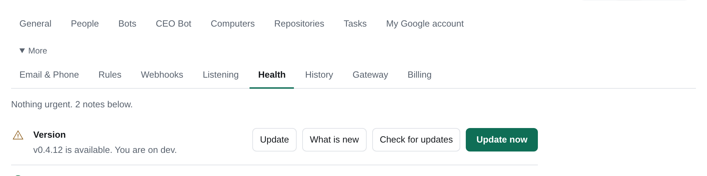

# Install Tico

Tico has two parts. The **server** holds the app, the team's data and the sign-in; it runs no bots. The
**computers** run the bots: a Mac, or any Linux or cloud computer, each joined to the server with a one-time code.
Both parts are Docker images (linux/amd64 and linux/arm64):

| Image | Holds | Size (pull / on disk) |
|---|---|---|
| `ghcr.io/ticoteam/tico` | the server and Litestream backups | 106 MB / 450 MB |
| `ghcr.io/ticoteam/tico-runner` | a runner with git, gh, node, python, build tools, ripgrep, jq and curl; no model CLIs (it installs them itself, see [harnesses](harnesses.md)) | 268 MB / 1.1 GB |
| `ghcr.io/ticoteam/tico-updater` | the one-click updater | 74 MB / 310 MB |

```
browser -> caddy (HTTPS) or cloudflared --> server :8765 (data volume)
                                                 ^
                    Mac (native) and Linux runners join from anywhere over https://<your domain>
```

## Recommended setup

The quick start below with the recommended choices already made: a **sample company** (Sample Co: the Assistant and
four role bots with short starter tasks), models on **your Claude and ChatGPT subscriptions, plus Tico Gateway**, **Tico
Support on**, and a computer on this server that runs the bots (a Docker runner on the server's network, named *Server
computer*). There is no domain, DNS or sign-in provider to set up:

```
curl -fsSL https://github.com/ticoteam/tico/releases/latest/download/install.sh -o install.sh && sh install.sh --recommended --owner-email you@example.com
```

Run on a terminal with no options, the installer asks which setup you want and offers this one first (press Enter); with
any option, or piped without a terminal, it asks nothing and installs as before. It
prints the owner sign-in link, as the quick start does. What is left is one step: open the link, then **Settings >
Computers > Server computer > Sign in**, to Claude and to ChatGPT.

A local install has no public address, and it can still link to your Tico company (**Settings > General > Tico company**,
with a server code from app.tico.dev Hosting > **Connect your own server**) for Tico models and billing. It shows there as
a local server, with no Open link.

- `--support off` turns Tico Support off (`TICO_SUPPORT=off`: the **?** chat sends nothing; [PRIVACY.md](../PRIVACY.md)).
  With Support on, its tickets are tied to this install. On an installed Tico, `sh install.sh --local --support off`
  (or `on`) saves the switch and restarts; every other setting stays as it is.
- The Gateway is enrolled from an invite whoever runs the install puts in the environment, `TICO_GATEWAY_INVITE`; you
  never type it, and the installer never prints it. With one, the Gateway connects on Tico's first start; without one
  the install still runs, on your subscriptions, and says the Gateway is not set up.
- If the server computer cannot start, Tico keeps running and the installer says how to add it from **Settings >
  Computers > Add computer**.
- It writes `TICO_INSTALL_PRESET=recommended`, `TICO_SAMPLE_COMPANY=on`, `TICO_MODELS_PRESET=subscriptions-gateway` and
  `TICO_SUPPORT` into `.env`; the server reads them on its first start. Every other choice below (the quick start, your own
  domain with Google, Microsoft or Cloudflare Access, your own API keys) installs as before.

## Quick start on your own computer

To use a team selected in the org-chart picker, export `tico.company.yaml` and pass it to the setup wizard:

```
python3 -m pip install PyYAML
python3 -m setup --company-file ./tico.company.yaml
```

Choose this server, an existing SSH server, or AWS; the wizard configures the usual sign-in, DNS and HTTPS.
The same flag works with the non-interactive cloud setup. The company YAML file and its normalized plan must each
fit within 512 KiB (524,288 bytes). Setup refuses larger files or plans before provisioning. It validates the file, uses its
company name, and carries the normalized plan privately to the server. On first startup the app creates the selected
AI employees and reporting lines, adds its built-in roles once, and leaves employees marked **later** paused.
It preserves the plan across retries and refuses to replace an existing company. A selected file takes precedence
over the recommended sample company. Charts up to 300 seats fit. AWS setup creates a private, encrypted bucket in
your account, with public access blocked and a one-day expiry rule. It copies the plan to the server and deletes the
bucket's copy once the app reads it. SSH and local setup write the plan to a private file, checking its checksum before
starting Tico. The chart stays out of the server's environment and AWS Parameter Store size limit.
See [Finish setup](onboarding.md) for file support and choices saved for later. You can also install without
`--company-file`, then on the first Welcome step in Tico, under **Already chose your team?**, choose the file in
**Company YAML file** and click **Use this team**.

Nothing to set up first: no domain, no DNS, no sign-in provider. Tico runs on this computer only, at
`http://127.0.0.1:8765`, and you sign in as the owner with a token kept on this computer. Add a domain and sign-in
later, when other people need in. It takes about two minutes and needs Docker: on a Mac or a Windows PC, open Docker Desktop
first; on Linux the installer installs Docker for you.

Run the installer with `--local` (a Mac or Linux; it asks for your email when you leave `--owner-email` out):

```
curl -fsSL https://github.com/ticoteam/tico/releases/latest/download/install.sh -o install.sh && sh install.sh --local --owner-email you@example.com
```

The line saves the installer as `install.sh` in the current folder (replacing one already there), so it stops with an error when `curl` is missing or the download fails; on a bare Ubuntu or Debian,
run `sudo apt-get install -y curl` first. That installs the newest release; to pin one, use `releases/download/vX.Y.Z/install.sh` instead of `releases/latest/download/install.sh`.
Files go to `/opt/tico` on Linux (it uses `sudo`) and to `~/tico` on a Mac (no `sudo`); `--dir` changes it. Port 8765 is the default; use `--port 8877` if it is occupied. By hand, set `TICO_PORT=8877` in `.env`.
The public, runner and MCP addresses follow this port. `TICO_PUBLIC_URL` and `TICO_RUNNER_URL` override their defaults.
To prefill Finish setup, add `--owner-name "Ana" --team-name "Acme"` to the local installer command; `--company` remains an alias.
To start with a team exported from tico.team/setup, add `--company-file ~/tico.company.yaml`: the installer packs it with the server's own code and the team loads on the first start (with `--recommended` it replaces the sample company).

It prints a reusable private owner sign-in link. Keep it private: anyone with the link on this computer can sign in as you.
Recover the token any time with `docker compose exec server cat /data/local-owner.token` in the install directory.
Open the link in your browser: the app opens on **Finish setup**. Then:

1. **Choose AI providers** (optional): **Your Claude and ChatGPT subscriptions, plus Tico Gateway** is recommended
   ([the four choices](ai-gateway.md#choose-how-bots-get-their-models)). To choose later, select
   **Your company's plans or API keys**, untick its providers and press **Skip for now**. Bots need a provider
   to run; until then each bot says "Add an AI provider", and **Settings > Models** adds it.
   With a gateway key from Tico, the [Tico AI Gateway](ai-gateway.md) card there adds the Tico picks (department, level, Fast, version).
2. **Name the team**, say what it does, and pick its groups. A few bots are suggested for each group. For the first result
   below, pick **Marketing** and keep **Content Marketer** (`content`) checked; untick the other suggestions if you want only it.
3. **Add computer**: choose *A Linux or cloud server (Docker)*, press **Add computer**, and run the line it shows on this computer.
   It joins the server's own Docker network, so it needs no domain, and the computer shows online in a few seconds.
4. **Create my team.** The four built-in bots are created automatically. Each other role you picked waits as a Recruiting seat;
   recruiting one creates a bot in **Needs setup** until you talk to it. A switched-on Inbox Manager is the exception: it is made as a bot linked to its mailbox.
5. **Sign in to your models.** For either Claude and ChatGPT subscription choice, sign in to each model subscription you chose:
   Claude Code and Codex (ChatGPT through Codex). One signed-in model is enough for the first result; Health lists the others
   until you sign in. **Tico Gateway only** needs no model sign-in. In **Settings > Computers**, wait for each
   selected harness to be installed, then press **Sign in** beside it.
   Open the provider link and enter its device code, or paste the returned code into Tico when asked.
   Wait for the computer's model sign-in to show **ready**. Other harnesses use their own terminal sign-in; API credentials and
   profiles are explained in [Harnesses](harnesses.md). Pick a provider in **Settings > Models** if you skipped it,
   then choose the starter's model in **Settings > Bots**.

**Unreleased wizard layout:** Provider checkboxes appear only under **Your company's plans or API keys**.
The Computer step shows sign-in commands for your provider choice ([Finish setup](onboarding.md#the-screens)).

### Your first result

One bot, one fictional input, one reviewed draft: **Content Marketer** writes a short blog post about a made-up product, a
person reviews it, and the person who asked closes the task. [Demo mode](demo.md) does not run bots, so do this on an install
like the one above.

**You need** the install above with its computer online, and one model sign-in on that computer: a ChatGPT sign-in for Codex,
a Claude sign-in for Claude Code, or an API key ([Harnesses](harnesses.md)). No GitHub account, outside Tool or real company data.

1. **Check the AI provider is ready** before any real work. Open **Settings > Health**: **Models** should read "Codex is signed
   in." (or Claude Code). "No AI provider is chosen yet" or "No online computer is signed in to your model" means stop and follow
   [First-result recovery](#first-result-recovery). Runs cost what your provider charges; [Usage](usage.md) shows the estimate.
   With no spending limit set (the default) there is no cap. A bot that reaches an hourly, daily, weekly or monthly limit (its own, its group's or the team's) takes no new work
   ("Paused: over its daily limit") until the period turns over or someone raises it; a run already in progress finishes.
   Runs on a ChatGPT or Claude sign-in count toward a limit too, unless you turn off **Count subscription runs**.
2. **Set up Content Marketer.** Open its page and press **Set up**. Paste the [sample answers](#sample-answers-for-content-marketer)
   and answer anything else it asks. It posts a first draft in the same chat, labelled "First draft, not yet reviewed".
   Outbound sending stays off until you turn it on for that bot.
3. **Give it one task.** On **Tasks > New task**, assign Content Marketer: “Draft a 200-word blog post introducing our example app to project teams from these facts:
   our example app keeps tasks and meeting notes together; readers can try it locally; use a plain, friendly voice and invent
   no claims. Return a draft on this task.”
4. **Review the draft.** When it finishes, the bot marks the task **Done** with a note, and the draft file (`post.md`, from its
   `reports/` folder) is on the task. Read it. To change something, comment on the task and the bot revises it.
5. **Close the task.** The bot marks its work Done; it cannot accept its own result. You asked for it, so you close it:
   press **Close task** at the top of the task (it is also in its **…** menu).

Success: a draft file on the task, read by a person, and a task its requester closed, with the computer online and no blocking
Health issue.

**Next: meeting notes.** Once this works, add **Project Coordinator** (`meeting-notes`, in **Operations**, or **Settings > Bots >
Add from template**), add a fictional transcript with **Meetings > Add notes > Paste** ([Meetings](meetings.md)), and ask it for a
summary with decisions and action items. Close that task the same way.

### Sample answers for Content Marketer

Paste this into its Setup chat (or replace it with your own facts):

> Our readers are project teams; the next step is to try our example app locally. Plan a weekly blog post and a short
> social version; keep both as drafts for me. Two voice examples: “Keep the next task beside the meeting notes.” and
> “Pick one job, write down the result, and share it with your team.” Avoid “The ultimate revolutionary platform.”
> Readers ask how to keep tasks and notes together, how to follow up after a meeting, and how to get a first result.
> Facts for the first draft: our example app keeps tasks and meeting notes together, and people can try it locally.
> No customer names, invented numbers, testimonials, comparisons or roadmap promises. Send the plan to me; use no
> external Tools for this first draft.

### First-result recovery

- **Add an AI provider**: when chat says "Saved — no AI provider is chosen", use its **Add an AI provider** link
  to open **Settings > Models**, then select the bot's model in **Settings > Bots**. Your message stays saved.
- **Offline** or **Missing bot repository or AGENT.md**: check **Settings > Computers** and keep the joined computer running;
  [Setup troubleshooting](onboarding.md#troubleshooting) explains repository and placement failures.
- **Sign-in rejected**: Health names the credential source when the computer reports it. Replace a shared model key in
  **Tools > Credentials**; for a computer-local key or login, update it or use **Sign in** in **Settings > Computers**.
  Older computers show both paths. See [Harnesses](harnesses.md).
- **Needs setup**: open the bot's chat and press **Set up**; tasks and routines wait until that conversation is finished.
- **A missing Tool or Credential**: use the bot's card or [Connect tools](connect-tools.md) and grant the credential to that bot.

[Set up your first bots](onboarding-guide.md) covers how to review and improve the result.

On a Windows PC, run the installer inside WSL 2 with Docker Desktop's WSL integration on, which is the Linux path.
By hand, on any computer with Docker (the same thing the installer does): download the release's compose bundle, copy `.env.example`
to `.env`, keep only these lines, and run `docker compose up -d`:

```
TICO_TEAM_NAME=Acme
TICO_OWNER_EMAIL=you@example.com
TICO_TAG=v0.3.3
TICO_PORT=8765
COMPOSE_PROFILES=updater
TICO_UPDATER_URL=http://updater:8080
```

`TICO_TEAM_NAME` is the team name; existing `TICO_COMPANY_NAME` settings still work. If both are set, `TICO_TEAM_NAME` wins.

Set `TICO_TAG` to the release whose bundle you downloaded. To upgrade by hand, run that release's installer with `--version vX.Y.Z`; it replaces the bundle and pins the images.

Then get the sign-in token with `docker compose exec server cat /data/local-owner.token` and open
`http://127.0.0.1:8765/api/v2/local-signin?token=<token>`. The app opens on the first-run wizard; you can create the team
before a computer or an AI provider exists. Join this computer under **Settings > Computers > Add computer**.

The server answers on this computer only: compose publishes the port on `127.0.0.1`, and a server with a domain and no
sign-in refuses to start. A public address always needs sign-in.

Bots' pages and SVG show as **Open** cards here: they need a separate address to show inline. Turn on
[Tico file hosting](files.md#tico-file-hosting) on the Gateway page and they show inline from your `ticofiles.com`
address; nothing has to reach this computer ([Visuals](visuals.md#self-hosting)).

### Add a domain and sign-in later

To let your humans in from anywhere, edit `.env` in the install directory and run `docker compose up -d` there:

1. Point a domain at this computer and pick the front door: set `COMPOSE_PROFILES=caddy,updater` and `TICO_DOMAIN=tico.example.com`
   (or the Cloudflare tunnel; see below).
2. Choose the sign-in: `TICO_AUTH_PROXY=oidc` with its issuer, client ID and secret, or `cloudflare` (see [Sign-in](#sign-in)).
3. Add the others in **Settings > People**; they sign in with the same account.

Setting `TICO_DOMAIN` without `TICO_AUTH_PROXY` stops the server with a message that names the missing setting.
The wizard below does all of this for you, on a fresh server.

## Install the server for your team

One command, run on the Linux server itself. It takes about 15 minutes, most of it waiting for DNS.

### Before you start

- [ ] **A Linux server**, about 2 GB of memory and 20 GB of disk (1 GB of memory is the minimum; see [sizing](sizing.md)). Ubuntu 24.04 or Debian 12 on
      x86_64 or arm64 is what is tested. You need root or `sudo`. See "Where to get a server" below.
- [ ] **A domain name** you can add a DNS record to, such as `tico.example.com`. The wizard tells you which
      provider serves it and the exact record to add.
- [ ] **A way to sign in.** A Google or Microsoft account that can create an OAuth client (Google Workspace,
      Microsoft Entra ID) for your humans. If the server has no public IP address (an office or home computer),
      use a **Cloudflare Tunnel** instead: it needs the domain on Cloudflare and no open ports.
- [ ] **A model subscription** for the bots (ChatGPT/Codex, Claude, Gemini and others). You sign the bots in after the
      install, on the computer that runs them; the server never holds it.

### Where to get a server

Any Linux computer works. If you need one, these are the cheap always-on options (list prices as of September 2026;
check the provider before you commit):

| | Size | Price, 24/7 | Notes |
|---|---|---|---|
| Hetzner Cloud | `cax11` (2 vCPU Arm, 4 GB, 40 GB) or `cx23` (2 vCPU x86, 4 GB) | about EUR 5.99 or EUR 5.49, plus the IPv4 | Lowest price. Arm sizes only in Germany and Finland (`nbg1`, `fsn1`, `hel1`); take `cx23` or `cx33` elsewhere. |
| DigitalOcean | `s-1vcpu-2gb` (1 vCPU, 2 GB, 50 GB), Ubuntu 24.04 x64 | $12 | `s-2vcpu-2gb` is $18. A Reserved IP is free while assigned. |
| AWS EC2 | `t4g.small` (2 GB, Arm), 30 GB gp3 | about $18 with disk and IPv4 | Ubuntu 24.04 or Amazon Linux 2023, in a public subnet (route to an internet gateway; a subnet whose 0.0.0.0/0 goes to a NAT gateway is unreachable from outside). The bot computer (runner) may sit in a private subnet since it only connects outbound. Open 80 and 443 in the security group (nothing for a tunnel), and set the metadata hop limit to 1 so containers cannot read the instance role: `aws ec2 modify-instance-metadata-options --instance-id i-... --http-tokens required --http-put-response-hop-limit 1`. Backups from the container then need explicit keys limited to the backup bucket: the server has no AWS credentials that could create them, so run `python3 -m setup backup-storage --domain tico.example.com --aws-region us-west-2` from a clone on your laptop (with your AWS credentials) first; it creates the bucket and key and prints the two `export` lines and the `existing` answer to give the installer. |
| Any Linux computer | 2 GB or more | your own | Give it a stable public IP (Caddy) or no public IP at all (tunnel). |

Whatever you pick, allow inbound 80 and 443 in the provider's firewall (not needed with a tunnel), and add an SSH
key or console access so you can reach a shell. The installer does not touch the firewall.

**Shortcut.** If you would rather not click through a provider's console, `tico setup --cloud hetzner|digitalocean|aws`
creates the server for you from your laptop, through your own `hcloud`, `doctl` or AWS credentials, and the new server
runs this same installer as its first boot step (`infra/cloud-init/`). Run it from a clone of the repository:
`python3 -m setup --cloud hetzner --domain tico.example.com`. It is optional; everything below is what it automates.

### The command

Open a shell on the server and run the installer of the release you want (see
[Releases](https://github.com/ticoteam/tico/releases); the tag is part of the address, so the script and the
software it installs always match):

```
curl -fsSL https://github.com/ticoteam/tico/releases/download/vX.Y.Z/install.sh -o install.sh && sh install.sh
```

It asks for `sudo` if you are not root, and it prints each step. In order it:

1. **Checks the computer:** Linux on x86_64 or arm64, root or sudo, at least 1 GB of memory and 1 GB of free disk, and
   ports 80 and 443 free (skipped with `--tunnel`).
2. **Installs Docker** if it is missing or too old (Compose v2.20 or newer is needed): from Docker's own apt
   repository on Debian and Ubuntu, and with Docker's convenience script (`get.docker.com`) on other distributions.
3. **Downloads that release's compose bundle** (`tico-bundle-vX.Y.Z.tar.gz`) and checks it against the release's
   `SHA256SUMS`. A bundle that does not match is refused and nothing is installed.
4. **Runs the `tico setup` wizard** on the server, interactively, with the release pinned in `.env` as `TICO_TAG`.

Everything lives in `/opt/tico` (`compose.yaml`, `.env`, the wizard). Options, after `sh install.sh`:

| Flag | Meaning |
|---|---|
| `--version vX.Y.Z` | Install this release instead of the one the script came from |
| `--dir PATH` | Install somewhere other than `/opt/tico` |
| `--yes` | Do not ask for confirmation |
| `--tunnel` | Cloudflare Tunnel: no public ports, so 80 and 443 are not checked |
| `--docker-only` | Only install Docker and Compose (runner computers) |
| `-- FLAGS` | Everything after `--` goes to `tico setup` (see Automation below) |

Exit codes: 0 done, 2 bad usage, 3 the computer does not qualify, 4 download or checksum failed, 5 Docker or Python
could not be set up, 6 the wizard or the health check failed.

**Running it again is safe.** With an existing `.env` it does not ask anything and never rewrites your settings: the
same version is repaired (bundle restored, stack restarted), a different `--version` upgrades (only `TICO_TAG` changes),
and an installer older than what the updater already installed leaves the newer version alone. If the wizard stopped
half way, running the command again resumes it.

### What the wizard asks

1. **How do humans reach it?** Caddy (automatic HTTPS, opens ports 80 and 443) or a Cloudflare tunnel (no open
   ports). With a scoped Cloudflare API token (Cloudflare Tunnel: Edit, and DNS: Edit on the one zone) it creates the
   tunnel, its route and the DNS record; without one it shows the exact dashboard steps and asks for the tunnel token.
2. **Domain and DNS.** It looks up which nameservers the internet actually uses for your domain and names the provider
   (Route 53, Cloudflare, Netlify/NS1, Vercel, Google, GoDaddy, Namecheap, ...). With Cloudflare and a token (or Route 53
   and AWS credentials) it offers to create the record; anywhere else it prints the exact record and where to add it. Then
   it polls public resolvers (8.8.8.8, 1.1.1.1, 9.9.9.9) and only starts Caddy once they agree, because a certificate
   requested before DNS is live fails without a visible error. It suggests this server's public IPv4 address; confirm it.
3. **Sign-in.** Google or Microsoft (OIDC), or Cloudflare Access. It opens the right console page, prints the redirect
   URI to paste (`https://<domain>/auth/callback`, character for character), and asks for the client ID and secret
   (hidden). Optionally limit sign-in to one email domain.
4. **Team name.** Name, owner email (it must be the account you will sign in with), and an optional model key for the
   server's own decision model.
5. **Backups.** A bucket (an S3 or R2 bucket it can create, one `setup backup-storage` created from your laptop, or one you already have) or local only, with the warning
   that local copies do not survive losing the server. See [Backups and restore](#backups-and-restore).

Then it shows the plan and asks "Go ahead?". `--dry-run` prints the plan and changes nothing (it only reads DNS):

```
$ python3 -m setup --dry-run --non-interactive --target local --front-door caddy --domain tico.example.com \
    --server-ip 203.0.113.7 --auth google --client-id 1234-abc.apps.googleusercontent.com --company Acme --owner-email you@example.com
tico setup (dry run: nothing will be created or changed)
Sign-in: create a Google OAuth client at https://console.cloud.google.com/auth/clients/create
  with redirect URI exactly https://tico.example.com/auth/callback

Plan
Tico at https://tico.example.com: one server running the Tico server in Docker. Bots run on computers you add afterwards.

  1. On this server: install Docker if missing, write /opt/tico/compose.yaml and /opt/tico/.env (0600), `docker compose up -d`
  2. DNS: tico.example.com is served by <your DNS provider>
       A tico.example.com -> 203.0.113.7
  3. Wait until public resolvers (8.8.8.8, 1.1.1.1, 9.9.9.9) answer with those records, before anything asks for a certificate
  4. Sign-in: Google OIDC; OAuth client redirect URI must be exactly https://tico.example.com/auth/callback
  5. Backups: local only
  6. Team 'Acme', owner you@example.com
  7. Verify: HTTPS certificate, /healthz, sign-in redirect, server container up
```

Credentials never appear on the command line, in the plan, in logs or in the repository. They go to the server's `.env`
(mode 0600) and to a private copy under `/opt/tico/.setup/` so a re-run can resume.

### What you will see after about 15 minutes

- The installer finishes with `Done. Open https://tico.example.com and sign in as you@example.com.`, after checks for
  the HTTPS certificate, `/healthz`, the sign-in redirect (provider host and exact redirect URI), and the server
  container. Any failed check prints a fix beside it.
- Most of the time goes to DNS: seconds with Route 53 or Cloudflare and a token, and up to your DNS provider's
  propagation time (the wizard waits up to 20 minutes and can be resumed) when you add the record yourself.
- Opening the URL shows Google or Microsoft sign-in, then the **setup wizard**: AI providers (when none are chosen yet),
  then Names, About the team, Your team chart, Add the computer that runs your bots, Connect an external agent and Review and create. Nothing runs
  bots until a computer is added: the next section is the step that does.

### When something fails

- **The certificate does not appear.** DNS was not live when Caddy first asked. Check the record is at the provider
  `tico setup` named (a Route 53 zone can exist while another provider serves the domain), then
  `docker compose restart caddy` in `/opt/tico`.
- **"redirect_uri_mismatch" at sign-in.** The OAuth client must list exactly `https://<domain>/auth/callback`.
- **Sign-in says you are not on the roster.** The owner email must match the account you sign in with.
- **Ports 80/443 time out from outside, though everything looks healthy on the server.** The server is probably in a
  private subnet: its route table's `0.0.0.0/0` goes to a NAT gateway instead of an internet gateway (`igw-...`).
  Launch it in a public subnet (or fix the route), and Let's Encrypt can then reach it.
- **A port is in use.** The installer stops before changing anything; free the port or use `--tunnel`.
- **Check again later:** `cd /opt/tico && sudo ./scripts/tico-setup doctor --domain tico.example.com` re-runs the checks
  with a fix for each failure. When a check fails, it offers to send the failures to Tico support and prints a link
  where the reply shows up ([support.md](support.md#reach-us-from-anywhere)); `--no-support` skips the question.

### Automation

Run the installer with no terminal (a provisioning script, cloud-init, CI) and the wizard never prompts: a missing
value is an error that names the flag. Flags after `--` go to `tico setup`; credentials come from the environment only, so
they never appear in a process list:

```
TICO_OIDC_CLIENT_SECRET=... sh install.sh --yes --version vX.Y.Z -- --domain tico.example.com --front-door caddy \
  --server-ip 203.0.113.7 --auth google --client-id 1234-abc.apps.googleusercontent.com --company Acme \
  --owner-email you@example.com --backup local
```

Flags: `--domain`, `--front-door caddy|cloudflared`, `--server-ip`, `--tico-version`, `--auth google|microsoft|cloudflare`,
`--tenant`, `--client-id`, `--allowed-domain`, `--company` (the team name), `--owner-email`, `--decisions-provider` (the old `--judge-provider` still works), `--backup`,
`--backup-url`, `--backup-endpoint`, `--backup-region`, `--no-updater`, `--dns-timeout MINUTES`, `--skip-dns-wait`.
Credentials: `TICO_OIDC_CLIENT_SECRET`, `CLOUDFLARE_API_TOKEN`, `CLOUDFLARE_TUNNEL_TOKEN`, `OPENAI_API_KEY` (or
`ANTHROPIC_API_KEY`, `GEMINI_API_KEY`). `python3 -m setup --help` lists all of them.

To connect an already enrolled company Inbox, set `TICO_INBOUND_KEY` in the installer's environment; setup does not issue
or rotate keys. Optional `TICO_INBOUND_URL` keeps the server's existing HTTPS or loopback endpoint rules; omit it to use
the server's HQ default. Both settings go through the private server `.env` (SSM SecureString on AWS), are masked in
plans and diagnostics, and stay in setup's 0600 private environment copy for retries without fresh values. They are
excluded from public setup state and runner settings. An explicit nonempty environment value replaces its saved value.

For an existing workspace with an Inbox key, a signed-in owner or admin can connect its Inbox to a company in the
customer portal. In **Settings > More > Email & Phone**, open **Connect Inbox to Tico account/company** and follow the
portal link to obtain a five-minute connection code. Paste it into the workspace, preview the company name and ID,
then confirm sharing in both directions: existing workspace inboxes and messages join the company's shared Inbox,
and the workspace's agents can read that shared Inbox. The key stays on the server; no agent receives it. A saved
installation identity is required and is reported as Inbox provenance, without granting ownership of other services.
Disconnect in the portal stops future access while retaining merged history and existing local copies. A fresh code
can reconnect the same company; a revoked key stays revoked. This flow does not issue keys or configure email routing.

**cloud-init.** `infra/cloud-init/tico-server.yaml` and `tico-runner.yaml` are paste-ready user data for any Ubuntu 24.04
cloud that accepts it (Hetzner, DigitalOcean, AWS, Vultr, Linode, OCI). Edit the block between the two `inputs` markers
(release, domain, owner email, team name, sign-in). They write `/opt/tico/.env` from it, turn on `ufw`, keep containers away
from the provider's metadata service, and call this same `install.sh` for the pinned release, which sees the existing `.env`
and installs and starts without asking. They are safe to run again and delete their inputs when done. Provider user data is
stored by the provider and readable from the server through its metadata service, so the OIDC client secret sits there for the
life of the server: use a client secret you can rotate. Progress is in `/var/log/tico-setup.log`.

### Sign-in

| `TICO_AUTH_PROXY` | Also set | Use |
|---|---|---|
| `oidc` | `TICO_OIDC_ISSUER`, `TICO_OIDC_CLIENT_ID`, `TICO_OIDC_CLIENT_SECRET`; optionally `TICO_OIDC_ALLOWED_DOMAINS` (comma-separated, such as `acme.com`) and `TICO_OIDC_LABEL` (the provider's name: a signed-out browser then gets a page with one "Sign in with <label>" button instead of going straight to the provider) | Google, Okta, Microsoft Entra or any OpenID Connect provider. Register `https://<TICO_DOMAIN>/auth/callback` as the redirect URI with the provider. The setup wizard's `--auth oidc --issuer <url> --client-id <id>` takes any issuer, with the secret from `TICO_OIDC_CLIENT_SECRET` in the environment and `--signin-label` for the button. On a server Tico hosts (`--hosted`), the owner sign-in link below stays as break-glass beside it (`TICO_OWNER_LINK_HASH`): it never calls the issuer, so the owner gets in while the issuer is down, and people already signed in stay signed in. |
| `cloudflare` | `TICO_ACCESS_ISSUER`, `TICO_ACCESS_AUDIENCE` | Cloudflare Access in front of the tunnel |
| `owner-link` | `TICO_HOSTED` (`own` or `invited`), `TICO_OWNER_EMAIL`; `TICO_OWNER_LINK_HASH` for the first link | Only for a server Tico hosts, on an https domain name (the server refuses to start on an IP address). The owner signs in once with a link our team sends (`/auth/owner-link#<secret>`): it works once, and for a week at most. The setup wizard writes it with `--hosted own|invited --hosted-zone <zone>` (the domain must be under that zone) to a 0600 file and never prints it; `python3 -m setup owner-link --domain <domain> [--sign-out]` makes a new one, the old unused one stops working, and `--sign-out` also ends the owner's sessions. `--preset recommended` adds the [recommended setup](#recommended-setup)'s choices and the server's own computer; the Gateway invite comes from `TICO_GATEWAY_INVITE` on each run and goes only to the server, never into setup's saved copy of the `.env`. |
| unset (or `none`) | nothing; leave `TICO_DOMAIN` unset | The quick start. The server answers on `http://127.0.0.1:8765` and the owner signs in with the token from `docker compose exec server cat /data/local-owner.token` (`Authorization: Bearer <token>`, or `GET /api/v2/local-signin?token=...`). With `TICO_DOMAIN` set, the server refuses to start. |

The owner is the first human on the roster; add the others in the app. The wizard writes these settings; to change
one later, edit `/opt/tico/.env` and run `docker compose up -d` there. `.env.example` in the bundle lists every setting.

For a hosted AWS/Caddy workspace whose public name is a DNS-only alias, keep `--domain acme.tico.dev
--hosted-zone tico.dev` for the application, HTTPS certificate and exact OIDC callback. Give the separate operational
record with `--dns-name pv-abcdefgh.preview.tico.team --dns-zone preview.tico.team --name pv-abcdefgh`. Both DNS flags
are exact hostnames and the detected authoritative zone must match the named Route53 zone. The domain owner publishes
the public CNAME; setup writes only the operational A/AAAA record and verifies both addresses before success. Without
these flags, setup keeps its existing single-domain behavior. The DNS settings are saved for `destroy --dns`, which
deletes only records still pointing at that server, before releasing its address; they can also be passed explicitly
when recovering without saved state. Keep each attempt's `TICO_SETUP_HOME` separate when retrying the same public name.

Attachment storage settings also go in `.env` next to `compose.yaml`:

| Setting | Use |
|---|---|
| `TICO_BLOB_BUCKET` | Private attachment bucket, optionally `s3://acme-files/prefix`; unset keeps local storage. |
| `TICO_BLOB_REGION` | Attachment region; otherwise `TICO_BACKUP_REGION` when both endpoint settings are unset, then the AWS default inside the container. |
| `TICO_BLOB_ENDPOINT` | Endpoint URL for an S3-compatible attachment store; unset uses AWS. |
| `TICO_UPLOAD_MAX_BYTES` | Upload limit in bytes; default `2147483648` (2 GiB). |
| `TICO_BLOB_ACCESS_KEY_ID`, `TICO_BLOB_SECRET_ACCESS_KEY` | Optional separate keys for attachments and desktop downloads; set both. Otherwise AWS credentials, profiles or role settings inside the container use boto3's default chain; without those settings, the backup `LITESTREAM_ACCESS_KEY_ID` / `LITESTREAM_SECRET_ACCESS_KEY` pair is reused. Grant it the attachment bucket permissions too. Without backup keys, the default chain applies, including IAM roles. |

Docker does not forward AWS credentials from the operator's shell; `AWS_REGION` and `AWS_DEFAULT_REGION`
pass through when set. Set them in `.env`, not in the shell: in-app updates read `.env` only, so a region
exported in a shell would change on the next update. Empty storage settings are treated as unset.

See [File storage](files.md#storage) for bucket permissions and Health warnings.

### Caddy and a separate visual site

With `COMPOSE_PROFILES=caddy,updater`, Caddy serves the app on `TICO_DOMAIN` with automatic HTTPS.
An external visual CDN still works with `TICO_VISUAL_ORIGIN` alone. To serve signed visuals from this Caddy
instead, set `TICO_CADDY_VISUALS=1` and an HTTPS `TICO_VISUAL_ORIGIN`, for example
`https://assets.acme.example`, whose hostname differs from the app and runner. Point both DNS names at this
server and allow ports 80 and 443. This setting creates no DNS records and configures no CDN or Access policy.

The visual site accepts only GET and HEAD for an exact signed `/visuals/<token>` path; queries, encoded path
variants and other routes get 404. It removes browser credentials before proxying and removes response cookies.
The backend still checks the token, its expiry and the reader's permission, including range requests. App routes
keep their ordinary authentication and proxy behavior. Caddy does not add full-app aliases or a runner site.

The server writes an atomic configuration generation into the `tico-caddy` volume before becoming healthy.
Caddy reads that volume read-only; its supervisor stops the previous listener, validates a private snapshot and
starts the replacement. Health requires that exact generation to answer on a container-private loopback endpoint.
Removing the opt-in, an invalid optional visual origin or runner URL, or an invalid/missing generated file retires
the old visual listener; an invalid required app name refuses server startup. Certificates stay in the existing
`caddy-data` and `caddy-config` volumes.

After editing these settings in `.env`, run `docker compose up -d server`, wait for the server to become healthy,
then run `docker compose up -d --no-deps --force-recreate --wait caddy`. Install the feature-aware updater before
enabling the visual site. It recreates an existing Caddy service after server health on updates and rollback,
using that bundle's Compose file. A manual rollback with an older updater must also recreate Caddy from the
restored Compose file: `docker compose up -d --no-deps --force-recreate caddy`. A pre-feature bundle restores its
ordinary app-only proxy; its running state does not prove visual-site readiness.

### Cloudflare Tunnel

No open ports, and Cloudflare Access can do the sign-in. The wizard creates the tunnel when you give it a token; by hand:

1. In Cloudflare Zero Trust, create a tunnel (Networks > Tunnels > Create > Cloudflared) and copy its token.
2. Nothing to route by hand: the compose file runs cloudflared with a small config that sends `TICO_DOMAIN` to
   `http://hold:8080` and answers anything else with a 404. `hold` is a small Caddy in front of `server:8765` that
   keeps requests waiting while the server restarts ([Update](#update)). The server writes the config at every start.
   Only the DNS record is yours: a proxied CNAME for the hostname to `<tunnel id>.cfargotunnel.com` (the wizard creates it).
   With Access in front, the wizard also gives the tunnel a runner hostname without Access (`--runner-hostname`; default
   `runner.<domain>`, or `tico-runner.example.com` for `tico.example.com`, which Cloudflare's universal certificate covers;
   `none` to skip): its route for `/api/v2` and `/download` only, its DNS record, and `TICO_RUNNER_URL`, so computers and
   external agents connect without a bypass. Keep that hostname out of the Access application; `setup doctor` checks it.
   When `TICO_VISUAL_ORIGIN` names a separate HTTPS site for inline visuals, the generated config also routes that
   hostname to the same server, for `^/visuals/` only, on every start. Add its proxied CNAME to the same tunnel,
   bypass caching for that hostname, and keep it out of Access. A malformed origin, or the app or runner hostname, is
   never written: the server logs a warning naming the reason (`tico: warning: TICO_VISUAL_ORIGIN ...`), writes the
   config without the visuals route and starts as usual. The one exception is the app's own address (the same origin
   as `TICO_PUBLIC_URL`): the server refuses to start with that. Dashboard-managed tunnels need this path-limited
   route added in Cloudflare instead ([Visuals in replies](visuals.md)).
   A locally managed tunnel can retain old app hostnames with `TICO_DOMAIN_ALIASES`, for example
   `old.acme.example,legacy.acme.example`. These are full-app routes, after `TICO_DOMAIN` and before the restricted
   runner and visual routes. Names are normalized to lowercase and duplicates are removed; malformed names,
   wildcards, empty comma-separated entries, and runner/visual host collisions reject the new config. With aliases
   set, an invalid runner URL or visual origin also rejects the config so its host cannot accidentally become an app route.
   The runner URL must be a plain DNS HTTP(S) address without credentials, a path, query or fragment. A runner URL
   on `TICO_DOMAIN` is still allowed and adds no separate route.
   The previous config stays intact on validation failure. Removing an alias removes only its route at the next start.
   Each alias needs its own proxied DNS record and equivalent sign-in protection. With Access, keep the existing
   application's issuer, audience and policy on every app hostname. Configure the exact old HTTPS Origins in
   `TICO_CORS_ORIGINS` if their pages still need to write; aliases grant no CORS permission and change no cookie scope.
   With built-in OIDC and nonempty `TICO_DOMAIN_ALIASES`, fresh sign-in from an alias first moves to
   `TICO_PUBLIC_URL` before creating a login cookie. In this opt-in mode every proxy must preserve the external
   Host authority, including a nondefault port (for nginx, `proxy_set_header Host $http_host;`, not `$host` alone).
   With aliases unset or empty, existing single-host proxy behavior is unchanged.
   Register this installation's canonical callback with the provider; aliases need no extra callbacks,
   and pending and session cookies remain host-only.
   Existing alias sessions can keep working. This does not change a desktop app's selected server: update that
   address separately when moving its native connection to the canonical host.
   Never put an unprotected runner or cookie-free visual hostname in this list.
   cloudflared reads this config only when it starts. After changing `TICO_VISUAL_ORIGIN`, `TICO_DOMAIN`,
   `TICO_DOMAIN_ALIASES` or `TICO_RUNNER_URL` in `.env`, recreate the server with `docker compose up -d server`,
   then restart the connector once the server is healthy: `docker compose restart cloudflared`.
3. Create an Access application for the hostname with your identity provider and a policy for your humans.
   Note the team URL (`https://<team>.cloudflareaccess.com`) and the application's Audience tag. Any identity
   provider Access offers works with the desktop app too (Google, Microsoft Entra, Okta, GitHub, a one-time PIN): the
   whole sign-in stays in the app's window, so the app gets the session, not the browser.
4. In `.env`: `COMPOSE_PROFILES=cloudflared,updater`, `TICO_DOMAIN=<hostname>`, `CLOUDFLARE_TUNNEL_TOKEN=<token>`,
   `TICO_AUTH_PROXY=cloudflare`, `TICO_ACCESS_ISSUER=<team URL>`, `TICO_ACCESS_AUDIENCE=<AUD tag>`.
5. `docker compose up -d`

**How long a sign-in lasts.** Cloudflare Access controls when people must sign in again; behind Access, Tico has no
sign-in timeout of its own. The Access application's session duration (24 hours unless you change it) sets how long its
session lasts, and a policy's own session duration overrides it. When that session ends, Cloudflare sends the app's next
request to its login page, which a page cannot follow in the background, and Cloudflare offers no way to renew the
session from the page. Tico then stops reconnecting and shows "You've been signed out" with **Sign in again**: Access's
login opens in the same window, and afterwards the page comes back where it was, with any text typed in an open box.
While the global Access session (also 24 hours by default) is still valid, that login goes straight through without
asking your identity provider again. The desktop app's Dock badge shows "!" until then. To see the signed-out screen
less often, lengthen the application's session duration (and the policy's, if it sets one); to be asked by your identity
provider less often, lengthen the global session duration in Zero Trust settings.

**Which route wins.** cloudflared prefers the configuration Cloudflare holds for the tunnel. A tunnel you created in the
dashboard, or that setup created through the API, is remotely managed and keeps the **Public Hostname** route you set
there: the config the server writes is ignored, so set that route to `HTTP` `hold:8080` (`server:8765` still works, but
requests fail while the server restarts). A locally managed tunnel (made with `cloudflared tunnel create` and reused
here by its token) has none, and the server's config is what routes it. Before this was shipped such a tunnel logged
`No ingress rules ... cloudflared will return 503` and answered every request with a 503 while its container showed as
running. `python3 -m setup doctor` now fails on that 503 and on that log line, and says what to run:
`docker compose pull && docker compose up -d` in `/opt/tico`.

`TICO_DOMAIN_ALIASES` changes only the locally generated tunnel config; add explicit app and restricted visual
routes in Cloudflare for a remotely managed tunnel. Caddy app aliases are unchanged; its optional restricted visual
site is configured separately above.

**A runner hostname without Access.** To keep Access on the team hostname and let computers and external agents in
without a bypass, add a second proxied CNAME, `runner.<domain>`, to the same tunnel (`<tunnel id>.cfargotunnel.com`),
create no Access application for it, and set `TICO_RUNNER_URL=https://runner.<domain>` in `.env`. The server then also
routes that hostname in the config it writes, for `/api/v2/...` and `/download/...` only (both check their own tokens);
anything else on it gets the 404. A remotely managed tunnel needs the same route added in the dashboard.
That hostname has no Access in front of it: it exposes every `/api/v2` route, each of which checks its own token, and
the few that need none: the team icon (public), and agent pairing and setup, runner enrollment, the GitHub webhook and
local sign-in, each protected by its own one-time code, an HMAC or a long secret.

Otherwise computers join through the same hostname. If Access sits in front of all of it, give the runners a bypass or a
service token for `/api/v2/runners/*` (the runner authenticates itself with its own token), and give `/api/v2/mcp` a
Bypass policy so humans' own external agents can connect with their tokens ([Connect an external agent](connect-an-agent.md)).
To link the server to its Tico company (Settings > General > Tico company), also bypass
`GET /api/v2/company-connection/proof` on the app hostname: Tico checks it there, and it answers only while an owner's
connect is pending.

Or run the bots' computer on the server itself and skip Access altogether: the runner joins the server's own Docker
network and talks to it directly. With a one-time code from Settings > Computers > Add computer, on the server:

```
curl -fsSL https://github.com/ticoteam/tico/releases/download/vX.Y.Z/install.sh -o install.sh && sh install.sh --runner \
  --url http://server:8765 --server-network tico_default --code <code> --label "Server computer"
```

`--server-network` writes `runner.override.yaml` in the runner's directory; updates keep it. Size the server for both
(a t4g.medium or 4 GB is a good start for a handful of bots).

### Sizing

- **Server:** 1 to 2 GiB of memory and 10 GiB of disk is plenty (it is a web app and a SQLite database).
- **Runners:** plan roughly 0.5 to 1 GiB of memory for each bot working at the same time, and disk for the bots'
  repositories (20 GiB and up). When bots queue, add another runner computer rather than a bigger one. More in
  [sizing](sizing.md).

### Wake on webhook

A server you run yourself may be off or asleep when a webhook arrives. An address [through Tico Gateway](webhooks.md#through-tico-gateway)
keeps the call at Tico HQ until the server is back, but nothing starts the server. A **wake address** does: an https address
you run that turns the server on, such as a cloud function that starts your VM or a script on your home router.

It is for servers you run. A server Tico hosts is woken by Tico already.

When a call has waited at the Gateway for more than a minute, Tico HQ posts `tico.wake` to your address, at most once every 10
minutes:

```json
{"type": "tico.wake", "install": "acme", "pending": 3, "oldest_received_at": "2026-10-25T10:00:00Z"}
```

Set it as the owner, with the Tico Gateway connected in Settings → Gateway:

```
hub relay wake-url set https://wake.acme.example/start-tico
```

The answer shows a signing secret (`whsec_...`) once. Tico does not keep it. `hub relay wake-url show` shows the address, who set
it and when; `hub relay wake-url off` stops the calls. The address must be public https with no user or password.

The call is signed as [Standard Webhooks](https://www.standardwebhooks.com) (`webhook-id`, `webhook-timestamp`,
`webhook-signature`) with that secret. Check it before you start anything, so a stranger who finds the address cannot start your
server:

```python
import os
from standardwebhooks import Webhook

wh = Webhook(os.environ["TICO_WAKE_SECRET"])      # the whsec_... from the answer

def handle(raw_body: bytes, headers: dict):
    wh.verify(raw_body, headers)                  # raises if the signature or timestamp is wrong
    start_acme_server()                           # your own code: power on the VM, send wake-on-LAN, ...
```

Answer with any 2xx quickly (HQ waits 5 seconds). A failure is not retried before the 10 minutes are up, and the calls that
waited are collected as soon as the server is back.

## Add computers to run your bots

In the app open **Settings > Computers > Add computer** (or step 4 of the Finish setup wizard, "Add the computer that
runs your bots"), pick the kind of computer, and copy the commands it shows. The one-time code works once and
expires after 15 minutes. Adding a computer never assigns bots to it: choose it for each bot afterwards.

**A new computer signs in to your model by itself when your team has given every computer its model key.** Store the key
once under Credentials (a credential named `OPENAI_API_KEY`, `ANTHROPIC_API_KEY`, `CLAUDE_CODE_OAUTH_TOKEN` or `CURSOR_API_KEY`,
type API key or token), open **Manage access** on it and choose **Every computer**. Only a credential administrator can do this,
and BotOps asks for a Confirm click first. From then on, when a new computer joins or gets its first job and its model is not
signed in, the runner (the software on the computer) asks the server for that key as itself, saves it in its own secrets folder
and signs in the way it would with a key you had typed there. Nobody copies a key between computers, and the key is in no log.
For those model-key names, a blank **Bot variable name** is inferred automatically; an explicit variable takes precedence.
Older name-only model keys also offer **Every computer (signs models in)**, and granting one fills the missing variable.
Tool Credentials need a grant per bot; `hub_credential_grant` targets a bot.

Only that model credential comes this way: a bot's own credentials stay with that bot, and a computer never receives them.

A subscription login (a ChatGPT or Claude plan) cannot be copied. If that is how your team signs in, Settings > Health shows
"*computer name*: sign in to Codex" (or Claude Code) for each new computer that needs it. Sign it in from Settings > Computers, or ask
BotOps to start it, then finish the sign-in in your browser.

To change the account a computer uses, open it in Settings > Computers and choose **Switch account** on its connection: the new account is
signed in on the side, and the old one keeps working until that finishes (or if you cancel). **Sign out** names the bots
that stop first; they wait until someone signs in again. A computer you signed out is not signed back in by the model key
given to every computer until you sign in or choose **Use the shared key**. See [Computers](computers.md#signing-out-and-switching-accounts).

A computer can also run on a model API key of its own, with no terminal: **Add key** (or **Replace key**) on its connection in
Settings > Computers keeps the key in Tico's credential vault for that computer alone, and the computer checks it before
the old one goes. **Clear key** names the bots that stop, then takes the key off the computer. For the key given to every
computer, both ask whether to change **this computer only** or **all of them**; an offline computer clears its copy when
it is next online. See [Computers](computers.md#api-keys-on-a-computer).

### Linux or cloud server (Docker)

On any Linux computer, run the line the app shows. It downloads the installer of the release your server runs, so the
runner and its updater start on that same release:

```
curl -fsSL https://github.com/ticoteam/tico/releases/download/vX.Y.Z/install.sh -o install.sh && \
  sh install.sh --runner --url https://tico.example.com --code <code> --label "Build computer"
```

`vX.Y.Z` is your server's release (Settings and Settings > Health show it); `--runner` exists from v0.2.1.

`install.sh --runner` installs Docker if it is missing, puts that release's `runner.compose.yaml` and a `.env`
(`TICO_URL`, `TICO_CODE`, `TICO_RUNNER_LABEL`, and `TICO_TAG` and `TICO_UPDATER_TAG` pinned to the release) in
`/opt/tico-runner` (`--dir` changes it), and runs `docker compose -f runner.compose.yaml up -d`. The compose file has
an **updater sidecar**, which is what keeps the runner on the server's release ([updates](updates.md#a-docker-runner));
a runner started any other way never follows it. Run the line again any time: it keeps the `.env` and repairs the
stack, and `--version vX.Y.Z` moves the pinned tag.

The runner enrolls, starts, and comes back by itself after a reboot or a server restart. Its model logins and the
bots' repositories live in a Docker volume, so running the line again never enrolls a second runner. If the server no
longer knows the runner (a wiped database), start it again with a new code.

**A server that moved** (a new address, such as `http://server:8765` to `https://hub.tico.team`): change `TICO_URL` in the
runner's `.env` and restart it. The runner keeps its login and follows the new address, as long as it is the same server
that enrolled it; any other address is left alone and the log says so.

**Reinstalling a runner** (its volumes were wiped, or the server forgot it): make a new code in Settings > Computers > Add
computer and run the installer again with it. `--code`, `--url` and `--label` given on that line replace their own keys in the
existing `/opt/tico-runner/.env` (it says which), and every other setting stays; `--url` and `--code` are only required when there
is no `.env` yet. Run with none of them, the installer keeps the `.env` as it is and only repairs and updates.

```
curl -fsSL https://github.com/ticoteam/tico/releases/download/vX.Y.Z/install.sh -o install.sh && sh install.sh --runner --code <new code>
```

**A computer on the same host as a local server (the quick start).** A server that answers on this computer only cannot be
reached at `127.0.0.1` from inside the runner's container, so the runner joins the server's Docker network. The app shows
this line when the server is local:

```
curl -fsSL https://github.com/ticoteam/tico/releases/latest/download/install.sh -o install.sh && \
  sh install.sh --runner --url http://server:8765 --server-network tico_default --code <code> --label "This computer"
```

**Add a second computer on the same host (for a message bot).** A message bot must have a computer of its
own, so a second one on the same host is the usual next step ([mail](mail.md)). Give it a name and run the installer again with
a new code from Settings > Computers > Add computer; the first computer is not touched:

```
curl -fsSL https://github.com/ticoteam/tico/releases/download/vX.Y.Z/install.sh -o install.sh && sh install.sh --runner --name mail \
  --url http://server:8765 --server-network tico_default --code <code> --label "Mail computer"
```

`--name` makes its own directory, `/opt/tico-runner-mail`, with its own compose project and container (`tico-runner-mail`, so
`docker exec tico-runner-mail ...`), its own home volume (`tico-runner-mail_runner-home`, so logins and repositories are not
shared) and its own updater; `--label` defaults to the name. `--server-network` works as above, and `--dir` still overrides
the directory. The settings that differ from the first computer are in `runner.override.yaml` there, which updates keep. Each
computer's updater follows the server's release on its own, so nothing else changes: to update, pin or reinstall it, run the
line again with the same `--name` (or use its directory), and add `--version`, or a new `--code`, as for the first one.

**Moving a runner that was started with a bare `docker run`.** Run the line above on the same computer. It finds the
`tico-runner` volume, points the compose file at it (`TICO_RUNNER_HOME_VOLUME=tico-runner` in `.env`), removes the old
container, and starts the compose one: the login, the bots' repositories and the enrollment carry over, and the runner
now has its updater.

**Plain `docker run` (an alternative that does not update itself).** If you would rather manage the container yourself:

```
docker run -d --name tico-runner --restart unless-stopped -v tico-runner:/home/runner \
  --user 0 --cap-drop ALL --cap-add CHOWN --cap-add DAC_OVERRIDE --cap-add KILL --cap-add SETGID --cap-add SETUID \
  --security-opt no-new-privileges:true \
  ghcr.io/ticoteam/tico-runner:vX.Y.Z join --url https://tico.example.com --code <code> --label "Build computer"
```

The `--user 0` and capabilities are what keep the runner's own login out of the bots' reach (below); without them the
container runs as one user, as it did before. It has no updater: it stays on the release you pinned until you pull a newer image and recreate the container, and
Settings > Health says so.

**Who runs what.** The container's entrypoint starts as root, with five capabilities and nothing else, only to prepare
the volume; the runner itself is the `ticorun` user that owns `/home/runner/runner.json`, its state and the tools
directory, as in every earlier release. Everything a bot runs (each run's model CLI,
its `git`, the sign-in flows) runs as the unprivileged `bot` user, whose home holds the workspace, `secrets/` and the
model logins. So a bot cannot read the runner's own credential, which could claim any bot's work; a run gets its
run token, and asks the runner for its bot's GitHub token over a local socket. Bots still share the `bot` user with
one another, except for Tico model turns and turns on a harness that keeps no shared sign-in file (pi): each such
turn uses its own temporary OS user from a pool of 64, in the same workspace group. Each checkout and worktree has a
group of its own too, and a leased turn is let into only the checkouts its turn runs in. A sibling bot cannot read that turn's process environment, open file descriptors or
private temporary files, or use its Gateway connection, even with its relay pass. The workspace remains shared;
owner-only workspace files are made available through the group, and files a Gateway turn creates return to the
ordinary bot user when it ends. The runner revokes the connection, kills leftover processes and cleans temporary
files before reusing a user; an incomplete cleanup keeps that user out of the pool until restart. Turns on Claude
Code, Codex, Gemini CLI, Cursor, Grok, Muse Code and Antigravity still run as `bot`, because their sign-in files are
owner-only and shared across turns; the tool's chip in **Settings > Computers** says which tools' turns share the bot
user. They, the runner's own git, watchers and shared base clones retain the existing shared-user boundary
([SECURITY.md](../SECURITY.md#bots-on-one-computer-share-a-trust-boundary-on-purpose)). The first start of a volume from an older image
changes its ownership to match (one time, a minute on a large workspace). If an update is rolled back, the previous
image still starts on the migrated volume and reads its own files; the bots then run as the runner's user again until
the next update. Use `docker exec -u bot` for what a bot should
own (model logins). Legacy secret files stay with the runner supervisor; bots receive granted Credentials.

The image holds no model CLI. Once your team has enabled a provider (Settings > Models), the runner installs
that provider's CLI into `/home/runner/tools` in the volume (a minute or two; Settings > Computers shows the progress),
keeps it current between runs, and lets the owner pin a version. See [harnesses](harnesses.md).

Use **Settings > Computers > Sign in** on the Computer you registered. The login stays in its volume.
**Switch account** and **Sign out** there change or remove it without a terminal or a restart.
For terminal recovery, replace `<container-name>` in every command below with the name from that Computer's
Docker sign-in command in **Add computer**, or find it with `docker ps`. An installer command with
`--name build` creates `tico-runner-build`; use the full container name, including `tico-runner-`.
Only the optional unnamed manual install uses `tico-runner`. Sign in as `bot`:

```
docker exec -it -u bot '<container-name>' codex login --device-auth      # ChatGPT subscription: open the URL, enter the code
docker exec -it -u bot '<container-name>' claude auth login              # Claude subscription: open the URL, paste the code back
```

`claude setup-token` is not a sign-in: it prints a long-lived token and leaves Claude Code signed out. To use such a
token, store it as a `CLAUDE_CODE_OAUTH_TOKEN` Credential for every computer instead (above).

Store API keys and other Credentials in **Tools > Credentials**, set their environment-variable name,
and grant them to each bot that needs them. A bot run receives only its grants; it does not inherit
`_shared.env` or the runner's process credentials. On upgrade, each existing bot is granted its own keys and every
key in its computer's `_shared.env`, so its access continues. Bots created after the upgrade start with none. See [Credentials](credential-vault.md).

**Codex with an API key.** Model sign-in on a Computer may use a computer-local key or a team's model key shared
with **Every computer (signs models in)**. The runner sends it to `codex login --with-api-key` on standard input,
with no key in a command line or log. This signs models in; tool Credentials still need a grant per bot.
A key Codex refuses is tried again after ten minutes or when the key changes.
The `.codex` folder in the volume belongs to `bot`, is group-writable and setgid, and its login files are
readable by the runner's group, so a `codex login` you run yourself as `bot` works too.

Check with **Settings > Bots**, or
`docker exec '<container-name>' tico-runner --config /home/runner/runner.json doctor`.

To write the compose setup by hand instead of using the installer, copy `docker/runner.compose.yaml` from the release
to the computer, write a `.env` next to it with `TICO_URL=https://tico.example.com`, `TICO_CODE=<code>`,
`TICO_RUNNER_LABEL=<name>`, and `TICO_TAG` and `TICO_UPDATER_TAG` set to the server's release (`vX.Y.Z`, not `latest`), and run
`docker compose -f runner.compose.yaml up -d`.

The runner's container is capped at `TICO_RUNNER_MEMORY` (for example `16g`): the installer and the updater set a default from the
computer's memory, less a reserve of 3 GiB or 12%, whichever is larger. Put your own value in `.env` to change it, or `0` for no limit.

**Meeting importers and Close calls run here too, with nothing extra to start.** The runner container also runs the
`importers` and `close-calls` jobs that a Mac runs as launchd jobs, as children of the runner with restart and backoff,
and only while they are wanted:

- *Meeting importers* (Zoom, Google Meet, Granola): in **Tools > Meeting importers**
  tick **Enabled** and choose this computer. The job starts within a minute and stops again when you switch it off
  or pick another computer. Put the tool's credential in the runner's secrets folder, for example
  `docker exec '<container-name>' sh -c 'umask 077; printf "%s\n" "GRANOLA_API_KEY=<key>" | tee /home/runner/workspace/secrets/granola.env >/dev/null'`
  (the file names are in [meetings](meetings.md#meeting-importers)); `docker exec '<container-name>' python -m runner
  --config /home/runner/runner.json importers-doctor` says which are present.
- *Close calls*: put `CLOSE_API_KEY=<key>` in `/home/runner/workspace/secrets/close-calls.env` the same way. The job
  starts when that file appears; keep it on one computer only. See [meetings](meetings.md#close).

`docker logs '<container-name>'` carries the jobs' lines (`Tico side jobs: started importers`), and each importer's health
shows on its Settings card and the Meetings Sources strip.

*Mail and calendar (`connectors`)* run on a Linux runner the same way, from the team's Google service-account
key ([Message bots](mail.md#works-on-linux-runners) has the Google Workspace setup). Put the key in the runner's state directory,
where only the runner can read it, and keep it on one computer only:
`docker exec -i -u ticorun '<container-name>' sh -c 'umask 077; cat > "$(ls -d /home/runner/state-* | head -1)/google-sa.json"' < google-sa.json`
(the runner refuses a key that is not mode 0600). A key an older install kept in `workspace/secrets/google-sa.json` is moved
there once, automatically. Bots cannot read it; a message bot asks the runner for a token for its own mailbox, and a message bot
gets a computer to itself ([Message bots](mail.md#who-can-read-the-key)).
The job starts within a minute of the file appearing, builds its Python environment into the volume the first time
(about a minute; `docker logs` shows it), and stops when the file is removed. Instead of the key, an owner who
sets `TICO_PROCESSING_OPERATORS` on the server assigns the job to that owner's runners. `docker exec '<container-name>'
python -m runner --config /home/runner/runner.json connectors-doctor` says whether the key is found.
`TICO_SIDE_JOBS=0` in the container's environment turns the supervisor off.

Update a runner with `docker pull ghcr.io/ticoteam/tico-runner:latest`, then remove and re-run the container
(for the manual example above, `docker rm -f tico-runner`, then the same `docker run` line; the volume keeps everything). With the compose file it
is `docker compose -f runner.compose.yaml pull && docker compose -f runner.compose.yaml up -d`. The runner
finishes runs in progress (up to 15 minutes) before it stops.
With the compose file the runner also updates itself to the release its server runs, through an `updater` sidecar
(the only container with the Docker socket); see [updates.md](updates.md).

The runner container is not a sandbox between bots: all bots on one runner run as the same user. It cannot see
the server or its data (they are on other computers), and bots cannot reach a Docker socket. On AWS, keep the
instance metadata hop limit at 1 for runner computers too.

### Screen

> **Beta**: a computer's screen (View and Control) works today and may still change. See [Beta features](support.md#beta-features).

A Linux runner can offer its screen to the web app, so people can watch bots work in a headed browser and, if
allowed, take control. The computer itself decides whether it offers one:

- Docker: a new runner offers it. `install.sh --runner` (and `tico setup runner`, and the cloud-init template) writes
  `TICO_SCREEN=1` in the runner's `.env`; `--no-screen` (or `TICO_SCREEN=0` in the cloud-init inputs) writes `0`
  instead. A runner installed before this default has no such line and keeps its screen off until you turn it on.
  To turn it on later, run this in the runner's folder; it takes effect live, with no restart, so no running turn is
  cut off, and it is saved in `runner.json` on the `runner-home` volume, so it survives updates:
  `sudo docker compose -f runner.compose.yaml $([ -f runner.override.yaml ] && echo -f runner.override.yaml) exec runner tico-runner --config /home/runner/runner.json screen on`
  (`screen off` and `screen status` too). A non-empty `TICO_SCREEN` in `.env` wins over that setting, so with
  `TICO_SCREEN=0` there the command changes nothing. Then, or on a runner too old for that command, set the line to `1`
  (`.env` is root's, mode 600, so edit it with sudo) and run `sudo docker compose -f runner.compose.yaml $([ -f runner.override.yaml ] && echo -f runner.override.yaml) up -d runner`,
  once the computer is idle, since that recreates the runner's container and cuts off a running turn.
  `install.sh --runner --screen` writes `TICO_SCREEN=1` too. The `$([ -f runner.override.yaml ] && ...)` part adds the
  override file a named or `--server-network` runner has, as every compose call for that runner must.
- A Linux checkout: `sudo apt-get install xvfb x11vnc matchbox-window-manager`, then `scripts/tico screen on`
  (`screen off` and `screen status` too; a running runner follows within seconds).

In **Bot → Settings → Screen**, use the switch to enable or disable screen access. If setup is needed, the switch
reveals the command to run on the computer and shows **Waiting for computer setup** until it reports readiness.
The same switch is in the computer’s details under **Settings → Computers**.

The first time a new computer offers its screen, its **Screen** setting in **Settings > Computers** starts at
**Control**, so its operator and admins can watch it and drive it: the screen opens in Control, with **View** one tap
away; choose **View** there to watch only, or **Off**. No one
else can open it. A setting someone already chose stays, including View and Off, and a computer added before this
default keeps its setting. The runner runs a virtual
display (1440x900) on the first free display from `:99` to `:120` and gives bots that `DISPLAY` (set
`TICO_SCREEN_DISPLAY`, like `:101`, to use exactly one; when another X server holds it, the screen says which); its VNC servers listen on no network port (only on
sockets in a directory bots cannot open), and the server relays each session. Anyone allowed to open the screen sees everything on that display, including what a bot types into a page,
and with Control can use it. All bots on one computer share one display. A Mac reports "Linux only for now".

#### Rust screen relay

Rust is the only screen WebSocket relay. The standard server image includes its binary, and
`python -m backend.server` starts and supervises it together with the API. Rust keeps the existing
public listener and forwards ordinary HTTP requests and event streams to a private loopback API.
Python retains authentication, permission policy, durable screen settings and audit persistence.
Tickets, sessions, buffering and socket forwarding live only in Rust. There is no Python fallback.

| Installation | Routing |
|---|---|
| Docker with Caddy | The existing front door continues forwarding to `server:8765`. |
| Locally managed Cloudflare Tunnel | Both generated origins remain `http://hold:8080`, which forwards to `server:8765`. |
| Dashboard-managed Cloudflare Tunnel | Keep or restore both applicable origins to `http://hold:8080` (or `http://server:8765`, without the restart hold); preserve hostname, Access and runner-path restrictions. |
| Native/local or native Tunnel | Run `python -m backend.server --host 127.0.0.1 --port 8765`; keep the existing public origin. |

Native release checkouts download the matching checksummed binary. Development checkouts build
it with Rust 1.92 or newer. `TICO_SCREEN_RELAY_BIN` can supply a matching executable; its source
fingerprint is checked before startup. Use `CARGO_HOME`, `CARGO_TARGET_DIR`, `RUSTUP_HOME` and
`TMPDIR` on your work disk to keep build files there. Docker ships the binary and needs no compiler.

Existing native launchd/systemd server jobs need a one-time `scripts/tico -e <env> server install`
after updating, so they run `backend.server` rather than a direct Uvicorn listener. New jobs already
use that entry point. The server creates a fresh private control secret and allocated loopback ports
on every start; no relay option or manually managed secret is required. The public listener refuses
`/control/*` and `/_tico/*`. If either server process exits, its supervisor restarts the pair.

The standard Compose file's front doors (Caddy, cloudflared) reach the server over their own `edge` network from fixed
addresses, and the server trusts forwarded client addresses only from those two, loopback and the network's dynamic
range (where only the server and the tunnel's `hold` live), so each visitor keeps their own rate limit with no change to
`compose.yaml`. If `172.30.254.0/28` clashes with a network on your computer, move it with `TICO_EDGE_SUBNET`,
`TICO_EDGE_DYNAMIC_RANGE`, `TICO_CADDY_ADDRESS` and `TICO_CLOUDFLARED_ADDRESS` in `.env`; an update that hits the clash
rolls back and its message names these settings. After setting them, run `docker compose up -d` (or update again).
Docker keeps an existing network's subnet, so to move an edge network that was already created, run
`docker compose down` once first. With your own reverse proxy, set `TICO_TRUSTED_PROXIES` to its addresses plus loopback.
`TICO_CLIENT_IP_HEADER` defaults to `x-forwarded-for`; use `cf-connecting-ip` only when cloudflared is the only trusted
ingress. See [public roadmaps](roadmaps.md#client-addresses-behind-a-proxy).

Former pilot installations should stop their own `screen-proxy` and `screen-relay` services and
return to the standard Compose file. The old overlay is an empty compatibility file. For a manually
configured native pilot, stop its old sidecar/proxy and use the standard server command. Obsolete
`TICO_SCREEN_RELAY=python` or `rust` settings are ignored; they cannot select another implementation.

Rollback means returning to a previous complete TICO release, rather than selecting a relay engine.
The database schema is unchanged; process restarts invalidate old tickets and reconcile audit opens.
[relay-rs/README.md](../relay-rs/README.md) documents the private protocol and resource limits.

For isolated validation, build the binary and run the permission, socket, streaming and startup checks:

```bash
TICO_SCREEN_RELAY_BIN=/path/on/work-disk/to/tico-screen-relay \
  python -m pytest -q -n 0 -m slow backend/tests/test_screen.py \
    backend/tests/test_screen_relay_contract.py backend/tests/test_screen_relay_ingress.py
```


### Mac

**Mac** in Add computer shows the same one-line installer as Linux; it needs Docker Desktop running and installs into
`~/tico-runner-<name>` without sudo. Sign the computer in from **Settings > Computers** afterwards.

The native runner is unchanged and fully supported: a Mac keeps its own logins, desktop apps and files. Choose **Mac**
in Add computer and **Use a Tico checkout instead**, then in the Tico checkout on that Mac run the command it prints
(`scripts/setup-runner.sh "$HOME/Downloads/<setup-file>.json"`, or `scripts/tico -e <env> enroll --code-file <file>
--label "Studio Mac"`, then `scripts/tico -e <env> install bot`; see the README). It connects to
`https://<TICO_DOMAIN>`, runs under launchd, and reconnects on its own after the server restarts.

**Mac updates.** The runner follows the server's release by itself ([updates.md](updates.md#a-mac-or-linux-checkout)).
After a healthy update it also restarts the side jobs installed beside it (`connectors`, `close-calls`, `importers`), and
each side job exits and restarts when it sees the checkout move to another revision (checked about once a minute), so no job
keeps old code in memory. `scripts/tico restart` does the same by hand.

### Windows PC (WSL 2)

> **Beta**: Windows computers through WSL 2 work today and may still change. See [Beta features](support.md#beta-features).

A Windows PC runs the Linux runner inside WSL 2. Choose **Windows** in Add computer and paste the line it shows into
PowerShell opened **as administrator**:

```
& ([scriptblock]::Create((irm https://github.com/ticoteam/tico/releases/download/vX.Y.Z/install-wsl.ps1))) `
  -Url https://tico.example.com -Code <code> -Label 'Build PC'
```

`install-wsl.ps1` (in `infra/windows/`, published with each release) installs WSL and Ubuntu when they are missing (as root, skipping the "create a Linux user" prompt),
turns on systemd in Ubuntu, then runs `install.sh --runner` inside it, so Docker, the runner and its updater are the same
as on a Linux server. If WSL was just enabled, Windows asks for a restart first: restart, take a new code from Add
computer (codes last 15 minutes) and run the line again. WSL stops an idle distribution, so the script adds a logon task,
**Tico runner keep-alive**, that holds Ubuntu open, and turns off sleep on mains power (`-AllowSleep` leaves it alone).
To undo both: `Unregister-ScheduledTask 'Tico runner keep-alive'` and `powercfg /change standby-timeout-ac 30`.
Bots run while that Windows user is signed in. Sign the computer in to Claude Code or Codex from **Settings > Computers**.
Docker Desktop is not needed; if its WSL integration is on for Ubuntu, the runner uses it.

### A Linux checkout (systemd)

A Linux computer can also run the native runner from a Tico checkout, the way a Mac does. `scripts/tico` drives it with
systemd **user** units instead of launchd; no root is needed:

```
scripts/tico -e <env> enroll --code-file <file> --label "Build box"     # or scripts/setup-runner.sh
scripts/tico -e <env> install            # tico-bot, tico-connectors, tico-close-calls, tico-importers: Restart=always
scripts/tico -e <env> status
```

`install` writes `~/.config/systemd/user/tico-<job>.service` (`tico-<env>-<job>.service` with `-e`), enables and starts
each, and tells you to run `loginctl enable-linger $USER` when linger is off (otherwise the runner stops at logout and
does not start at boot). It needs a user session: over a bare ssh login that has none, set
`XDG_RUNTIME_DIR=/run/user/$(id -u)` first. `restart`, `logs`, `doctor`, `uninstall` and `update` behave as on a Mac.
Run `install` once: it is also what lets the runner update itself when the server does
([updates.md](updates.md#linux-from-a-checkout-run-scriptstico-install-once)); until then Settings > Computers and Health say
"run `scripts/tico install` once".

## Slack

Add `slack` to `COMPOSE_PROFILES` to run the Slack service, then paste the app's tokens in Settings. Steps and troubleshooting: [slack.md](slack.md).

## Update

Use **Update now** (Settings, or Health → Version for the owner), or run the target release's installer again to update both the pinned image tag and compose bundle, preserving `.env`.



*Synthetic Acme example. The pictured v0.4.12 is a fictional newer-release answer used to show Update now; no update was installed.*

Pulling an unchanged pinned tag does not upgrade Tico. See [Updates](updates.md) for manual updates, self-update and rollback.
Data lives in named volumes and survives updates. Computers follow the server's release.

The server is down for a few seconds while its container is replaced. The front door holds requests meanwhile: it tries
the server again every 250 ms for up to 30 seconds, and the request gets its normal answer once the server is back, a
little late. Only a failed connection is retried for every method; once a request reached the server, only a GET is
sent again, so a write never runs twice. Down for longer, it answers 503 with `Retry-After`, never 502. Caddy does this
itself; cloudflared cannot, so with a tunnel the `hold` service sits between them (same image as Caddy, nothing to
configure). After an update the updater also recreates Caddy itself, a moment in which new connections are refused.

A server Tico hosts (`TICO_HOSTED`) never follows new releases by itself either. Tico support can schedule a release
for it: the server reads it from Tico HQ with its Gateway key every 15 minutes, waits until no bot turn runs (two hours
at most), and updates through the same updater as **Update now**. Settings and Health say "Tico will update this server
to vX when idle" meanwhile. A failed or rolled-back update is reported to support and is not tried again until they
schedule it again. A self-run server never asks.

### One-click updates

With `updater` in `COMPOSE_PROFILES` and `TICO_UPDATER_URL=http://updater:8080` in `.env` (both are in
`.env.example`), the app's **Update now** button works. The `updater` service:

- listens on the compose network only (no published port); the server calls it with a shared secret that the
  server generates into the `tico-control` volume on first start, which only the server and updater mount;
- `POST /update {"version": "vX.Y.Z" | "latest"}` downloads and verifies that release's compose bundle and replaces the files in it (never `.env`), pulls that image, recreates the server, waits up to 3 minutes for
  `/healthz`, rolls back the image and the bundle if it does not come back, and otherwise writes `TICO_TAG` into `.env`;
- `GET /status` returns `{"state": "idle|pulling|restarting|healthy|rolled_back|failed", "from", "to", "message"}`;
- both calls need `Authorization: Bearer <token>`. The server gets `TICO_UPDATER_URL` and `TICO_UPDATER_TOKEN`, and
  the running version as `TICO_VERSION` (also the image label `org.opencontainers.image.version`).

Tradeoff: the updater mounts the Docker socket, which is root on the host. The server runs no bots, so nothing
untrusted shares that host, and the updater runs nothing but `docker compose` for the `server` service. To turn it
off, delete `updater` from `COMPOSE_PROFILES` and `TICO_UPDATER_URL` from `.env`. Self-update is on by default: a helper
recreates the updater, and restores the previous updater if the replacement fails. A failed server health check rolls the server
image, bundle and database back. See [Updates](updates.md#the-servers-own-updater) for self-update and recovery.
Computers follow the server's release by themselves.

The release bundle includes the current `compose.yaml`, so **Update now** also adds newly forwarded
attachment and AWS settings on existing installs while preserving `.env`. After upgrading, add
`TICO_BLOB_BUCKET` to that `.env` and run `docker compose up -d`. If it was already set before the
upgrade, the recreated server picks it up automatically. For manual upgrades, run the target
release's installer again or replace `compose.yaml` with that release's copy before recreating
the server; updating the image alone keeps the old environment list.

## Backups and restore

Backups are on from the first start. Inside the server container, Litestream copies the database about once a minute
(`TICO_BACKUP_SYNC_INTERVAL`, default `1m`) and attachments (`/data/blobs`) follow every 30 seconds.

| `.env` | Where the copies go | Survives |
|---|---|---|
| `TICO_BACKUP_URL` set | your S3, R2 or S3-compatible bucket | losing the server |
| nothing set (default) | the `tico-backups` Docker volume on the same server | deleting `tico-data`, not losing the server |
| `TICO_BACKUP=off` | nowhere | nothing |

Without a bucket the server logs a warning at start and every hour, and the config payload
(`GET /api/v2/config`) carries `backup: {mode, last_replicated_at, reason, behind_since, checked_at, unsent_files, target_kind, warning}`
with `mode` one of `remote`, `local-only` or `off`, so the app can show it to the owner. A copy is behind when Litestream
holds a change the backup location lacks, and `behind_since` is when that began. Health warns once that has lasted longer
than the greater of 10 minutes and 10 sync intervals, and marks it bad past the greater of an hour and that. A quiet
database is never behind, however old its last copy. `checked_at` is when the loop last read the backup location; once it is older than the same warning time, Health warns that the location may be unreachable. It reports a stuck backup when more files pile up in
Litestream's local level-0 folder (`unsent_files`) than a healthy install holds between uploads: more than 1,000, or two sync intervals' worth of one-second files (`TICO_BACKUP_SYNC_INTERVAL`) when that is more. Restart the server first. Point it at a bucket when you can:

```
TICO_BACKUP_URL=s3://my-bucket/tico
TICO_BACKUP_ENDPOINT=https://<account>.r2.cloudflarestorage.com   # R2 or another S3-compatible store; omit for AWS
TICO_BACKUP_REGION=auto                                            # omit for AWS
LITESTREAM_ACCESS_KEY_ID=...
LITESTREAM_SECRET_ACCESS_KEY=...
```

`TICO_BACKUP_SYNC_INTERVAL` sets how often Litestream sends database changes: a whole number with `s`, `m` or `h`
from `1s` to `1h` (for example `10s`, `5m`, `1h`). The default `1m` is the most that can be lost if the server is
lost, and a shorter interval means more bucket writes. Any other value stops the container at start with an error.

`python3 -m setup` offers to create that storage: on AWS a versioned, encrypted, private S3 bucket and an IAM user
limited to it, on Cloudflare an R2 bucket (with an API token that has Workers R2 Storage: Edit), or a bucket you
already have. Turn on bucket versioning yourself if you make one by hand; a deleted or overwritten backup is then
still recoverable. With `TICO_BLOB_BUCKET` set, attachments already live in S3 and are not copied again.

**The key files are copied too.** Litestream carries the database, not the files beside it that decrypt what the
database stores. A database restored without them cannot open those secrets:

| File in `/data` | Opens | When it exists |
|---|---|---|
| `credential.key` | every saved credential ([Credentials](credential-vault.md)) | no `TICO_CREDENTIAL_KMS_KEY` |
| `github-app.key` | the GitHub App's private key, client secret and webhook secret, and the directory sync credentials | no `TICO_CREDENTIAL_KMS_KEY` (or GitHub connected, or directory sync saved, before it was set) |
| `slack.key` | the Slack tokens pasted in Settings > Slack | no `TICO_CREDENTIAL_KMS_KEY` (or Slack tokens saved before it was set) |

The backup loop copies each to the same place as the rest (the bucket and prefix in `TICO_BACKUP_URL`, else the
`tico-backups` volume), as `credential-key/<file>`, when it first appears and whenever it changes. A different copy already there (the key that
opens a restored database, when a new key was made after the file was lost) is kept as `credential-key/<file>.replaced-<time>`,
never overwritten. They are stored as the
bucket stores everything: encrypted at rest by the bucket (S3 and R2 encrypt every object by default), which also means
anyone who can read the bucket can read the keys and the database together, so keep the bucket private and its access
key to that bucket alone. The keys are never logged or sent anywhere else, and Health warns while one exists and has not
been copied yet. `GET /api/v2/config` carries `backup.credential_key: {present, copied_at, current}` and
`backup.key_files: {<file>: {present, copied_at, current}}`. `tico-session-secret`, which only signs the few minutes of an
OpenID Connect sign-in, is not copied: a new one is made on the new volume and nobody's session ends (sessions are in the
database).

**A lost volume never becomes a blank team.** The server records that it is an existing team outside the
database: a `.tico-environment` file in the data volume and an `environment.json` object beside the backup. When it
starts with an empty volume it first restores; if the restore fails (wrong key, no network) and a team is known
to exist, or the backup cannot be read at all, it refuses to start and says why, instead of creating an empty team
and replicating it over your backup. A genuinely new install (nothing anywhere) starts as usual. To begin a new
team over an existing backup on purpose, set `TICO_INITIALIZE_EMPTY=1` (or run `server --initialize-empty`).

**A stuck copy moves to a new generation.** The copy is kept in generations: the backup location itself holds the first,
and a new one is a folder `gen-<UTC time>/` beside it (for example `gen-20261101T120000Z/`). `environment.json` names the
current generation in its `generation` field; a backup without that field is the first one. The server starts a new
generation when the copy is stuck: its local state holds more than 5,000 copies (a healthy install keeps about 200), and
the replica has not received a new copy for 20 minutes while the database kept changing. Both limits grow with
`TICO_BACKUP_SYNC_INTERVAL`: three sync intervals of copies, and two sync intervals without a new one, when that is more
than the numbers above (an hourly sync allows 10,800 copies and two hours). It then stops Litestream, the
container restarts, and the new generation starts from the database. The copy it had stays where it is, and the other
fields of `environment.json` are kept. To ask for a new generation by hand, create `/data/.tico-backup-heal` in the
server's data volume and run `docker compose restart server`. A new generation is started at most once every 6 hours. A
request inside that window is dropped and the server log says so; a copy that is still stuck when the window ends asks
again. A request waits only while the backup location cannot be read. If a switch to a new generation was interrupted, the
server keeps running and Litestream waits, retrying the backup location every 30 seconds, then every 5 minutes, until it
can be read; then the switch finishes. A stop of the container ends the wait.

The data volume also holds `/data/.tico-backup-generation`, the generation the database is in. A start reads that file
and not the backup location, so an unreachable bucket cannot hold it up. Before Litestream starts, the server reads
`environment.json` and corrects both the file and the Litestream config to match. If the file is missing, the server
takes the generation from `environment.json` in the same way; only when that cannot be read on a volume that has a
database does it use the root layout, as before generations existed. If the file cannot be read, the start stops and
says so. Once the backup location is reachable, fix the file or remove it, and the next start reads `environment.json`
again. `restore` and a first start that restores read the current generation, so after a new one they return the newest
data; if the current generation cannot be read they stop rather than read an older copy. Older generations are kept, and
nothing deletes them automatically.

<a id="restore"></a>

**Restore into an empty data volume**, from the bucket or, with no `TICO_BACKUP_URL`, from `tico-backups`:

```
docker compose stop server
docker compose run --rm --no-deps server restore    # database, attachments and the key files
docker compose up -d
```

**The key files are backed up with the database.** `restore` puts `credential.key`, `github-app.key` and `slack.key` back
in `/data` (mode 0600) when the backup has them, and says which it does not have. A key already on the volume is left
alone (with `--force` it is kept beside the restored one as `<file>.before-restore.<time>`). If the database was restored
by itself on first start, or from a backup made before a file was copied, run `restore` again or copy the object
`credential-key/<file>` from the backup location to `/data/<file>` by hand (32 bytes, mode 0600, owned by the server's
user), then restart. Health's **Stored secrets** check names any secret a missing or wrong key file cannot open, and the
file to put back. A backup made before a key was copied cannot bring it back: copy it from the old server's volume if it
still exists. Else paste the Slack tokens again, and disconnect and reconnect GitHub or save the directory sync
credentials again: Tico asks you to confirm replacing the lost key, then drops the GitHub App and every directory source's
credentials sealed with it (recorded as `github.lost_key_replaced`), and you enter them again (in the API: `POST
/api/v2/github/app/replace-lost-key`, or `replace_lost_key` on `PUT /api/v2/directory`; never through a proposal card). With
`TICO_CREDENTIAL_KMS_KEY` set, credentials, the GitHub App and Slack use the KMS-wrapped key in the database, and only a
`github-app.key` or `slack.key` from before KMS was set needs keeping.

**Setting `TICO_CREDENTIAL_KMS_KEY` after GitHub, directory sync or Slack were connected** needs nothing else: a secret
sealed with `github-app.key` or `slack.key` before then still opens with that file, and the first time the server reads
it (a GitHub token, a webhook, a directory sync, the Slack gateway starting) it is re-sealed with the KMS-wrapped key, once,
and the server log says which (`Re-sealed github_app app ...`, never a secret). Until every one has been re-sealed,
Health's **Stored secrets** says how many still need each file ("2 secrets still need github-app.key and 1 still needs
slack.key"): keep the files until that line clears, and keep them in the backup after that too, since a backup from
before KMS still needs them. Reading never makes a new one. If a file is gone, **Stored secrets** warns and names what
it sealed; enter those again.

**Hand-run and scheduled bundle backups carry the key files too.** The bundle that `python -m backend.manage backup`
uploads, and the scheduled AWS backup (`backups/<tier>/...`, the same bundle code), holds the database at its key, its
manifest and the attachments, and also each of `credential.key`, `github-app.key` and
`slack.key` present beside the database, as `<key>.keys/<file>`, each read back after upload; a key file that is not 32
bytes stops the backup before its manifest is published. `python -m backend.backup --bucket ... --key ... --database
<new path> ...` restores them beside the new database (mode 0600) after checking each against the manifest, and refuses,
before restoring anything, when a different key of that name is already in the target directory. A bundle made before
this release has no key files: copy them from `credential-key/` in the automatic backup, or from the old volume. The
scheduled restore check reads them too, into its temporary copy, which it removes.

**Anyone who can read the backup bucket can open the stored secrets, unless `TICO_CREDENTIAL_KMS_KEY` is set.** Every
backup above (Litestream's `credential-key/`, hand-run and scheduled bundles) puts the database and the key files that
decrypt it in the same bucket, so read access to the bucket is read access to every credential, the GitHub App's private
key, the directory sync credentials and the Slack tokens. With KMS, the credentials and anything sealed after KMS was set
also need `kms:Decrypt` on the key, which the bucket does not grant. To harden a local-key install, keep the backups in a
separate bucket (or at least a separate prefix) whose access key or role is used only by the backup and the restore, with
no other reader; turn on versioning, and never share it with the attachment bucket's or an application's credentials.

**`manage.py restore` is in place, on the same machine.** `python -m backend.manage restore <snapshot> <new database>`
restores a local snapshot file next to the key files already on this computer; it does not read or move key files. To
restore on another machine, use the bundle restore (`python -m backend.backup`, which brings the key files back) or
`docker compose run --rm server restore`, or copy `credential.key`, `github-app.key` and `slack.key` across yourself
(32 bytes each, mode 0600, owned by the server's user).

**Restore an existing install.** `restore` refuses a volume that already holds data. Stop the server and add `--force`
to restore the database, attachments and key files together:

```
docker compose stop server
docker compose run --rm --no-deps server restore --force
docker compose up -d
```

Tico keeps the current database as `hub.sqlite.before-restore.<time>`, with its write-ahead log as
`hub.sqlite.before-restore.<time>-wal` (and `-shm`), so the kept copy opens with every commit it had. Each different key
file is kept as `<file>.before-restore.<time>` beside the restored files. The install's permanent id
(`TICO_ENVIRONMENT_ID`) is stored in the database, so it comes back with the restore and the Macs and runners
already enrolled keep working.

**Move to a new server:** install Docker on the new computer, copy the same `.env` (and `compose.yaml`), then

```
docker compose pull
docker compose run --rm --no-deps server restore
docker compose up -d
```

and point the domain at the new computer (Cloudflare tunnel: run the same tunnel token there). Stop the old server
first; two servers writing to one bucket corrupt the replica. A fresh volume that finds a backup also restores the
database by itself on first start, but run `restore` so attachments, the key files and any error are visible. This
needs the bucket, so with the default local-only backups you can only rebuild on the same computer; that is the reason
to set `TICO_BACKUP_URL`. Moving the volume by hand instead (a `docker cp` or a disk copy) needs every file in `/data`,
not only `hub.sqlite`: `credential.key`, `github-app.key` and `slack.key` with it, or the secrets they seal are lost.

Runners hold no team data that is not in a git remote, but back up their volume if bots keep local work.

### Check the AWS identity

On AWS, the server's default AWS credentials (an instance or task role, usually) decide which account its KMS key,
Secrets Manager secrets and attachments bucket are used in. To make sure a start never runs with another account's
credentials (a changed role, a copied server), set the account it must run as:

```
TICO_EXPECTED_AWS_ACCOUNT=123456789012
TICO_EXPECTED_AWS_ROLE=tico-server        # optional: a role name, or arn:aws:iam::123456789012:role/path/tico-server
```

Before the server and the Slack gateway start, and before `restore` reads the backup, each asks AWS STS who it is
(`GetCallerIdentity`, which needs no IAM permission). It refuses, with one line in the log naming the expected and the
actual account or role, when the account differs, the caller is not that role, no credentials are found, or STS does not answer (about
10 seconds a try, two tries). A rehearsal checks too. Unset, nothing is checked and nothing is called.

### Rehearse a migration

To try a move (a new server, a new release, a new host) on a copy of the real data first, start the copy with
`TICO_REHEARSAL=1`. It runs the same migrations and initialization as any start and shows the whole team, but nothing runs
on a timer and nothing leaves the server:

| Off in a rehearsal | |
|---|---|
| Scheduler and directory sync | routines make no jobs, and the directory is not read (so nobody is marked as having left) |
| Backups | no Litestream, no replication loop, and nothing is written to `TICO_BACKUP_URL`; the log says so at start |
| Release check and usage count | nothing goes to GitHub or Tico HQ |
| Outbound from the server | contact support and team suggestions (HQ), the Slack gateway (its container waits), GitHub App calls, error and analytics reporting, and **Update now** |
| Uploads to an attachments bucket | reading works; adding to `TICO_BLOB_BUCKET` is refused |

The server sends no email of its own. The app shows a banner on every page, **Rehearsal: nothing runs or leaves this server**,
and `GET /api/v2/config` carries `"rehearsal": true`.

```
# in a separate directory, with a copy of compose.yaml and .env
# Set these in the copy's .env, and leave TICO_DOMAIN and COMPOSE_PROFILES empty:
COMPOSE_PROJECT_NAME=tico-rehearsal
TICO_PORT=8877
TICO_REHEARSAL=1
TICO_BACKUP_URL=s3://my-bucket/tico     # restore reads this backup; replication stays off
# Use local owner sign-in: unset TICO_AUTH_PROXY, TICO_PUBLIC_URL, TICO_RUNNER_URL and TICO_UPDATER_URL.
docker compose up -d
```

For a local backup on the same computer, a second directory also needs its own project, data volume and port.
Stop the source server first so its local backup is complete. In its original install directory:

```sh
docker compose stop server
```

Copy `compose.yaml` and `.env` into a separate rehearsal directory. In the copied `.env`, set
`COMPOSE_PROJECT_NAME=tico-rehearsal`, `TICO_PORT=8877` and `TICO_REHEARSAL=1`; leave `TICO_DOMAIN`,
`TICO_AUTH_PROXY`, `TICO_PUBLIC_URL`, `TICO_RUNNER_URL`, `COMPOSE_PROFILES`, `TICO_UPDATER_URL` and
`TICO_BACKUP_URL` empty. Create `rehearsal.yaml` there:

```yaml
services:
  server:
    volumes:
      - tico-backups:/backups:ro
volumes:
  tico-backups:
    external: true
    name: tico_tico-backups
```

Replace `tico_tico-backups` with the source project's backup volume (`<project>_tico-backups` for the default
volume naming). The rehearsal's data volume remains separate. In the rehearsal directory:

```sh
docker compose -f compose.yaml -f rehearsal.yaml run --rm --no-deps server restore
docker compose -f compose.yaml -f rehearsal.yaml up -d server
docker compose -f compose.yaml -f rehearsal.yaml exec server cat /data/local-owner.token
```

Open `http://127.0.0.1:8877/api/v2/local-signin?token=<token>` with that token. The backup is mounted read-only:
restore reads the database, attachments and key files; rehearsal does not write backups or call a decision provider.
Restart the source from its original directory with `docker compose start server`. Remove the rehearsal when finished with
`docker compose -f compose.yaml -f rehearsal.yaml down -v`; its external source backup volume is kept.

Set `TICO_REHEARSAL=1` before the first start of the copy. A rehearsal refuses runners: enrolment codes, enrolment,
heartbeats and job claims, and agent pairings, all answer `409 rehearsal`, so no bot runs against the copy's queue. Do not
give it the production domain. Leave rehearsal by building a new server without
the variable; a copy that ran in rehearsal was never backed up. An explicit `TICO_SCHEDULER=0` (without `TICO_REHEARSAL`)
turns off only the scheduler and directory sync; unset, the server starts them.

Generated **Add computer** commands use this server's Docker network and a separate runner name for each enrollment.
With `COMPOSE_PROJECT_NAME=acme`, the network is `acme_default`; if you use a custom network, set
`TICO_SERVER_NETWORK` in the server's `.env`. Its runner commands use that network rather than the default `tico_default`.

At startup, the Computer catches up local teammate commits using each teammate's scoped GitHub credential, through
the same in-memory credential helper used after a task. If scoped access is unavailable, the commits stay local;
a Computer without a connected GitHub App keeps its existing Git access.

In **Settings > Computers**, revoked computers are hidden by default; **Show revoked** reveals their retained
records. **Remove computer** revokes its registration immediately. Its assigned bots remain visible;
use **Reassign in Bots** to choose another computer. The page shows how to stop the Docker runner from that computer's
install directory; this keeps its repositories and sign-in. Re-register it with a new code if you want to use it again.

## Operating it

| | |
|---|---|
| Status | `docker compose ps` (the server shows `healthy`) |
| Logs | `docker compose logs -f server`; on a runner computer `docker logs -f tico-runner` |
| Restart | `docker compose restart server` (runners reconnect by themselves) |
| Stop and keep data | `docker compose down` |
| Remove everything | `docker compose down -v` (deletes the data volume) |

Every service restarts automatically (`restart: unless-stopped`), including after the host reboots.

## Building the images yourself

```
docker build --target server  -t tico:local .
docker build --target runner  -t tico-runner:local .
docker build --target updater -t tico-updater:local .
TICO_IMAGE=tico TICO_TAG=local docker compose up -d
TICO_RUNNER_IMAGE=tico-runner docker/smoke.sh     # local image checks
```

Tool versions and their sha256 digests are in `docker/versions.env` and are checked during the build. The images
run Python 3.15 on Debian trixie with SQLite from `SQLITE_VERSION` there, built from source by `docker/sqlite.sh`
in place of Debian's older copy; the build fails unless Python's `sqlite3` reports that version. The
model CLIs are not in the image; the runner installs them (see [harnesses](harnesses.md)).

## Advanced installs

Everything above is the one way to install: Docker is the only supported way to run the server. Driving the wizard from a
laptop, pasting cloud-init by hand, and putting your own load balancer or Cloudflare Access in front are in
[install-advanced.md](install-advanced.md).
Many companies' servers on one shared host (how Tico runs its cloud companies) are in [cell.md](cell.md).
