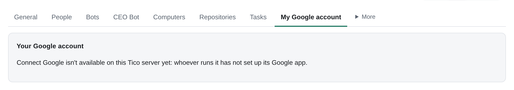

# Message bots: how a bot reads and files email

> **Beta**: message bots (mail and calendar) work today and may still change. See [Beta features](support.md#beta-features).

In the web app, each connected mailbox and Slack channel is listed in the Team sidebar under the bot that covers it:
an Inbox Manager's under **Message bots**, a team bot's under that bot. Open one to see that bot's instructions and routines on the
left and example messages on the right. Whole Workspace email threads are read and organized live in Gmail.
A messaging icon beside a human in the team chart opens their message bot.
The old `#/mail` route remains available for existing deep links.

## Reading mail

`hub email mailboxes` lists the person's readable mailboxes, including shared ones. With Whole Workspace connected,
`hub email inbox <address>`, `hub email search <address> "<Gmail query>"`, `hub email thread <address> <thread-id>` and
`hub email message <address> <message-id>` read live from Gmail without saving mail. The person's Assistant has the
same mailbox access. Output is Markdown by default; add `--json` for the API response. Lists accept `--limit` (up to
50) and `--cursor` with the previous `next_cursor`. Inbox accepts `--q` to search within INBOX. `hub mail` is postal mail.

The mail API requires a mailbox for live lists; it does not combine Workspace inboxes. Personal Connect Google grants
and legacy connections keep their existing stored reads; live reading needs Whole Workspace. Existing mail sync and
stored copies are unchanged by live reads. Opening a message or thread checks access and records `mail.read`.

## Organizing live

With Whole Workspace, use `hub email archive|unarchive|mark-read|mark-unread <address> <id> ...` or
`hub email label|unlabel <address> <label> <id> ...`. Supply ids (up to 500) or `--query "<Gmail query>"` with
`--limit` (default 100, maximum 500). Each call needs Read and write and the company's **What Tico may do >
Organize mail** switch; the Assistant acts as its person, bots at their own level. Gmail keeps the mail;
`mail.organize` records only ids and action details. Output gives count and undo; `--json` includes all ids.
Undo applies the inverse to those ids, including mail already in that state. Only labeling creates a missing user
label. These commands never delete, trash, or change Spam, Sent or Draft labels.
API: `POST /api/v2/mail/messages/organize`.

Automation archive, label and leave actions run on the server for Whole Workspace mailboxes, without waiting for a
computer. Other mail actions and personal connections still use the mailbox's computer; owner access is checked again before acting.

Mail is one shared tool, `$HUB_DIR/scripts/mail.sh`. One Google service account acts as every
mailbox; who may act as which one comes from the `tools:` block in your `bot.yaml`
(`policies/access.md`), never from a prompt. Every read of a body and every label, archive or
star is written to an audit log with your slug and the task.

**Never call the Gmail or Calendar API directly.** Not with curl, not with a Google SDK, not
from your own `software/`. The access checks, the rules, the audit log and the retry handling
live in the tool; a direct call skips all four and is a policy violation, not a shortcut. The
service-account key is not in your environment, so a direct call would not work anyway.

The dispatcher gives every run `HUB_BOT` (your slug) and `HUB_DIR` (Tico's own install, never a place
for Git work), so `mail.sh` already knows who you are. `--as <slug>` is only for running it by hand.

## What you can do today

Reading:

```bash
$HUB_DIR/scripts/mail.sh inbox --untriaged --format brief   # inbox mail with no hub/* label; the list you work
$HUB_DIR/scripts/mail.sh inbox --untriaged --all-mailboxes --format brief  # every mailbox Tico gives this run
$HUB_DIR/scripts/mail.sh inbox --new --since 24h      # what you have not seen in the last day (marks it seen)
$HUB_DIR/scripts/mail.sh inbox --label hub/needs-owner --format brief
$HUB_DIR/scripts/mail.sh thread 18f2c9a3b4d5e6f7 --format brief   # the conversation, no bodies; md when drafting
$HUB_DIR/scripts/mail.sh search "from:stripe.com newer_than:7d"   # any Gmail query, max 50
```

Output is markdown by default: one block per message with id, thread, from, to, date
(America/Los_Angeles), labels, whether it carries an unsubscribe link, attachments listed by
name and size, and a plain-text body (HTML stripped, cut at 32 KB with a marker). Add
`--format json` when you want to process it, `--json` on the other commands.

Filing, which is visible in Gmail so Ana can see and undo what you did:

```bash
$HUB_DIR/scripts/mail.sh label add 18f2... 18f3... hub/needs-owner
$HUB_DIR/scripts/mail.sh label remove 18f2... hub/needs-owner
$HUB_DIR/scripts/mail.sh archive 18f2...             # removes INBOX, deletes nothing
$HUB_DIR/scripts/mail.sh mark-read 18f2...
$HUB_DIR/scripts/mail.sh star 18f2...
$HUB_DIR/scripts/mail.sh triaged 18f2... 18f3...     # you are done with these
```

Every one of those takes `--dry-run`, which prints what would change and changes nothing.

The rules, which run before you read anything:

```bash
$HUB_DIR/scripts/mail.sh rules run --dry-run          # what the rules would do
$HUB_DIR/scripts/mail.sh rules run                    # do it
$HUB_DIR/scripts/mail.sh rules run --all-mailboxes    # each mailbox's own rules, own plus reports
$HUB_DIR/scripts/mail.sh rules explain 18f2...        # why this message got what it got
```

Rules run before any model. Marketing (unsubscribe links), notification senders, and
`registry/mail-rules.yaml` `skip:` addresses/domains are filed and never opened by the bot.
Each mailbox can add its own rules under that address after `common`.

Who may use a mailbox is Tico's answer, never the run's (backend/mailbox_access.py; Settings > Inboxes):
- a person has Read and write on their own mailbox, and admins on a shared inbox;
- a person's Assistant has exactly that person's access;
- everyone else, bots included, needs a grant: Read, or Read and write (organize, draft, send). Only the mailbox's
  person, or an admin for a shared inbox, gives or takes one; nobody passes a grant on;
- a mailbox whose person has not joined yet is private (Awaiting person) until they join or an admin makes it a
  shared inbox;
- the company's What Tico may do caps every level, and an address outside the company's domains is Read only.
The owner has no bypass, and managers get nothing automatic on their reports' mail. Every mail command asks
`GET /api/v2/mail/access` as its own credential (a bot's turn token, a person's own Tico token); `bot.yaml` gmail
entries only narrow that answer (`read_only: true`, and `draft`/`send` only when `can:` lists them). `org_read` no
longer does anything: the upgrade (migration 0092) turned each `org_read: true` into Read grants on the mailboxes
below, so nobody lost access, and a manager's view of reports' mail is now a grant their reports give. This boundary
applies to Gmail and mailbox tokens; [calendar Tools](#calendar) have separate access rules, except for the token
limit on a two-user Docker runner.
The Inbox Manager starts with one disabled weekday 07:30 Routine in America/Los_Angeles; Setup
switches it on. Change its time zone on its automation in **Automations**.

And the record:

```bash
$HUB_DIR/scripts/mail.sh whoami                       # your mailboxes and verbs
$HUB_DIR/scripts/mail.sh policy show                  # what you may send, to whom, how often
$HUB_DIR/scripts/mail.sh audit --since 24h            # everything mail did
$HUB_DIR/scripts/mail.sh sent-log --since 7d          # what actually went out
$HUB_DIR/scripts/mail.sh doctor                       # is mail set up at all
$HUB_DIR/scripts/mail.sh sync --all-roster --backfill 90d   # persist mail locally (Mac)
$HUB_DIR/scripts/mail.sh sync export --json           # unpushed batch; no hub token
$HUB_DIR/scripts/mail.sh sync ack <id> ... --mailbox you@acme.example
```

`mail sync` copies normalized messages into `<projects>/runtime/mail/mail.db` (`messages` plus a
per-mailbox `sync_state` cursor). First run backfills `--backfill 90d`; later runs use Gmail
history and, if that cursor has expired, `after:<last_run − 2d>`. `--all-roster` is every
address on `registry/people.yaml`; it is for running the command by hand, and the runner's `connectors` job does not use it (see "Which mailboxes the sync covers" below). The same rows are also written whenever `inbox`, `thread` or
`search` already fetches a message. Export/ack print and acknowledge a batch only — this
command does not hold a Tico token or push to the server.

## Writing: draft, reply, send

Every write goes through the same five gates, in order: **policy**, **lint**, **a second model**,
execution, audit. A gate that says no never throws the words away - it leaves a draft in Gmail
with the reason. Read the reason. Do not retry the same text, and do not look for another route.

### Draft

```bash
$HUB_DIR/scripts/mail.sh draft --to ava@creator.example \
  --subject "Ava, 6 months of Acme on us" --body-file out/ava.txt --issue 128 [--dry-run]
$HUB_DIR/scripts/mail.sh draft --reply-to 18f2c9a3b4d5e6f7 --body-file out/reply.txt --issue 128 \
  --attach out/response-letter.pdf
$HUB_DIR/scripts/mail.sh draft discard r-882... --issue 128
```

`--reply-to <thread>` fills in the recipient and the subject from the thread and keeps
`In-Reply-To` and `References`, so the message lands in the conversation instead of starting a
new one. `--cc` takes internal addresses only. `--dry-run` lints and reviews and writes nothing.

The draft is keyed on (you, the task, the recipient, the subject, the body, and the hashes of any
attached files): running the same
command twice **updates the same Gmail draft** instead of leaving two. Change a word and it is a
new draft. The thread gets `hub/drafted`, so Ana can see it in Gmail.

`--attach <path>` adds a file; repeat it for several, up to 25 MB in all (Gmail's limit, checked
from the file sizes before anything is read). Attachments use the shared sending policy, whose attachment prompt is on by default. Legacy `allow_attachments` keys
in `registry/mail-policy.yaml` are accepted but do nothing. A file must be inside your own folder
(`bot-<slug>`, or an older bot's `emp-<slug>`), after following symlinks; a relative path starts
there, and `..` is refused. Files that look like keys or passwords are refused wherever they are: `.env*`, `*.pem`,
`*.key`, `id_rsa*`, `id_ed25519*`, `*.p12`, `*.pfx`, `.netrc`, `.npmrc`, `.pypirc`,
`credentials*`, `*secret*`, `*token*`, and anything under `secrets/`, `private keys/`, `.ssh/`,
`.aws/`, `.gnupg/` or `.config/gh/`. The type comes from the file's extension. Lint and the
reviewer read the text, and the reviewer is told each file's name, type and size, not its
contents. Attaching lifts no permission. The server freezes and hashes every attachment, including unnamed inline parts. An approval binds that exact snapshot; changed files need a new send and approval.

If a Tico send approval names files, that binding still applies: its payload carries `draft` and
`attachments: [{name, size, sha256}]`. At send time the connector hashes the files as they stand
in the Gmail draft and requires the exact approved set and draft id; changed, added, removed or
swapped files need a new approval. `mail draft --attach --json` returns an optional
`approval_request` summary and a `mail send` command that freezes the draft through the shared queue. The generic approvals endpoint does not accept a new email approval. When the draft
belongs to a Tico task (`--issue <task id>`, or the task the run is for), `mail draft` first attaches
each file to it and adds its `file_id` to the request, so the approver can open the file from the
approval card; the send ignores `file_id` and matches on name, size and sha256. The card links a
file only to the version on the task whose stored sha256 and size are the approved ones. Attached
files become readable by everyone who can read the task.

`draft discard <draft-id>` (or `discard <draft-id>`) deletes an unsent draft you made with `mail draft`, and nothing else: a
draft someone else wrote, a draft already sent, or a message id is refused (exit 2). It needs
the `draft` verb and is audited.

```json
{ "ok": true, "draft": "r-882...", "thread": "18f2c9a3b4d5e6f7", "to": ["ava@creator.example"],
  "subject": "Ava, 6 months of Acme on us", "created": true, "updated": false,
  "lint": { "ok": true, "findings": [], "summary": "clean" },
  "review": "ok", "label": "hub/drafted" }
```

### Send

```bash
$HUB_DIR/scripts/mail.sh send --draft r-882... --issue 128 [--approval-issue <tico-approval-id>] [--dry-run]
```

**Once a person has turned sending on for the bot in Tico (see "Turning sending on"), the bot follows its rules without
asking for each message, to three kinds of recipient:**

1. **Anyone in the team's own domain** (`@acme.example` here).
2. **The sender of the thread it is replying to**: `reply --thread <id>`, to that one person, with nobody added. A
   message that also copies someone outside, or goes to a second outside address, is not covered.
3. **The forward addresses a person approved in Tico**, usually the owner's other email. An address that is only in
   `forward_to:` in the bot's `bot.yaml` is a request and still needs an approval for each message.

Grandfathered recipient scopes keep their existing registry allowances. New sends use the shared company/inbox/bot
policy below. A Tico approval or an authorized person's in-chat “send it” can approve a specific message; the effective
**Who can OK** rule decides whose instruction counts. A numbered GitHub issue does not prove a Tico approver identity
and no longer authorizes a send. Use a Tico send approval instead. The person's verified message still reaches the
reviewer as their instruction. See docs/mail-service.md, “Per-message approval”.
New email approvals are created by the frozen send queue. Use `mail send --draft <id>` or
`POST /api/v2/email/sends`; a generic `POST /api/v2/approvals` with `kind=send` is refused.
The card binds the complete MIME and exact To, Cc and Bcc, and approval requires loading its authorized preview.
Only old-format approvals created before the queue migration retain their original text-bound recipient scope.
Finance also queues its exact invoice email for this preview; approving the finance action does not approve unseen MIME.
The daily cap, the wait between messages to one person, the blocklist and the people the owner handles personally apply
to every send, the three kinds above included. `mail policy show` says which of these you have, which forward targets
Tico holds, what bot.yaml asks, and which policy it is reading.

`send` always answers in JSON and always exits 0 for a policy refusal. A refusal is a
**downgrade**, not an error:

```json
{ "ok": true, "sent": false, "downgraded": "draft", "gate": "outbound_send",
  "reason": "outbound_send is false for influencer: no person has turned sending on for influencer in Tico yet; ...",
  "draft": "r-882...", "to": ["ava@creator.example"],
  "note": "the draft is still in ana@acme.example Drafts; Ana can send it, or close the gate
           that refused it." }
```

A successful send looks like `{"ok": true, "sent": true, "message": "18f3...",
"label": "hub/handled/<slug>"}` and writes a row to `sent-log`. Sending the same draft twice
sends nothing the second time.

### Reply

```bash
$HUB_DIR/scripts/mail.sh reply --thread 18f2c9a3b4d5e6f7 --body-file out/reply.txt --issue 128
```

Drafts, then sends if every gate allows it. If not, you get the draft and the reason in one
JSON object with `"sent": false`. This is the command to use on a thread; `draft` plus `send` is
the same thing in two steps.

## Lint and the reviewer, on their own

```bash
$HUB_DIR/scripts/mail.sh lint --body-file out/ava.txt --subject "Ava, ..." [--to addr] \
  [--reply-to <thread>] [--check-calendar] [--slot 2026-09-08T13:00:00-07:00]
$HUB_DIR/scripts/mail.sh review --body-file out/reply.txt --thread 18f2c9a3b4d5e6f7
```

`lint` exits 0 when clean and 2 when a rule blocks. Every finding has a stable id, a severity
and a fix, and the ids are stable enough to quote on a task:

```json
{ "ok": false, "summary": "1 error(s), 0 warning(s)",
  "findings": [ { "id": "L001", "severity": "error",
                  "message": "forbidden phrase: 'we guarantee'",
                  "fix": "Team writing rules: do not promise outcomes. Say
                          'we will look into it', ..." } ] }
```

The rules, in short: no forbidden phrases (for example `we guarantee`, `AI Agent`,
`outsource`, `is locked`, `our crew`; the list is yours to set in the policy); acme.example links only, and if you have a
required CTA every link must be it; no placeholders, key-shaped strings, `s3://`, `emp-`, `bot-<slug>/` or Tico
task numbers; a subject under 120 characters, a body of 20-2500, at most three exclamation
marks, a signature naming Ana, one external recipient; and for times offered: at least two, in
order, in the future, on a weekday, in business hours, with the zone spelled out. Confirmation
language without `--slot` is an error - **never confirm a time before the invite exists.**

`review` asks a second model (Grok, a different vendor from the one that wrote the draft) to
check the draft against the incoming thread. Any commitment - money, a date, a discount, a legal
position, a guarantee - fails it. If the reviewer is unreachable, a draft still goes through
flagged `"review": "unavailable"`, and a send is downgraded to a draft.

## Calendar

Tico's MCP/API calendar tools let a bot read and schedule on the **team owner's calendar**
(the default) and **its operator's calendar**, without a Gmail grant in its manifest. Other roster
calendars are refused on this path. Humans can use calendars whose mail they may read; the team
owner can use all of them. This example uses the default team-owner calendar:

```text
hub_calendar_list()
hub_calendar_schedule(title="Murphy hold", start="2026-09-22T09:00:00-07:00",
                      end="2026-09-22T09:30:00-07:00", attendees=["person@example.com"])
hub_calendar_status(id="<action id>")
```

The schedule call queues one idempotent action for the private Mac calendar tool. Only a status of
`succeeded` means the Google event and invitations exist. `pending` and `running` are unfinished;
`unknown` must be inspected before retrying. This standing calendar grant does not enable Gmail
reading, drafting or sending. The equivalent shell commands are `hub calendar list`,
`hub calendar schedule` and `hub calendar status`.

The mail-local calendar commands have a broader registry-based grant: every bot can read or create
an event on any address in `registry/people.yaml`; Gmail permissions, including `read_only`, do not
change that calendar access. On a Docker runner with the two-user layout a bot gets calendar tokens only for the
mailboxes on its mail token list (the ones Tico gives it, Settings > Inboxes) (see [Who can read the key](#who-can-read-the-key)). An address outside the roster needs an explicit `google-calendar`
Tool entry with the required verbs. The private Google service-account setup must also be working
on that computer. These commands do not expand the MCP/API rule above:

```bash
$HUB_DIR/scripts/mail.sh slots --for ana@acme.example --n 2 --minutes 20 [--days 7]
$HUB_DIR/scripts/mail.sh calendar list --for teammate@acme.example --hours 48 --json
$HUB_DIR/scripts/mail.sh calendar add --for teammate@acme.example \
  --start 2026-09-22T09:00:00-07:00 --minutes 30 --summary "Customer follow-up" \
  [--attendee another-teammate@acme.example] [--description "Internal context"]
$HUB_DIR/scripts/mail.sh calendar get --for teammate@acme.example --event <id> --json
$HUB_DIR/scripts/mail.sh schedule --thread 18f2... --slot 2026-09-08T13:00:00-07:00 \
  --minutes 20 --attendee ava@creator.example --body-file out/confirm.txt --issue 128
```

`calendar add` is audited and deterministic: the same exact request retrieves the existing event
instead of making a duplicate. It accepts any attendee address by default. Set `TICO_BLOCK_EXTERNAL_INVITES=1` to allow only roster attendees;
this opt-in rule also applies to the `schedule` flow.
In Docker, set it in the server install's `.env` and run `docker compose up -d`.
**Settings > Health > Outside calendar invites** shows whether this calendar Tool setting is active.
A mail-local calendar command on a computer needs the setting in that computer's environment too.

`slots` reads **every** calendar the mailbox can see, treats all of them as busy, keeps a
30-minute buffer both sides, and only offers weekdays 09:00-17:00 America/Los_Angeles. It prints
lines you can paste straight into a draft - `Tue Sep 8, 1:00–1:20pm PT` - and
`{"slots": [{"start": "...", "end": "...", "human": "Tue Sep 8, 1:00–1:20pm PT"}]}` with `--json`.

`schedule` creates the event and sends the confirmation, or does neither: if the send fails the
event is deleted again. While your sending is off in Tico it puts **nothing** on the calendar
and answers with the draft plus `"would_schedule": {...}` so Ana can do it in one click.

## Verbs, and the one thing that is implied

Your `tools:` entry lists verbs: `read`, `draft`, `send`.

`read` also allows `label`, `archive`, `mark-read`, `star` and `triaged` **on your own
mailbox**. Moving a message between folders is not a send: nothing leaves the team, the
change is visible in Gmail, and Ana undoes it by relabelling.

`draft` is needed for `draft`, `reply` and `schedule`. `send` is needed on top of that for
anything to leave, and `send` also needs sending turned on for you in Tico by a person. Until then every send
is a draft, whatever your `bot.yaml` or an older instruction says.

Anything you are not granted is refused with exit code 2 and a line telling you what to ask
for. Do not work around a refusal: open a task with `owner:ana` and `type:decision` naming
the mailbox and why, per `policies/access.md`.

## The rules do the boring half

`registry/mail-rules.yaml` files the obvious mail before a model sees it: legal risk words
(`legal-risk-words`) and money-owed words like past due or final notice (`payment-risk-words`)
get `hub/needs-owner` and are never archived; receipts and a short list of exact senders Ana
has settled (Clio bills, Postiz digests, and so on) are archived and marked read; anything with
an unsubscribe link is marketing and gets archived; machine senders get `hub/notification`.
Rules cost no tokens, so everything they settle is free.

Run `rules run` first, then `inbox --untriaged --format brief --decisions`. What is left is the part that
needs judgement. `--format brief` is id, date, from, subject, labels and a snippet; `md` prints
whole bodies, so use it on one thread you are about to act on, never on a list.

`--decisions` asks the decision model (an optional decision model, `skills/decisions/SKILL.md`) about every listed
message before any thread is opened, from the listing's fields alone, and prints one more line
under each:

```text
  decision: reply  (reply 0.81; ask 0.90, money 0.05, legal 0.02, urgency 1.4)
```

The word after `decision:` is what the thresholds in `questions/mail-triage.json` say to do:
`archive`, `needs-owner`, `route`, `reply`, or `read`. Legal protects first, at a low
threshold, because a wrong needs-owner costs one look; money protects only when someone is
also asking, because payroll runs and receipts score money high with nobody asking anything;
filings need high confidence, because a wrong archive costs a missed email. `read` means the model was not sure enough: open the thread
and decide the way you always did. It changes nothing in Gmail; the JSON carries the same under
`judgment`, and one `judge` audit line (the audit name is unchanged) keeps the counts and the suggestion per id. Inside a bot
run the call goes through Tico with your credential; outside one it needs
the decision model API key (`skills/decisions/SKILL.md`), and `MAIL_DECISIONS=none` switches it off (`MAIL_JUDGE` and `--judge` are the deprecated old names and still work).

`draft` runs the same model as a gate before the second reviewer: six yes/no questions
(`questions/mail-draft-gate.json`) about money, dates, a confirmed time, unsupported claims, a
legal position and tone, printed as `gate: ok` or `gate: flagged commitment_money 0.81`. The
gate is advisory: a flagged draft is still written, the reviewer still decides, and the audit
keeps both so the thresholds can be tuned from what actually happened. Rewrite a flagged draft
once before you try again.

Three rules under `ana@acme.example` (`judge-legal-risk`, `judge-needs-owner`, `judge-noise`) ask the decision model
instead of matching words: a `decision` condition (`judge` is the old spelling and is still read) reads what the model said about the message
from the same listing fields as `--decisions` (`registry/mail-rules.yaml` explains the shape). They
sit under the mailbox on purpose: they run after every common rule, so a word protection still
blocks the model's archive, and only that mailbox's mail is sent to the model. Inside a bot run
the call goes through Tico; with no decision model available those rules simply do not fire and the
report says so. `mail rules explain <id>` prints the answer a message got.

If you keep triaging the same kind of message by hand, that is a rule. Write it in the file's
own shape - id, `when`, `do` - for `common`, above the protections, with `to_matches` on your
mailbox and `stop: true` (a mailbox-section rule runs after `common` and can never archive what a
`never_archive` rule protected). Prove it with `rules backtest --since 14d --rules <file>` and one
fixture, then open a PR against ticoteam/tico; a human merges it. Do not edit
`registry/mail-rules.yaml` in place.

## Labels Tico owns

`hub/triaged/<slug>`, `hub/handled/<slug>`, `hub/drafted`, `hub/needs-owner`, `hub/marketing`,
`hub/notification`, `hub/noise`. The tool refuses to touch any label outside `hub/` (and
Gmail's own INBOX, UNREAD, STARRED), because everything else is Ana's own filing.

## What to put in the task closing comment

Per `policies/handoffs.md`, three sections and under 200 words. For a mail run, **what was
done** is counts and not a transcript:

```text
What was done: 41 new messages in ana@acme.example. Rules filed 33 (26 marketing archived,
7 notifications). I triaged 6 and left 2 for Ana.
Deliverable: labels in Gmail; 2 messages carry hub/needs-owner:
  18f2c9a3b4d5e6f7  Acme renewal quote, they want an answer by Friday
  18f2c9a3b4d5e6f8  Invoice 4471 past due, $2,140
What the requester should know: the renewal needs a number I do not have.
Audit: scripts/mail.sh audit --since 24h --employee <slug>
```

When a message bot files a task from an email sent to its mailbox, the task may include the
sender, the subject, the message's own text, the message id and a link to the thread. That is
what lets the next bot, such as a Support Agent, answer the question. Leave out the other
recipients (to and cc), quoted earlier history and attachment contents unless a human asks.
In a report or closing comment, message ids and one line of context are enough. Nothing from a
mailbox goes into Slack.

## When something is wrong

`doctor` prints one line per problem with the exact fix. If it says the key is missing or
delegation is not granted, that is Ana's twenty minutes, not yours: open a task with
`owner:ana` and `needs-human` quoting the failing line, and stop. Exit codes: 0 fine,
1 something broke, 2 a Tico policy refused you.

Details of the plan and the reasoning behind every gate: `docs/mail-service.md`. The rule ids,
the policy schema and the reviewer backends: `connectors/mail/README.md`.

## Works on Linux runners

The mail and calendar sync (the `connectors` job) runs on a Docker runner, so a team whose bots all live
on cloud Linux can sync mail and calendar with no Mac. It is the same code and behavior as on a Mac; only the places it
looks are named instead of guessed.

Replace `<container-name>` below with this Computer's full Docker container name. The installer's
`--name mail` creates `tico-runner-mail`; copy the name from the Docker sign-in command in **Add computer**
or find it with `docker ps`. Only the optional unnamed manual install uses `tico-runner`.
See [Computer sign-in and diagnostics](install.md#linux-or-cloud-server-docker).

### Set up Google in Settings

Settings > Inboxes > Settings first asks an admin **How do you want to connect Google?**, until one way is set up:

- **One account at a time**: each person signs in with Google, starting with you.
- **Whole Workspace**: a Google admin connects every mailbox in the domain at once.

Only the way picked shows; **Use the other way** switches. Once a way is set up, Settings > Inboxes > Settings opens on it, and
**Also set up …** adds the other. With both set up, Whole Workspace shows first, since it covers the mailboxes. Someone
who isn't an admin never sees the question or the setup: only **Connect your account**, or, before an admin has set
Google up, a line asking them to.

Each way's setup offers **Have my agent do it** (the default) and **Set it up myself**. The first shows a prompt to copy
into your own coding agent (Claude Code, Codex, or any agent with a browser or `gcloud`); the second shows the steps
below.

**What Tico may do** shows once for the company, above both ways, for an admin:

- **Read mail and calendar**: always on.
- **Organize mail** (label, archive, drafts), **Send mail** and **Create and change calendar events**: on until an admin
  turns them off. Each box saves on its own.

Organize mail and Send mail both need Google's `gmail.modify`, so Tico holds each box itself too: the mail connector
refuses a label, archive or draft with Organize mail off, a send with Send mail off, and a calendar write with Change
calendar off, whichever credential it holds (a server token, a computer's own service-account key, or a standalone
grant). A draft is the first step of a send, so Send mail on allows one, and Tico's own markers on the thread
(`hub/drafted`, `hub/handled/<bot>`) go with the draft or send they record. With Send mail off no bot sends mail, whatever
its own **Mail sending** switch says (and no approval lifts it), and an automation's send becomes a draft. With it on,
each bot still needs its own switch (Settings > Bots > Edit > Mail sending; see [Turning sending on](#turning-sending-on)).
These settings apply to everyone who acts through Tico: bots, automations, the runner's own calendar bookings, people
and the Assistant. An admin who wants Tico to send turns Send mail on. The connector reads the boxes from Tico for each
run: a bot's from its mail setting, a person's from their `GET /api/v2/mail/access` answer, and the runner's connector
job's (`--as connector`, which its sync, mail actions and calendar bookings use) from the runner's own read
(`GET /api/v2/connectors/mail/targets`), never from the run itself. The connector reads the mailboxes its computer
syncs and writes only the actions the server leased it, each checked against the automation owner's level. When Tico
cannot be asked, writes are refused ("Tico couldn't check the company's mail settings; try again") and reads go on; a
run without the runner's registration can't ask, so it only reads. Change calendar needs `calendar.events`.

Organize mail, Send mail and Change calendar turned off take effect on the next token: Connect Google asks Google only
for what is ticked, each refresh leaves out a write turned off (the grant keeps it, so turning it back on needs no new
sign-in), and Whole Workspace tokens are
minted read only for it (`gmail.readonly`, `calendar.readonly`). Domain-wide delegation takes only scopes authorized by
name, so step 2 below authorizes the read-only scopes too, and Check records which ones Google accepted. A Workspace
authorized before them keeps minting its write scopes (Tico still holds each box off) and shows **Redo step 2 to narrow
Google access.**; redo step 2, then click Check. A box turned on that a person's grant lacks shows **Connect Google again** on their card. Both agent
prompts say what Tico will ask Google for. Only an admin acting as themselves changes these settings: never a bot,
BotOps or the Assistant.

**What these settings enforce.** Where Google allows it, Tico narrows the token itself: Organize mail and Send mail both
off gives read-only mail, and Change calendar off gives a read-only calendar. Otherwise Tico's mail tool enforces them,
and the server refuses a calendar booking while Change calendar is off (one already queued fails rather than lands
later). On a computer where bots run as the runner's own user (a Mac today), a bot that deliberately works around the
tool is not stopped; each bot's **Mail sending** switch has the same limit.

**Whole Workspace** lets Tico read the mailboxes of your Google Workspace through one service account. A Workspace admin does this once:

1. **Run one command in Cloud Shell.** Click **New command**, click **Open Cloud Shell**, and paste the command there (or click **Make prompt** to hand the same command to your agent, with what to do after it). If you belong to more than one organization, Cloud Shell asks which one to use. The command makes a service account in a Google Cloud project for Tico, turns on Gmail and Calendar for it, and sends its key to Tico. It never shows the key. If an organization policy blocks service account keys, the command turns that rule off for that project only. A setup command works once and expires after 30 minutes; each New command or Make prompt makes a new one, and an older one stops working. **Or upload a key file** takes a key you made yourself.
2. **Authorize in Google Admin.** Back in Tico, click **Open Google Admin**. Add the client ID and scopes shown in Tico, then click **Authorize**. An admin clicks this themselves; an agent can't.
3. **Check.** Under **Mailbox to check**, enter one covered mailbox and click **Check**. When Google accepts the key, Tico shows the mailbox as connected. If Google hasn't accepted it yet, Tico lists what to check and keeps checking every 20 seconds for 10 minutes.

To change the key later, click **Replace key**. **Disconnect** stops Tico reading every covered mailbox.

**One account at a time** lets each person connect their own mailbox ([Connect your Google account](#connect-your-google-account)), in three steps:

1. **Set up Google sign-in (once)**, for everyone on the server. The agent prompt names the redirect URI and this page, and has the agent ask you before it agrees to Google's API Services User Data Policy; Google has no `gcloud` command for these OAuth web clients, so the agent needs a browser. By hand:
   1. Enter the Google Cloud project ID (a project under your Google organization, for the Internal audience), then turn on the **Gmail API** and the **Google Calendar API** in it. Without them, Google's calls fail.
   2. Open **Auth overview** and fill in the app name, support email and audience.
   3. Open **Create a client**, choose Web application, and add the redirect URI that Tico shows.
   4. Copy the client ID and client secret from the dialog Google shows after Create (it shows the secret only once), paste them, then click **Save**.
2. **Connect your account**: **Connect Google** for your own mailbox.
3. **Your team**: everyone else with a mailbox, as Connected, Not connected, Connecting, Failing or Covered by Workspace. **Copy link** copies the link to Settings > Inboxes > Settings to send them yourself; Tico sends nothing. Each person connects their own mailbox.

Choose the audience in step 1:
- **Internal**: only accounts in your domain. Gmail needs no Google verification. It needs a project in your organization.
- **External**: any Google account, but Gmail is a restricted scope, so Google's verification applies.

**Remove Google app** turns it off for everyone. A server's Google app can also come from its environment; see [Manual or self-hosted](#manual-or-self-hosted).

### Start the sync on the runner

With Whole Workspace set, the `connectors` job on the runner reads the mailboxes below. It gets short-lived tokens from the Tico server, so no key file goes to the runner.

1. Wait a minute. `docker logs '<container-name>'` says `Tico side jobs: started connectors (mail, calendar)`. The first start builds
   the Python environment into the runner's volume (`/home/runner/tools/mail-venv`, or `/var/lib/tico-runner/tools/mail-venv`),
   about a minute, needing outbound access to PyPI once. It is not in the image, so the image stays slim for runners that never sync mail;
   it is rebuilt when `connectors/mail/requirements.txt` changes.
2. Check: `python -m runner_support --config <runner.json> connectors-doctor`, then Settings shows the mail and calendar
   tool health.

### Which mailboxes the sync covers

With **Whole Workspace**, the `connectors` job also syncs every known active personal mailbox linked to a person and
every shared inbox on the key's domain, even without a message bot. Each has one sync computer: its message bot's
non-revoked host, else the person's Assistant's online host, else an online isolated company server (owned by a
company owner or admin), else the person's own online computer. Shared mailboxes
without a message-bot host use only a company server. Among equally eligible computers, the lowest runner ID wins.
An isolated server is a Linux Docker runner that supervises its own `connectors` job. Another member's personal
computer is never chosen just because it is online. A fallback owner is replaced when it has not contacted Tico for
60 seconds or is revoked. If no eligible computer is online, nothing syncs and Health says the mailbox has no sync computer.
Stopped mailboxes and mailboxes awaiting a person are excluded from this fallback. A personal Connect Google grant
keeps its existing ownership rule. Syncing grants no bot access: the person and their Assistant can read their copies;
other bots still need an explicit mailbox grant, even on the syncing computer.

For each message bot (the bot named as someone's `inbox_bot`), the mailbox is the address the bot declares: the
identity of its `gmail` entry in `bot.yaml`, which BotOps fills from the `Mailbox: <email>` line in the bot's instructions
(`{{mailbox}}` in the template). Only when a bot declares none does the sync use its person's email from the roster. A person
who left, and an archived bot, are skipped.

This is what lets a team sign in on one domain and keep its Google Workspace on another. If the owner signs in as
`ana@acme-signin.example` but the Workspace, and so the service account's delegation, is for `acme.example`, the message bot declares
`ana@acme.example` and that is the mailbox that is synced and read. The calendar sync and the bot's token use the same address.

If the key cannot act for a mailbox's domain (Google answers `unauthorized_client`: no domain-wide delegation there), the job
does not fail on every cycle. It says so once in the runner's log, skips every mailbox on that domain, tries the domain again
after an hour, and shows one issue in Settings > Health that names the mailbox and the domain, for example
`Mail can't refresh for ana@acme-signin.example: the Google service account has no domain-wide delegation for the domain acme-signin.example`.
Fix it by adding the delegation for that domain in the Google Workspace admin console, or by giving the message bot a mailbox on
a domain the key covers. The issue goes away on its own once the mailbox syncs.

### Connect your Google account

A person can connect their own Google account from Tico, with no service account, no domain-wide delegation, no
Workspace admin console and no Google Cloud project of their own. It works for an ordinary mailbox user who can sign in.
Tico supplies the Google app ("Tico") and the consent screen, unless the company sets its own Google app (below). Google itself enforces what Tico may do: the grant belongs to
the account that signed in and cannot reach anyone else in the Workspace.



*Synthetic Acme example with Google not configured. Your personal Google connection is in Settings > Inboxes > Settings.*

1. In Tico, the person opens **Settings > Inboxes > Settings** and chooses **Connect Google**. Tico names the mailbox it will connect:
   the one their message bot manages.
2. Google asks them to sign in as that mailbox and to allow Tico to read their mail and calendar. With Tico's shared app,
   nothing that writes or sends is asked for. With the company's own Google app, see below.
3. Google returns them to Tico. The computer that runs the mail sync finishes the sign-in and keeps the grant. Settings
   shows what the grant allows, and the sync starts on its next cycle. The server sees a one-time code for a few
   minutes and never the grant itself.

Tico refuses any other account: if Google says someone else signed in, nothing is stored and that grant is revoked at
once. Only the person can connect their own mailbox; an owner cannot connect it for them.

What it allows with Tico's shared app: Gmail `gmail.readonly`, and Calendar `calendar.events.readonly`, `calendar.freebusy` and
`calendar.calendarlist.readonly`. A bot's `read` verb in Tico also covers labelling, archiving and triage, but a
read-only grant cannot do those at Google, so Tico refuses them before calling Google (exit 2, "connected to Tico
read-only at Google"). Sending stays off ([Turning sending on](#turning-sending-on)). Tico never asks Google for more on
its own.

**With the company's own Google app.** An admin can set the company's own Google app in Settings > Inboxes > Settings (its OAuth client
ID and secret, with the redirect address Settings shows). Then Connect Google also asks Google for `gmail.modify`, which
labels, archives and drafts mail, and for `calendar.events`, which adds calendar events. Google shows them on the same
consent screen, and the grant keeps only what Google gave. A person whose grant is read only is offered the upgrade in
Settings: **Connect Google** again adds the access, and nothing is forced. Tico's shared app stays read only, and so does
a server whose environment sets its own client (`TICO_GOOGLE_OAUTH_CLIENT_ID`), because the environment's client wins over
the one set in Settings. Sending stays off either way.

When Google says no. A Workspace's admin can block apps for everyone in it. Tico cannot get around that and does not
try. When Google answers `admin_policy_enforced`, Settings says so in those words: "The Google Workspace for
acme.example has a policy that blocks Tico", and that only a Workspace admin can allow it (Admin console > Security >
API controls > App access control > Tico). Google sometimes shows that block on its own page ("Access blocked: Tico is
not approved by your admin", Error 400 `admin_policy_enforced`) and never sends the person back; it is the same block.
A canceled consent reads as "not approved", and a problem with Tico's own Google app says it is Tico's to fix.

Reconnect and revoke:
- If the person removes Tico at myaccount.google.com/permissions, changes their password, or the admin blocks the app
  later, the next sync fails and Settings > Health says to reconnect (or names the admin policy). Tico never falls back
  to a service account for that mailbox. **Connect Google** again replaces the grant.
- **Disconnect** in Settings > Inboxes > Settings revokes the grant at Google and deletes it from the computer that holds it.
  A reconnect or a disconnect goes only to that computer, and a person's first connect goes to the computer that
  already holds mail access, so one computer keeps the team's mail. If another computer answers anyway it says it
  holds nothing, and Settings shows that instead of "disconnected". If that computer stays offline for 15 minutes,
  Settings says so and points to myaccount.google.com/permissions to remove Tico now; the disconnect stays queued, and
  the computer still revokes and deletes the grant when it is back.

Where the grant is kept: `google-oauth.json` beside `google-sa.json` (the runner's state directory on Linux, mode 0600,
closed to bots). It moves out of `workspace/secrets` without dropping other grants, and follows a re-enrollment the
same way the key does. No token reaches a bot's environment, a log or a report: a message bot's run still gets an
hour-long token for one mailbox the server named for it, and nothing else. A computer can hold both a key and grants:
mailboxes without a connected account still use the service account, if there is one.

Tico's Google app, testing and verification. Each Tico server names its own OAuth client, so there are two honest
ways to supply it:
- **A private app for one server** (for example one person's own mailbox). A Google Cloud project used by that server
  alone, by fewer than 100 people its operator knows, is a personal-use app, which Google lists as exempt from
  verification (support.google.com/cloud/answer/13464323). Publish it **In production** without submitting it for
  verification. Each person then sees Google's "Google hasn't verified this app" screen before consent and continues
  with **Advanced**. The project can never have more than 100 users in total, and Google's API Services User Data
  Policy still applies. Name it honestly as private to that server, never as Tico's public app, and don't share one
  such client across servers to stay under the cap. Google's 7-day limit applies to apps in **Testing**, so an app in
  production should keep its grants; check that on the real project by seeing a sync still work after the eighth day.
- **Tico's public app** for every team. Lasting grants for anyone need it **In production** and verified by Google.
  `gmail.readonly` is a restricted scope, so verification includes Google's yearly security assessment. Until then an
  app in **Testing** takes at most 100 listed test users, and Google ends each grant after 7 days. That is enough to
  try Connect Google, not for lasting sync.

The app's client secret never leaves the Tico server, for either kind of app: one public app's secret is shared by
every team, so no computer holds it. Google refreshes a grant only with the client that issued it, so the server does
it on the computers' behalf. The computer that holds the grant sends its refresh token to the server
(`POST /api/v2/connectors/mail/google/token`, with its runner registration). The server adds the secret, asks Google
for one service's scopes, never more than the grant holds, and returns only an hour-long access token and its expiry. It keeps no token
and logs none: only each grant's SHA-256 fingerprint, which can refresh nothing, so it refreshes only the grant it
issued for that mailbox and that computer. The sign-in's one-time code is exchanged the same way (`/exchange`, once, by the computer that
claimed it), so the grant on the computer has a client id and no secret. Only a computer that holds a Connect Google
grant from this server may ask, one service at a time. A grant from Tico's shared app, or one made before scopes were
recorded, holds only the read scopes (`gmail.readonly` and the calendar read scopes). A grant the company's own app made
also holds `gmail.modify` and `calendar.events` if Google gave them. The
computer's runner gives the mail CLI the server's address and its registration for this; a mail CLI run by hand, or
a bot's turn on a Mac without the runner's credential socket, cannot refresh such a grant and says to use the runner.
A grant made with `google connect --client-file` (a team's own Desktop client) keeps its own secret and refreshes on
the computer as before.

On the computer that holds the grants, `scripts/mail.sh google status` lists the connected accounts and what each may
do (never a token). `scripts/mail.sh google revoke --mailbox <address>` removes that account's grant from this computer
and asks Google to revoke it. The local copy goes first, so this computer stops using the grant even when Google cannot
be reached. If Google does not confirm the revocation, the command says so; the grant may still be active at Google, so
remove Tico at myaccount.google.com/permissions. The command ends without an error either way, so read its message.

Grants still end for Google's other reasons: the person removes the app or changes their password, six months without
use, a newer grant past Google's per-account limit, or an admin's policy. Settings > Health then says to reconnect.

Neither way gets past a Workspace's own controls. An administrator who blocks third-party apps, or who marks Gmail or
Calendar as restricted, blocks an unverified or untrusted app; Tico names that block as the admin's. An **Internal**
app avoids verification only for accounts in the Workspace that owns the project.

IMAP is not an alternative here: Google's OAuth for IMAP needs full-mail access, it carries no calendar, and a Workspace
that blocks apps usually blocks IMAP as well.

### Who can read the key

The key can act as any mailbox in the team, so bots must not be able to read it.

- **Key set in Settings > Inboxes > Settings**: the key is sealed on the Tico server, and no computer gets it. A computer gets short-lived tokens for the mailboxes it may use, and nothing else.
- **Docker runner with the two-user layout** (the current `runner.compose.yaml`) with a key you made yourself: the key is in the runner's state directory,
  closed to the bots' user. The `connectors` job reads it there. A message bot's run gets, from the runner over its credential
  socket, a Gmail or Calendar access token that lasts an hour for one mailbox at a time. The mailboxes it may ask for are the
  ones it holds a level on in Tico (`mailbox_levels` on its turn; a message bot gets its grant when it is set as a
  person's message bot). The server checks the level again on every mint, and a Read level gets the read-only scopes,
  except on the computer that syncs the mailbox, whose connector holds the full scope. Calendar tokens come from the same
  list, so on this layout the mail-local calendar commands reach only those mailboxes' calendars. Any other bot, and any
  other mailbox, is refused.
  A bot is a message bot to the server when it is its person's `inbox_bot`, which is what the server checks before it names any
  mailbox for a run. Making a bot from the `inbox` template does that itself: adding it in Settings, in the team builder, or
  through BotOps records the bot as the `inbox_bot` of the person the `Mailbox:` line names (by their roster email; for a bot
  BotOps registers in a DM, the person who asked), and writes that address as its `gmail` identity, or the person's own email when
  there is no line. A bot made before this is linked when the server starts, if it is unambiguous: a message-bot template, a
  mailbox in its instructions or its `gmail` identity, and the person whose email it is (or the only person on the roster).
  Changing it later is an owner's or admin's call, or BotOps's as the requester (a card for their click):
  `hub api POST access/people/<person> '{"inbox_bot": "<bot>", "mailbox": "ana@acme.example"}'`. Without the link the runner holds the key
  but gives the bot no token, and the mail tool says "this bot has no mailbox" (the bot's Tools list shows a problem; it is not "ready").
  Because the key is not in the bot's environment, the Tools list shows `GOOGLE_SA_KEY` as "present (held by the computer)" when the
  computer has the key and runs the `connectors` job, and as missing only when the computer has no key. The `mail.db` and
  `audit.jsonl` files in `workspace/runtime/mail` are group-writable so the bot's `mail.sh` and the job can both write them.
- **A Mac, or Docker started the old way**: bots run as the same user as the runner and can read the key file, and Settings >
  Health says so ("Mail key"). Keep such a computer for the message bot alone.
- A message bot may share a computer with other bots. To wall its mail key off, keep a computer for message bots alone
  (it can be on the same host, see [Add a second computer](install.md#linux-or-cloud-server-docker)):
  `POST /api/v2/computers/<id>/inbox-only {"enabled": true}`, by an owner, an admin, the computer's operator, or BotOps as one of them.
  The server then places no other bot there (409 `inbox_isolation`); `{"enabled": false}` stops keeping it. Installs from before
  this setting keep every computer that held only message bots kept for them.
- Bots that are not message bots but declare `gmail` access do not get mail on an isolated runner.

Instead of the key, the owner can set `TICO_PROCESSING_OPERATORS=<operator>` on the server: that owner's runners run
the job (and show a sign-in problem in Settings until the key is there).

| Setting | Default (Mac) | Linux runner |
| --- | --- | --- |
| `TICO_PROJECTS_DIR` bot repos, `secrets/` | folder above the checkout | `<home>/workspace` |
| `TICO_MAIL_VENV` | `<projects>/runtime/mail/venv` | `<tools>/mail-venv` for the `connectors` job; a bot's run is given `TICO_PROJECTS_DIR`, so its first `mail.sh` builds `<home>/workspace/runtime/mail/venv` (the bot user can write it) |
| `TICO_MAIL_RUNTIME_DIR` mail.db, audit log | `<projects>/runtime/mail` | same, under `workspace/runtime/mail` |
| `GOOGLE_SA_KEY` | `<projects>/secrets/google-sa.json` | the runner's state directory (`~/state-<id>/google-sa.json`) |
| `GOOGLE_OAUTH_GRANTS` connected accounts | `google-oauth.json` beside the key | beside the key, in the runner's state directory |
| `TICO_REGISTRY_DIR` | `<checkout>/registry` | unset: the sync needs no registry; per-bot mailbox rules do. There is no `mail-policy.yaml` either, so the mail policy is the built-in one (below) |
| `TICO_INTERNAL_DOMAINS` | the domains the policy file lists | optional, comma separated: the team's own mail domains when there is no policy file. Without it they come from the bot's mailbox and the team roster |

Nothing in the `connectors` job is Mac-only: the key is a file on both (no Keychain), and there is no browser automation
in it. What stays Mac-only is launchd (`scripts/tico-computer install`; Linux uses the runner's own supervisor) and
`connectors/browser.py`, the signed-in browser tool bots use, which needs a desktop browser.

### Manual or self-hosted

Use these instead of the Settings steps above when you make the Google key yourself, or run the Tico server.

**A key you make yourself**

1. Create the Google service account with domain-wide delegation once (`connectors/mail/README.md`, Setup), and download its JSON key.
   Without delegation, each person connects their own account instead ([Connect your Google account](#connect-your-google-account)) and you skip step 2.
2. Put the key on **one** runner, in the runner's own state directory, where only the runner can read it (owner `ticorun`, mode 0600):
   `docker exec -i -u ticorun '<container-name>' sh -c 'umask 077; cat > "$(ls -d /home/runner/state-* | head -1)/google-sa.json"' < google-sa.json`.
   A key left in `workspace/secrets/google-sa.json` (an older install, or an older version of this page) is moved there within
   a minute. Bots cannot read that place: a message bot's run asks the runner for a short-lived token for one mailbox instead
   ([Who can read the key](#who-can-read-the-key)).
   Re-enrollment on the same volume carries the protected key from the previous registration into the new state directory,
   preserving its permissions. The operator and server must match; another operator's key is never copied, and an existing
   key in the new registration is kept. Carryover is recorded once per registration after copying, finding an existing
   key or confirming there is no previous key. Deleting that registration's key later is respected on restart;
   a missing previous key is quiet, while failed reads or copies can retry. The previous key remains available for rollback.
   Health warns when an assigned teammate's online Computer reports a missing Tool Credential, naming the Tool and Computer.

**Tico's Google app on a server you run**

The server's operator can set Tico's OAuth client in its environment, `TICO_GOOGLE_OAUTH_CLIENT_ID` and `TICO_GOOGLE_OAUTH_CLIENT_SECRET`, as a Web application client whose redirect URI is `<TICO_PUBLIC_URL>/api/v2/mail/google/callback`. Settings > Inboxes > Settings can set the same client under **One account at a time**. When the environment sets it, the card says Set on the server and can't change it. Until one of them is set, Connect Google isn't set up on this server. A self-hosted team may use its own client the same way, or connect from the runner with `scripts/mail.sh google connect --mailbox <address> --client-file client.json` (a Desktop app client). `google status`, `google revoke` and `doctor` list, remove and check grants there.

## Turning sending on

Every email Tico sends goes through one server policy and a persisted queue: bot sends, automation replies and
forwards, approved sends, calendar invitations and scheduling offers, and the Assistant acting for a person. Configure it in **Settings >
Inboxes > Settings > Email > Sending**. An inbox's own page shows its policy, bot overrides, **Waiting to send** with
Cancel, and the send audit.

New senders start at **Ask first**, **Replies only**. **On their own** is an explicit opt-in at company, inbox or bot
level; the effective rule names the level that set it. Replies only keeps new messages behind a per-message approval.
**Never** at company, inbox or bot level blocks every send, including already-approved sends. A bot override cannot
relax company recipient restrictions, message type, approver requirements, always-ask rules, caps, pacing or the undo window. Recipient and approver rules at different levels intersect; the explicit Ask first → On their own opt-in is the exception. Only a person acting as themselves changes sending
policy: company admins, an inbox's person/admin, or a bot's manager for that bot. BotOps and the Assistant cannot
change these settings for them.

The default always-ask rules cover a new correspondent, attachments, more than ten recipients, and legal or money
matters. Inline and unnamed non-body MIME parts count as files. Decide reads all plain-text and sanitized HTML body representations; unavailable, incomplete or over-limit classification also asks a person, even when the legal/money prompt is off. Named primary bodies and alternative representations are classified. Non-primary inline text files also stay hashed, downloadable attachments and trigger attachment review; their text is classified too. Unsupported body alternatives or primary bodies, including named text/enriched, always need review without a new parser, even when attachment prompts are off. CSS-dependent, conditional or unsupported HTML needs review; its full frozen source is shown as inert text. This is triage, not a
security boundary. Read/write grants, Never, sender identity, content-bound approval and caps remain deterministic.
The approval rule is configurable: bot managers (the default), inbox admins, or named people. Hash-bound approvals
must match the content, subject, recipients and files. The approval card loads an authorized frozen body preview and links to the exact attachment bytes before enabling Approve. An in-chat “send it” must be an unambiguous affirmative instruction from an authorized person after they viewed the frozen send, and must name that send or reply to its approval message. Otherwise use the content-bound card. Changing content requires another send and approval.

Allowed emails wait in SQLite for the company's undo window (two minutes by default). The connector rechecks access,
policy, approval authority, aggregate daily caps and pacing before dispatch. Retained daily limits count the union of verified Sent history and queue attempts, de-duplicating their provider message ids. Cancel works until dispatch; delivered
mail cannot be recalled. Pending sends recover across server/runner restarts. An uncertain provider result is
**Unknown**, counted against caps and never automatically retried. An expired claim with no issued permit returns to Pending with a new fenced lease. Active, Sent and Unknown content and recipients deduplicate, including across MIME boundary and Message-ID changes. Retrying the same `operation_id` or HTTP idempotency key returns the same operation; a new intent may resend after a definite cancellation, block, failure or decline. Reply identity comes from MIME headers matched to synced history, so omitting caller metadata cannot bypass automatic-reply, bounce or repeated-reply guards. Delivery-status reports suppress previously attempted recipients; an inbox admin can
inspect and remove a suppression through the API.

```bash
hub email policy                                    # company policy
hub email policy --settings '{"mode":"on_their_own"}'
hub email policy --mailbox support@acme.example       # inbox effective rule
hub email policy --bot support --settings '{"mode":"ask_first"}'
hub email sends --mailbox support@acme.example --pending
hub email cancel <send-id>
```

The v2 API exposes `/email/sending-policy`, `/email/inboxes/{mailbox}/sending-policy`,
`/bots/{bot}/email-sending-policy`, `/email/sends` (queue and paged audit), `/email/sends/{id}`,
`/email/sends/{id}/approve` and `/email/sends/{id}/cancel`. The OpenAPI document describes the public endpoints.
The audit retains content/body hashes, recipients, attachment names/hashes, actor, policy decision, approval id,
provider message id and delivery status. `/email/sends/{id}` supplies the authorized preview and `/email/sends/{id}/attachments/{part}` downloads frozen attachment bytes. MIME content is discarded after delivery or cancellation. Gmail sends the frozen raw MIME in a single request, with retries disabled; a source draft may remain in Gmail so a concurrent user edit is never deleted.

Calendar creation is silent and checks inbox-level Never first. Invitations are frozen calendar attachments in the same queued email as their confirmation, so approval, undo and dispatch checks apply before any invitation is sent. Before freezing, the connector waits up to 15 polls for a generated conference link; if it is still unavailable it returns a retryable error and queues no invitation. The frozen invitation and visible body include the join URL, location and description. Canceling a queued invitation leaves the silent calendar hold in place. A verified canceled, blocked, declined or failed send releases the scheduling fence for a new intent; pending, sent and uncertain sends remain fenced. A rebooking checks every calendar conflict and reuses an unchanged hold from a verified definite non-send. Every unchanged hold with a trusted insert snapshot is excluded from the availability check, the newest is reused, and extra holds are left untouched. Polls are checked against the original insert snapshot: only conference status, entry points and the join link may change. Any other edit or a legacy hold without a trusted snapshot requires reviewing the calendar hold and stays busy. Moved or edited holds and unrelated events remain busy. Repeated conference-preparation failures reuse the same silent hold. A failed conference request is restarted on that event with a version check and a fresh request id, without sending invitations.

**After upgrading.** Existing explicitly enabled bot recipient scopes and existing automation versions retain their
previous authorization, marked **kept from before**. Existing legal inbox approvals stay approvals. New automation
ids and edited automation versions start under the shared default. Saving a company or inbox sending policy applies
its safeguards to grandfathered paths too. A bot's old registry recipient restrictions remain enforced until a person
sets its new policy. The older `hub bot mail` / `/bots/{bot}/mail-settings` controls remain compatible; setting their
switch now sets the bot's new mode. `outbound_send` and `forward_to` in bot.yaml remain requests, never authorization.

**Computers with no registry (Docker).** A Docker computer has no `registry/` folder, so nothing gives the mail tool a
`mail-policy.yaml`. Its policy is built in: sending on globally, the team's own domains as internal (from the bot's mailbox
and the team roster, never gmail.com and other public providers; `TICO_INTERNAL_DOMAINS` names them outright), the usual
caps (20 sends a day, one outside recipient, no outside Cc), no wait
between messages to the same person
(the forward address gets many messages), and an empty blocklist. `mail policy show` prints "built-in defaults". Put a
`mail-policy.yaml` in the registry and that file is the policy instead. The message bot's template also carries
`questions/mail-triage.json`, so the decision questions are in the bot's own repository wherever it runs.

**The decision model.** `mail.sh inbox --decisions` and the spam and injection check (`hub classify`) ask the
server's decision model. It asks the Tico AI Gateway first, with the gateway key in the server's `.env`
(`TICO_GATEWAY_KEY`); then your own `TYPESAFE_API_KEY`, if you set one (it is optional); then one of the team's model keys
(`ANTHROPIC_API_KEY`, `OPENAI_API_KEY`, `GEMINI_API_KEY`, `XAI_API_KEY`, `OPENROUTER_API_KEY`). `compose.yaml` hands them
to the server. A provider that fails hands the question to the next, and without any of them the check answers
"unchecked" and the bot works the mail as it always did.

## Unsubscribe before model triage

`rules run` now attempts RFC 8058 one-click unsubscribe for eligible subscription mail before
archiving it. It never calls a model. Earlier `never_archive` protection also blocks unsubscribe.
The acting bot needs the separate Gmail `unsubscribe` verb; read/draft/send do not imply it.
This grant cancels email-list subscriptions only, without enabling general emails or invites.

```
scripts/mail.sh unsubscribe <message-id> --as inbox --dry-run --json
scripts/mail.sh unsubscribe <message-id> --as inbox --archive --json
scripts/mail.sh rules run --as inbox --json
```

The command verifies DKIM over the raw message and both unsubscribe headers, then POSTs the
standard one-click body to HTTPS. No cookies, authorization, redirects, email requests or body
links are used. Connections are pinned to validated public IPs. Audit/state contains endpoint
hosts and token hashes, never full unsubscribe URLs. Duplicate endpoint requests are suppressed,
including uncertain outcomes after timeouts. A sender's 2xx means `accepted`, not proof it will
never send again. Unsupported methods return `manual_required`; uncertain requests return
`unknown`. The rules pass still archives unwanted mail and exposes the unsubscribe result;
standalone `--archive` archives only after acceptance. No request is made in a dry run.

An automation's `unsubscribe` action (mail only) makes the same request on the mail computer. It refuses starred mail, internal mail, people on the roster and senders the mailbox already writes to, and a refusal or an unconfirmed request fails the step. Mail actions on one message within one automation step run in order: an archive after an unsubscribe waits for it, and is skipped if it failed.

Keep the processing order: scripts and filing rules, then model analysis of unresolved mail.
Unsubscribe requires choosing unwanted subscription mail; it does not cancel a paid service.

## Scoped automatic scheduling (Ana approved September 8)

The message bot uses `mail scheduling offer|book`, not generic `reply`, `send` or `schedule`.
It has `scheduling_send: true` and separate Gmail/Calendar `schedule` verbs; general
`outbound_send` stays false. `policy show` reports both. Scope is influencers and BD-confirmed
non-investor contacts only. An independent reviewer checks relationship and explicit acceptance;
only fixed scheduling text can be sent. BD confirmation must be an actual Tico message authored
by that bot with exact `Scheduling approval: <email>` and `Thread: <thread>` lines.

Offers use two 30-minute slots, 20 hours notice, weekdays excluding nationwide federal/observed
holidays, 08:00-16:00 Pacific, and 30-minute buffers across every calendar. Unavailable freebusy
falls back to paginated event reads; unreadable calendars block scheduling. Thread and calendars
are rechecked immediately before a send. Bookings send a single invite with Google Meet creation,
not an invite followed by a separately fallible email. Per-mailbox locking and action records
suppress duplicates; uncertain delivery is recorded for reconciliation, never automatically
retried or falsely described as rolled back. `--dry-run` performs no outbound action.

Ana's `mail slots` uses the same time rules and defaults to 30 minutes. The older generic
scheduler is not the message bot's standing-authorized workflow.
