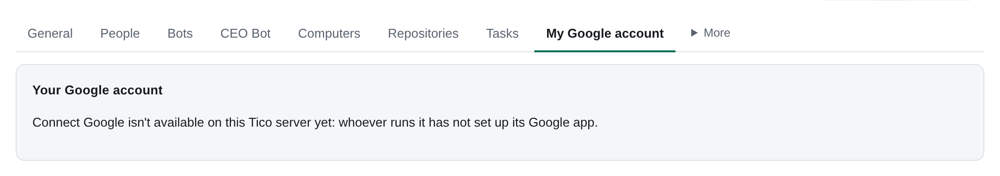

# Message bots: how a bot reads and files email

> **Beta**: message bots (mail and calendar) work today and may still change. See [Beta features](support.md#beta-features).

In the web app, each connected mailbox and Slack channel is listed in the Team sidebar under the bot that covers it:
an Inbox Manager's under **Message bots**, a team bot's under that bot. Open one to see that bot's instructions and routines on the
left and example messages on the right. Whole Workspace email threads are read and organized live in Gmail.
A messaging icon beside a human in the team chart opens their message bot.
The old `#/mail` route remains available for existing deep links.

## Reading mail

`tico email mailboxes` lists the person's readable mailboxes, including shared ones. With Whole Workspace connected,
`tico email inbox <address>`, `tico email search <address> "<Gmail query>"`, `tico email thread <address> <thread-id>` and
`tico email message <address> <message-id>` read live from Gmail without saving mail. The person's Assistant has the
same mailbox access. Output is Markdown by default; add `--json` for the API response. Lists accept `--limit` (up to
50) and `--cursor` with the previous `next_cursor`. Inbox accepts `--q` to search within INBOX. `tico mail` is postal mail.

The mail API requires a mailbox for every list; it does not combine inboxes. Every read asks Gmail at that moment: Tico
keeps no copy of mail. Opening a message or thread checks access and records `mail.read`.

## How Tico hears new mail

The server watches every active mailbox its Workspace key or a person's own Connect Google grant covers
(`backend/gmail_watch.py`, a drain worker): about
every 90 seconds it asks Gmail for the history since the mailbox's last check, reads each new message once, runs the
mailbox's message automations, notes bounces and feeds the Directory, then keeps only where it got to. Drafts are not
heard. A mailbox's first check starts its watch a day back and hears all of that day's mail, oldest first, over as many
passes as it takes; older mail never starts a run. A failed check keeps where it got to and shows why on Tools > the
mailbox; a refused Google sign-in also asks its person to reconnect. No computer touches mail: the server also sends
every queued email and carries out every automation mail action. A finished automation run keeps no message body or
snippet.

## Organizing live

With Whole Workspace, use `tico email archive|unarchive|mark-read|mark-unread|star|unstar|important|not-important|
trash|untrash|spam|not-spam <address> <id> ...` or `tico email label|unlabel <address> <label> <id> ...`. Supply
message ids (up to 500), `--thread <id>` (repeatable; every message in each thread) or `--query "<Gmail query>"` with
`--limit` (default 100, maximum 500). Each call needs Read and write and the company's **What Tico may do >
Organize mail** switch; the Assistant acts as its person, bots at their own level. Gmail keeps the mail;
`mail.organize` records only ids and action details. Output gives count and undo; `--json` includes all ids.
Undo applies the inverse to those ids, including mail already in that state. Only labeling creates a missing user
label. Trash and spam move mail out of the inbox and Gmail keeps it 30 days (`untrash`, `not-spam` bring it back; find
it with `tico email search <address> in:trash`). Nothing deletes a message for good, and Sent and Draft labels never
change. API: `POST /api/v2/mail/messages/organize`.

`tico email labels <address>` lists every label with Gmail's message and thread counts. `label-create`,
`label-rename` and `label-delete` change your own labels (never Gmail's system labels); deleting a label takes it off
its messages and keeps every message. `tico email original <address> <id>` shows every header as the message was
received (`--out file.eml` saves the whole message).

Automation mail actions run on the server, for a Whole Workspace mailbox or one with its person's own Connect Google
grant; owner access is checked again before acting. An action on a mailbox neither covers fails with why; one Google
cannot be reached for waits for the server's next try.

Mail is one shared tool, `tico email` (with `tico calendar`), over the server's routes. Who may act as which
mailbox is Tico's answer (below), never a prompt's. Every read of a body and every label, archive or
star is recorded with who did it.

**Never call the Gmail or Calendar API directly.** Not with curl, not with a Google SDK, not
from your own `software/`. The access checks, the rules, the audit log and the retry handling
live on the server; a direct call skips all four and is a policy violation, not a shortcut. The
service-account key is not in your environment, so a direct call would not work anyway.

Every command names its mailbox: a message bot's is the `Mailbox:` line in its instructions. There is no `--as` and
no default mailbox; each command runs as its caller (a bot's turn token, a person's own Tico login) at their own level.

## What you can do today

Reading:

```bash
tico email mailboxes                                   # the mailboxes you may use, your level, what you may do, the connection
tico email inbox ana@acme.example                      # newest first, headers and snippets only
tico email inbox ana@acme.example --q 'label:hub/needs-owner' --limit 20
tico email thread ana@acme.example 18f2c9a3b4d5e6f7    # the conversation with bodies; audited
tico email search ana@acme.example 'from:stripe.com newer_than:7d'
```

Lists carry headers and snippets, never bodies; `thread` and `message` carry bodies and are audited.

Filing, which is visible in Gmail so Ana can see and undo what you did:

```bash
tico email label ana@acme.example hub/needs-owner 18f2... 18f3...
tico email unlabel ana@acme.example hub/needs-owner 18f2...
tico email archive ana@acme.example 18f2...           # removes INBOX, deletes nothing
tico email mark-read ana@acme.example 18f2...
tico email label ana@acme.example STARRED 18f2...     # stars it
```

Each prints an undo line ([Organizing live](#organizing-live)).

The inbox's Message automation, which runs before you read anything:

```bash
tico automation list --owner person:<id>              # "Ana's inbox", trigger message on her mailbox
tico automation show <id>                             # its rules, decide step and actions
tico automation recent-runs --trigger message --range 24h   # what it did to new mail
```

Its rules run on the server on every new message, before any model. Marketing, notification senders and the
senders the person has settled are filed and never opened by a bot. Each person's inbox has its own.

Who may use a mailbox is Tico's answer, never the run's (backend/mailbox_access.py; Tools > Settings > Email):
- a person has Read and write on their own mailbox, and admins on a shared inbox;
- a person's Assistant has exactly that person's access;
- everyone else, bots included, needs a grant: Read, or Read and write (organize, draft, send). Only the mailbox's
  person, or an admin for a shared inbox, gives or takes one; nobody passes a grant on;
- a mailbox whose person has not joined yet is private (Awaiting person) until they join or an admin makes it a
  shared inbox;
- the company's What Tico may do caps every level, and an address outside the company's domains is Read only.
The owner has no bypass, and managers get nothing automatic on their reports' mail. The server checks the caller's
level on every mail route (a bot's turn token, a person's own Tico token). A message bot's `bot.yaml` `gmail` entry
only sets the level it starts with when it becomes a person's message bot: Read and write when `can:` lists `draft` or
`send`, Read otherwise or with `read_only: true`. `org_read` no
longer does anything: the upgrade (migration 0092) turned each `org_read: true` into Read grants on the mailboxes
below, so nobody lost access, and a manager's view of reports' mail is now a grant their reports give. This boundary
applies to Gmail; [calendar Tools](#calendar) have separate access rules.
The Inbox Manager starts with one disabled weekday 07:30 Routine in America/Los_Angeles; Setup
switches it on. Change its time zone on its automation in **Automations**.

And the record:

```bash
tico email mailboxes                                   # your mailboxes, what you may do, the connection and its last check
tico email policy --bot <slug>                         # your sending policy, as Tico answers it
tico email sends --mailbox ana@acme.example            # what was queued and what went out
```

Mail is read live from Gmail on the server, so nothing here needs a sync.

## Writing: draft, reply, send

`tico email draft` lints the text and writes a Gmail draft. `send` and `reply` (and `tico calendar schedule`'s
invitation) hand the frozen message to Tico's send queue, and Tico decides every send: your sending policy (**On their own**, **Ask first** or **Never**),
blocked recipients, the people the owner handles personally, outside Cc and many outside recipients, the lint and a
second reviewer on the text, the org rules, bounces and a person's OK. An allowed send waits out the undo window before it
goes. A send Tico blocks never throws the words away - the draft stays in Gmail with Tico's reason. Read the reason.
Do not retry the same text, and do not look for another route.

### Draft

```bash
tico email draft ana@acme.example --to ava@creator.example \
  --subject "Ava, 6 months of Acme on us" --body-file out/ava.txt
tico email draft ana@acme.example --reply-to 18f2c9a3b4d5e6f7 --body-file out/reply.txt
tico email draft ana@acme.example --to records@city.example --subject "Records request" \
  --body-file out/request.txt --attach out/request.pdf --attach file-0123456789abcdef01234567
tico email discard ana@acme.example r-882...
```

`--reply-to <thread>` answers the thread's last sender, takes the subject from the thread and keeps
`In-Reply-To` and `References`, so the message lands in the conversation instead of starting a
new one. `--cc` adds copies; Tico decides whether an outside Cc needs a person.

The lint refuses a draft with an error: rewrite it once, and never route around it. The answer carries the draft id,
the thread and the second reviewer's verdict (`review`) with its reason (`review_reason`). Running the same draft again **finds the same Gmail draft** instead of
leaving two. Change a word and it is a new draft. The thread gets `hub/drafted`, so Ana can see it in Gmail. A draft is
harmless: it sits in Gmail Drafts until someone sends it.

`--attach` (repeatable, also on `reply`) adds a file: a path in your checkout is published first, as `tico file
publish` does, and a Tico file id (`FILE` or `FILE@N`) is used as it is. Over MCP, `attachments` takes file ids only.
You may attach only files you may open; any other is not found. The draft carries each file's bytes as they are now,
so a changed file or another set of files is a new draft. An email is at most 24 MB with its files encoded (about
18 MB of files); a bigger one is refused.

Attachments use the shared sending policy, whose attachment prompt is on by default. The server freezes and hashes
every attachment, including unnamed inline parts. An OK binds that exact snapshot; changed files need a new send and OK.

Every draft in the mailbox counts, whoever made it (a person in Gmail, an older tool, a bot), and is named by its draft
id (`r-...`) or by its message's id, which `thread` and `search` show beside the draft's `draft_id`:

```bash
tico email drafts ana@acme.example --thread 18f2c9a3b4d5e6f7     # draft id, message id, to, subject, updated, files
tico email draft-show ana@acme.example r-882...                  # headers, body and files; audited as a read
tico email draft-update ana@acme.example r-882... --body-file out/reply.txt
```

`draft-update` changes a draft in place and keeps its draft id: `--to`, `--cc`, `--subject`, the body and `--attach`
(which replaces the draft's files); whatever you leave out stays as the draft has it, and a reply stays in its thread.
It meets the lint and the second reviewer again, as a new draft does. `tico email message` given a draft id opens the
draft.

`discard <draft-id>` deletes an unsent draft for good (Gmail keeps no copy), named by its draft id or its message id; a
name that is no draft is `not_found`. It needs Read and write on the mailbox and is audited.

### Send

```bash
tico email send ana@acme.example --draft r-882... --task 1a2b3c4d
```

`send` freezes the draft (named by its draft id or its message id) and queues it with Tico, and prints the send: its
`id`, `state`, `task_id` and `approval_id`. A draft that is gone (sent, discarded) is said so. `cancel` stops a queued
send and keeps its draft in Gmail. Your sending policy is set in Tico, never in `bot.yaml`: **Settings >
Bots > <bot> > Email sending**, or the company or inbox sending policy (see [Turning sending on](#turning-sending-on)).

- **On their own**: the send waits out the undo window (two minutes by default), then goes.
- **Ask first**: the send waits for a person to OK it in Tico. It goes once they do.
- **Never**: nothing is sent; the draft stays.

Some sends always ask a person whatever the mode, for example a new correspondent, attachments, an outside Cc or many
outside recipients, legal or money matters; the effective **Who can OK** rule decides whose yes counts. A held send
is an OK on a task of its own, titled with the email ("Send: <subject> → <first recipient>"), in that person's Needs
you. With `--task` (or, left out, the task a bot's turn works on) that task is a sub-task of the one the email is for,
and the send's `task_id` and `approval_task_id` name both. It is bound to the frozen send: the person sees the
whole email (the complete MIME and exact To, Cc and Bcc) and OKs it with their own click; a changed email needs a new
OK. Nothing a bot passes releases a send, and a numbered GitHub issue authorizes nothing either. Finance queues its
exact invoice email the same way; OKing the finance action does not OK an email nobody saw.
`tico email policy --bot <slug>` prints the mode and limits Tico applies to a bot.

`send` answers with Tico's decision:

- `pending`: the undo window runs, then it goes unless someone cancels it (`tico email cancel <send-id>`).
- `waiting_approval`: a person OKs it in Tico.
- `blocked`, with the reason: the draft stays in Drafts. This is not an error.

A bot without Read and write on the mailbox cannot queue a send.
Queuing the same draft twice queues nothing the second time.

### Reply

```bash
tico email reply ana@acme.example --thread 18f2c9a3b4d5e6f7 --body-file out/reply.txt
```

Drafts, then queues the send with Tico, with the same answer as `send`. This is the command to use on a thread;
`draft` plus `send` is the same thing in two steps. `--all` replies to everyone on the message: its sender and its
other To recipients in To, its Cc in Cc, the mailbox itself left out (`draft --reply-to <thread> --reply-all` drafts
it alone).

### Forward

```bash
tico email forward ana@acme.example 18f2c9a3b4d5e6f7 --to books@acme.example --body "For the books."
```

Forwards the message with its files (your text first, then the forwarded message), as a draft queued with Tico like
`reply`: the same sending policy, OKs and undo window, never delivered around them. `draft --forward <message-id>
--to <addr>` drafts it alone; `--attach` adds files after the forwarded ones.

## Lint on its own

```bash
tico email lint ana@acme.example --body-file out/ava.txt --subject "Ava, ..." [--to addr]
```

`lint` exits 0 when clean and 2 when a rule blocks. Every finding has a stable id, a severity
and a fix, and the ids are stable enough to quote on a task:

```json
{ "ok": false, "summary": "1 error(s), 0 warning(s)",
  "findings": [ { "id": "L001", "severity": "error",
                  "message": "forbidden phrase: 'we guarantee'",
                  "fix": "Team writing rules: do not promise outcomes. Say
                          'we will look into it', ..." } ] }
```

The rules, in short: no forbidden phrases (for example `we guarantee`); links on the team's own domains only; no placeholders, key-shaped strings, `s3://`, `emp-`, `bot-<slug>/` or Tico
task numbers; a subject under 120 characters, a body of 20-2500, at most three exclamation
marks, a signature naming Ana; and for times offered: at least two, in
order, in the future, on a weekday, in business hours, with the zone spelled out. Confirmation
language before the invite exists is an error - **never confirm a time before the invite exists.**

Tico runs the same lint, and a second reviewer, on every send of a bot's own writing; `lint` here is the quick
check before you queue it.

## Calendar

Tico's MCP/API calendar tools let a bot read and schedule on the **team owner's calendar**
(the default) and **its operator's calendar**, without a Gmail grant in its manifest. Other roster
calendars are refused on this path. Humans can use calendars whose mail they may read; the team
owner can use all of them. This example uses the default team-owner calendar:

```text
tico_calendar_list()
tico_calendar_schedule(title="Murphy hold", start="2026-09-22T09:00:00-07:00",
                      end="2026-09-22T09:30:00-07:00", attendees=["person@example.com"])
tico_calendar_status(id="<action id>")
```

The schedule call makes the Google event on the server and queues its invitation as an email (through the send
rules, OKs and undo window). Only a status of `succeeded` means the Google event exists and its invitation is
queued; `unknown` (Google never answered) must be inspected before retrying. The server reads and books with the
person's own Connect Google grant when they have one, else the Workspace key; a calendar neither reaches is refused.
Changes made to a Google calendar anywhere, in Google included, reach automations as `calendar.event.created`,
`calendar.event.changed` and `calendar.event.cancelled`, the same events Tico's own calendar sends. This standing calendar grant does not enable Gmail
reading, drafting or sending. The equivalent shell commands are `tico calendar list`,
`tico calendar schedule` and `tico calendar status`.

Events on any Tico or Google calendar a caller may see use the event tools. Times are shown in the zone of the
calendar they came from (UTC when none is given). Bots and the Assistant may book anyone unless the Who bots may book
rule refuses it; a person may add only to their own Tico calendar, and only without Google connected:

```text
tico calendar list --who human:ana,bot:ops --from 2026-11-11 --to 2026-11-14 [--kinds event,run,due,away] [--json]
tico calendar free --who human:ana,human:ben --minutes 30 --within 5d
tico calendar add --title "Standup" --start 2026-11-11T09:30:00-08:00 --end 2026-11-11T10:00:00-08:00 \
  --who human:ben --repeat "weekly on wed" [--calendar legal@acme.example] [--notes "..."] [--no-meet]
tico calendar move <occurrence> --start 2026-11-11T10:00:00-08:00 [--end ...] [--scope this|following|all]
tico calendar cancel <occurrence> [--scope this|following|all]
tico calendar search "standup with:ben" [--who human:ana]
```

The MCP tools are `tico_calendar_events`, `tico_calendar_free`, `tico_calendar_add`, `tico_calendar_move`,
`tico_calendar_cancel` and `tico_calendar_search`. `tico_calendar_list` with no `who` still reads the company calendar's
appointments.

`tico calendar add` accepts any attendee address by default. Set `TICO_BLOCK_EXTERNAL_INVITES=1` to allow only roster
attendees; this opt-in rule also applies to `tico calendar schedule`.
In Docker, set it in the server install's `.env` and run `docker compose up -d`.
**Settings > General > Health > Details** shows an **Outside calendar invites** check that says whether this calendar Tool setting is active.

`tico calendar free` offers times within the working hours of everyone named, treating every calendar they can see as
busy; paste its times into a draft as options. A hold is `tico calendar add` with no `--who` and `--no-meet`.

`tico calendar schedule` creates a silent event and queues the confirmation with the invitation attached. If Tico
refuses the invitation after the event is made, the booking fails and says so. With the inbox at **Never** it puts
**nothing** on the calendar.

## Levels: Read, or Read and write

Your level on a mailbox is Tico's answer (`tico email mailboxes` shows it), capped by the company's What Tico may do.

Read lets you list, search, open threads and download attachments. Read and write also lets you label, archive,
mark read, star, draft, unsubscribe and queue sends. Moving a message between folders is not a send: nothing leaves
the team, the change is visible in Gmail, and Ana undoes it by relabelling.

Whether a queued send goes is your sending policy in Tico, set by a person
([Turning sending on](#turning-sending-on)), whatever your `bot.yaml` or an older instruction says.

Anything you are not granted is refused with a line telling you what to ask
for. Do not work around a refusal: open a task with `owner:ana` and `type:decision` naming
the mailbox and why, per `policies/access.md`.

## The rules do the boring half

Each person's inbox has a **Message automation** on the server, named "<Name>'s inbox", with trigger `message` on the
mailbox. It runs on every new message as it arrives, before a bot reads anything. Its filter steps are the rules. For
example, legal risk words and money-owed words like past due or final notice are left for the person (`hub/needs-owner`) and never
archived; receipts and the senders Ana has settled are archived; marketing is archived or unsubscribed; machine
senders are labelled. Rules cost no tokens, so everything they settle is free. Its decide step sorts what the rules
leave with a few questions a small model answers (a message bot's template carries them as
`questions/mail-triage.json`), and its actions archive, label, leave for you, draft, send, forward or unsubscribe.
`backend/automation_templates/founder.json` is a worked example, and [Inbox templates](routines.md#inbox-templates)
lists the others.

```bash
tico automation list --owner person:<id>                    # find "Ana's inbox"
tico automation show <id>                                   # its rules, questions and actions
tico automation recent-runs --trigger message --range 24h   # what it did to new mail
tico email inbox ana@acme.example                           # what is still in the inbox
```

What is left in the inbox is the part that needs judgement. Lists carry headers and snippets; open one thread you are
about to act on with `tico email thread`, never a whole list.

`tico email draft` runs a second reviewer on the text. Its verdict is advisory: a flagged draft is still written, and
Tico still decides the send. A stop always says why in `review_reason` (a commitment, a confirmed time, a claim the
thread does not support, files it says are attached but are not, or wording that is not the company's); a review that
gave no verdict says that too. Rewrite a flagged draft once before you try again.

If you keep sorting the same kind of message by hand, that is a rule. Propose it as a change to the inbox's Message
automation: `tico automation update <id> --file <json> --summary "..."`. A bot's change to a person's automation is a
pending version the person accepts; nothing changes until they do.

## Labels Tico owns

`hub/triaged/<slug>`, `hub/handled/<slug>`, `hub/drafted`, `hub/needs-owner`, `hub/marketing`,
`hub/notification`, `hub/noise`. The tool refuses to touch any label outside `hub/` (and
Gmail's own INBOX, UNREAD, STARRED), because everything else is Ana's own filing.

## What to put in the task closing comment

Per `policies/handoffs.md`, three sections and under 200 words. For a mail run, **what was
done** is counts and not a transcript:

```text
What was done: 41 new messages in ana@acme.example. Rules filed 33 (26 marketing archived,
7 notifications). I triaged 6 and left 2 for Ana.
Deliverable: labels in Gmail; 2 messages carry hub/needs-owner:
  18f2c9a3b4d5e6f7  Acme renewal quote, they want an answer by Friday
  18f2c9a3b4d5e6f8  Invoice 4471 past due, $2,140
What the requester should know: the renewal needs a number I do not have.
```

When a message bot files a task from an email sent to its mailbox, the task may include the
sender, the subject, the message's own text, the message id and a link to the thread. That is
what lets the next bot, such as a Support Agent, answer the question. Leave out the other
recipients (to and cc), quoted earlier history and attachment contents unless a human asks.
In a report or closing comment, message ids and one line of context are enough. Nothing from a
mailbox goes into Slack.

## When something is wrong

`tico email mailboxes` shows each mailbox's connection (Whole Workspace, Connect Google, or none) with its last check
or error. If it says the mailbox is not connected or the last check failed, that is Ana's twenty minutes, not yours:
open a task with `owner:ana` and `needs-human` quoting the line, and stop.

Details of the plan and the reasoning behind it: `docs/mail-service.md`.

## Connect Google

Mail and calendar run on the Tico server: it reads Gmail and Google Calendar live, watches mailboxes, sends, carries out
mail actions and books calendars. The Google key and each person's grant stay sealed on the server, so no computer
needs Google access or a mail job, and a bot on any computer, Mac or Linux, works the same.

### Set up Google in Settings

Tools > Settings > Email first asks an admin **How do you want to connect Google?**, until one way is set up:

- **One account at a time**: each person signs in with Google, starting with you.
- **Whole Workspace**: a Google admin connects every mailbox in the domain at once.

Only the way picked shows; **Use the other way** switches. Once a way is set up, Tools > Settings > Email opens on it, and
**Also set up …** adds the other. With both set up, Whole Workspace shows first, since it covers the mailboxes. Someone
who isn't an admin never sees the question or the setup: only **Connect your account**, or, before an admin has set
Google up, a line asking them to.

Each way's setup offers **Have my agent do it** (the default) and **Set it up myself**. The first shows a prompt to copy
into your own coding agent (Claude Code, Codex, or any agent with a browser or `gcloud`); the second shows the steps
below.

**What Tico may do** shows once for the company, above both ways, for an admin:

- **Read mail and calendar**: always on.
- **Organize mail** (label, archive, drafts), **Send mail** and **Create and change calendar events**: on until an admin
  turns them off. Each box saves on its own.

Organize mail and Send mail both need Google's `gmail.modify`, so Tico holds each box itself too: the server
refuses a label, archive or draft with Organize mail off, a send with Send mail off, and a calendar write with Change
calendar off, whichever credential it holds (the Workspace key or a person's grant). A draft is the first step of a
send, so Send mail on allows one, and Tico's own markers on the thread (`hub/drafted`, `hub/handled/<bot>`) go with the
draft or send they record. With Send mail off no bot sends mail, whatever
its own sending policy says (and no approval lifts it), and an automation's send becomes a draft. With it on, each
bot's sending policy decides (Settings > Bots > <bot> > Email sending; see [Turning sending on](#turning-sending-on)).
These settings apply to everyone who acts through Tico: bots, automations, calendar bookings, people and the
Assistant. An admin who wants Tico to send turns Send mail on. The server checks them, and the caller's level, on
every call; an automation's mail action is checked against the automation owner's level. Change calendar needs
`calendar.events`.

Organize mail, Send mail and Change calendar turned off take effect on the next token: Connect Google asks Google only
for what is ticked, each refresh leaves out a write turned off (the grant keeps it, so turning it back on needs no new
sign-in), and Whole Workspace tokens are
minted read only for it (`gmail.readonly`, `calendar.readonly`). Domain-wide delegation takes only scopes authorized by
name, so step 2 below authorizes the read-only scopes too, and Check records which ones Google accepted. A Workspace
authorized before them keeps minting its write scopes (Tico still holds each box off) and shows **Redo step 2 to narrow
Google access.**; redo step 2, then click Check. A box turned on that a person's grant lacks shows **Connect Google again** on their card. Both agent
prompts say what Tico will ask Google for. Only an admin acting as themselves changes these settings: never a bot,
BotOps or the Assistant.

**What these settings enforce.** Where Google allows it, Tico narrows the token itself: Organize mail and Send mail both
off gives read-only mail, and Change calendar off gives a read-only calendar. Otherwise the server enforces them on
every call, and refuses a calendar booking while Change calendar is off. No computer holds a Google credential, so a
bot cannot work around them.

**Whole Workspace** lets Tico read the mailboxes of your Google Workspace through one service account. A Workspace admin does this once:

1. **Run one command in Cloud Shell.** Click **New command**, click **Open Cloud Shell**, and paste the command there (or click **Make prompt** to hand the same command to your agent, with what to do after it). If you belong to more than one organization, Cloud Shell asks which one to use. The command makes a service account in a Google Cloud project for Tico, turns on Gmail and Calendar for it, and sends its key to Tico. It never shows the key. If an organization policy blocks service account keys, the command turns that rule off for that project only. A setup command works once and expires after 30 minutes; each New command or Make prompt makes a new one, and an older one stops working. **Or upload a key file** takes a key you made yourself.
2. **Authorize in Google Admin.** Back in Tico, click **Open Google Admin**. Add the client ID and scopes shown in Tico, then click **Authorize**. An admin clicks this themselves; an agent can't.
3. **Check.** Under **Mailbox to check**, enter one covered mailbox and click **Check**. When Google accepts the key, Tico shows the mailbox as connected. If Google hasn't accepted it yet, Tico lists what to check and keeps checking every 20 seconds for 10 minutes.

To change the key later, click **Replace key**. **Disconnect** stops Tico reading every covered mailbox.

**One account at a time** lets each person connect their own mailbox ([Connect your Google account](#connect-your-google-account)), in three steps:

1. **Set up Google sign-in (once)**, for everyone on the server. The agent prompt names the redirect URI and this page, and has the agent ask you before it agrees to Google's API Services User Data Policy; Google has no `gcloud` command for these OAuth web clients, so the agent needs a browser. By hand:
   1. Enter the Google Cloud project ID (a project under your Google organization, for the Internal audience), then turn on the **Gmail API** and the **Google Calendar API** in it. Without them, Google's calls fail.
   2. Open **Auth overview** and fill in the app name, support email and audience.
   3. Open **Create a client**, choose Web application, and add the redirect URI that Tico shows.
   4. Copy the client ID and client secret from the dialog Google shows after Create (it shows the secret only once), paste them, then click **Save**.
2. **Connect your account**: **Connect Google** for your own mailbox.
3. **Your team**: everyone else with a mailbox, as Connected, Not connected, Connecting, Failing or Covered by Workspace. **Copy link** copies the link to Tools > Settings > Email to send them yourself; Tico sends nothing. Each person connects their own mailbox.

Choose the audience in step 1:
- **Internal**: only accounts in your domain. Gmail needs no Google verification. It needs a project in your organization.
- **External**: any Google account, but Gmail is a restricted scope, so Google's verification applies.

**Remove Google app** turns it off for everyone. A server's Google app can also come from its environment; see [Manual or self-hosted](#manual-or-self-hosted).

### Which mailbox a message bot uses

For each message bot (the bot named as someone's `inbox_bot`), the mailbox is the address the bot declares: the
identity of its `gmail` entry in `bot.yaml`, which BotOps fills from the `Mailbox: <email>` line in the bot's instructions
(`{{mailbox}}` in the template). Only when a bot declares none is its person's email from the roster used. A person
who left, and an archived bot, are skipped.

This is what lets a team sign in on one domain and keep its Google Workspace on another. If the owner signs in as
`ana@acme-signin.example` but the Workspace, and so the service account's delegation, is for `acme.example`, the message bot declares
`ana@acme.example` and that is the mailbox that the server watches and reads. Its calendar uses the same address.

If the key cannot act for a mailbox's domain (Google answers `unauthorized_client`: no domain-wide delegation there), the server's
mail watch keeps where it got to, records the reason on that mailbox (`check_error`, shown on Tools > the mailbox) and tries
again 90 seconds later. Fix it by adding the delegation for that domain in the Google Workspace admin console, or by giving the
message bot a mailbox on a domain the key covers. The mailbox clears on its own once a check succeeds.

### Connect your Google account

A person can connect their own Google account from Tico, with no service account, no domain-wide delegation, no
Workspace admin console and no Google Cloud project of their own. It works for an ordinary mailbox user who can sign in.
Tico supplies the Google app ("Tico") and the consent screen, unless the company sets its own Google app (below). Google itself enforces what Tico may do: the grant belongs to
the account that signed in and cannot reach anyone else in the Workspace.



*Synthetic Acme example with Google not configured. Your personal Google connection is in Tools > Settings > Email.*

1. In Tico, the person opens **Tools > Settings > Email** and chooses **Connect Google**. Tico names the mailbox it will connect:
   the one their message bot manages.
2. Google asks them to sign in as that mailbox and to allow Tico to read their mail and calendar. With Tico's shared app,
   nothing that writes or sends is asked for. With the company's own Google app, see below.
3. Google returns them to Tico. The Tico server trades the one-time code for the grant at once and keeps it sealed with
   its credential key. Settings shows what the grant allows, and Tico reads the mailbox live from Google. No computer
   holds the grant or any token from it.

Tico refuses any other account: if the ID token Google returns with the grant names someone else, nothing is stored
and that grant is revoked at once. A grant with no Gmail access, or more access than the app asks for, is revoked the
same way. Only the person can connect their own mailbox; an owner cannot connect it for them.

What it allows with Tico's shared app: Gmail `gmail.readonly`, and Calendar `calendar.events.readonly`, `calendar.freebusy` and
`calendar.calendarlist.readonly`. A bot's `read` verb in Tico also covers labelling, archiving and triage, but a
read-only grant cannot do those at Google, so Tico refuses them before calling Google (exit 2, "connected to Tico
read-only at Google"). Sending stays off ([Turning sending on](#turning-sending-on)). Tico never asks Google for more on
its own.

**With the company's own Google app.** An admin can set the company's own Google app in Tools > Settings > Email (its OAuth client
ID and secret, with the redirect address Settings shows). Then Connect Google also asks Google for `gmail.modify`, which
labels, archives and drafts mail, and for `calendar.events`, which adds calendar events. Google shows them on the same
consent screen, and the grant keeps only what Google gave. A person whose grant is read only is offered the upgrade in
Settings: **Connect Google** again adds the access, and nothing is forced. Tico's shared app stays read only, and so does
a server whose environment sets its own client (`TICO_GOOGLE_OAUTH_CLIENT_ID`), because the environment's client wins over
the one set in Settings. Sending stays off either way.

When Google says no. A Workspace's admin can block apps for everyone in it. Tico cannot get around that and does not
try. When Google answers `admin_policy_enforced`, Settings says so in those words: "The Google Workspace for
acme.example has a policy that blocks Tico", and that only a Workspace admin can allow it (Admin console > Security >
API controls > App access control > Tico). Google sometimes shows that block on its own page ("Access blocked: Tico is
not approved by your admin", Error 400 `admin_policy_enforced`) and never sends the person back; it is the same block.
A canceled consent reads as "not approved", and a problem with Tico's own Google app says it is Tico's to fix.

Reconnect and revoke:
- If the person removes Tico at myaccount.google.com/permissions, changes their password, or the admin blocks the app
  later, the next check fails and Settings > General > Health > Details says to reconnect (or names the admin policy). Tico never falls back
  to a service account for that mailbox. **Connect Google** again replaces the grant.
- **Disconnect** in Tools > Settings > Email deletes the grant from the server at once and revokes it at Google. If
  Google cannot be reached, Settings says so and points to myaccount.google.com/permissions to remove Tico there.
- Grants used to be kept on a computer. Since they moved to the server, each such connection shows **Connect Google
  again** once; the copy left on the computer is no longer used.

Where the grant is kept: in the server's database, sealed with its credential key (`google_connects.grant_sealed`) under
a context that names the person, the connect and the mailbox, so a sealed grant copied to another row, or kept
after the person's mailbox changed, opens nowhere. Connecting another mailbox ends the old grant and revokes it. No token or
refresh token reaches a response, a log, an event or `tico sql` (the table is closed to it). Every Gmail and Calendar
call on the server takes its token from one place (`backend/google_tokens.py`), which picks the person's grant over
the Workspace key. No token leaves the server: bots and people act through its routes.

Tico's Google app, testing and verification. Each Tico server names its own OAuth client, so there are two honest
ways to supply it:
- **A private app for one server** (for example one person's own mailbox). A Google Cloud project used by that server
  alone, by fewer than 100 people its operator knows, is a personal-use app, which Google lists as exempt from
  verification (support.google.com/cloud/answer/13464323). Publish it **In production** without submitting it for
  verification. Each person then sees Google's "Google hasn't verified this app" screen before consent and continues
  with **Advanced**. The project can never have more than 100 users in total, and Google's API Services User Data
  Policy still applies. Name it honestly as private to that server, never as Tico's public app, and don't share one
  such client across servers to stay under the cap. Google's 7-day limit applies to apps in **Testing**, so an app in
  production should keep its grants; check that on the real project by seeing mail still read after the eighth day.
- **Tico's public app** for every team. Lasting grants for anyone need it **In production** and verified by Google.
  `gmail.readonly` is a restricted scope, so verification includes Google's yearly security assessment. Until then an
  app in **Testing** takes at most 100 listed test users, and Google ends each grant after 7 days. That is enough to
  try Connect Google, not for lasting sync.

The app's client secret never leaves the Tico server, for either kind of app: one public app's secret is shared by
every team, so no computer holds it. Google refreshes a grant only with the client that issued it, so the server
refreshes it, for one service's scopes, never more than the grant holds. A grant from Tico's shared app, or one made
before scopes were recorded, holds only the read scopes (`gmail.readonly` and the calendar read scopes). A grant the
company's own app made also holds `gmail.modify` and `calendar.events` if Google gave them; a read-only grant refuses a
write before Google is asked. Each connect has its own id: a grant Google gives a sign-in the person has since replaced
or disconnected is not kept, and the grant connected before stays until a new connect finishes. Mail sent from such a
mailbox goes out from the server's own send queue, as Whole Workspace mail does.

Grants still end for Google's other reasons: the person removes the app or changes their password, six months without
use, a newer grant past Google's per-account limit, or an admin's policy. Settings > General > Health > Details then says to reconnect.

Neither way of supplying the app gets past a Workspace's own controls. An administrator who blocks third-party apps, or
who marks Gmail or Calendar as restricted, blocks an unverified or untrusted app; Tico names that block as the admin's.
An **Internal** app avoids verification only for accounts in the Workspace that owns the project.

IMAP is not an alternative here: Google's OAuth for IMAP needs full-mail access, it carries no calendar, and a Workspace
that blocks apps usually blocks IMAP as well.

### Where the key lives

The key can act as any mailbox in the team, so bots must not be able to read it. A key set in Tools > Settings > Email
is sealed on the Tico server, and so is each person's grant. No computer gets either, or a token from them: bots and
people act through the server's routes at their own level.

A bot is a message bot to the server when it is its person's `inbox_bot`, which is what the server checks before it
gives the bot its grant on a mailbox. Making a bot from the `inbox-manager` template does that itself: adding it in
Settings, in the team builder, or through BotOps records the bot as the `inbox_bot` of the person the `Mailbox:` line
names (by their roster email; for a bot BotOps registers in a DM, the person who asked), and writes that address as its
`gmail` identity, or the person's own email when there is no line. A bot made before this is linked when the server
starts, if it is unambiguous: a message-bot template, a mailbox in its instructions or its `gmail` identity, and the
person whose email it is (or the only person on the roster). Changing it later is an owner's or admin's call, or
BotOps's as the requester (an ask for their OK):
`tico api POST access/humans/<person> '{"inbox_bot": "<bot>", "mailbox": "ana@acme.example"}'`. Without the link the
bot has no mailbox, and its Tools list shows a problem.

A team may still keep a computer for message bots alone: `POST /api/v2/computers/<id>/inbox-only {"enabled": true}`,
by an owner, an admin, the computer's operator, or BotOps as one of them. The server then places no other bot there
(409 `inbox_isolation`); `{"enabled": false}` stops keeping it.

Older computers kept a Google key (`google-sa.json`), connected-account grants (`google-oauth.json`) and a mail copy
(`runtime/mail/`, `mail.db`). The first start after the update deletes them; a file the computer's own
`GOOGLE_SA_KEY` or `GOOGLE_OAUTH_GRANTS` names is the operator's and stays. A computer also removes its old
`connectors` job (launchd or systemd) and, on Docker, its `mail-venv`. This one-time step goes away in 0.7.

### Manual or self-hosted

Use these instead of the Settings steps above when you make the Google key yourself, or run the Tico server.

**A key you make yourself**

1. Create the Google service account with domain-wide delegation once, and download its JSON key.
   Without delegation, each person connects their own account instead ([Connect your Google account](#connect-your-google-account)).
2. In Tools > Settings > Email > Whole Workspace, choose **Or upload a key file**. The server seals the key; no
   computer gets it ([Where the key lives](#where-the-key-lives)).
3. Authorize its client ID and the scopes Tico shows in Google Admin, then click **Check**.

**Tico's Google app on a server you run**

The server's operator can set Tico's OAuth client in its environment, `TICO_GOOGLE_OAUTH_CLIENT_ID` and `TICO_GOOGLE_OAUTH_CLIENT_SECRET`, as a Web application client whose redirect URI is `<TICO_PUBLIC_URL>/api/v2/mail/google/callback`. Tools > Settings > Email can set the same client under **One account at a time**. When the environment sets it, the card says Set on the server and can't change it. Until one of them is set, Connect Google isn't set up on this server. A self-hosted team may use its own client the same way.

## Turning sending on

Every email Tico sends goes through one server policy and a persisted queue: bot sends, automation replies and
forwards, sends a person OK'd, calendar invitations, and the Assistant acting for a person. Configure it in **Settings >
Inboxes > Settings > Email > Sending**. An inbox's own page shows its policy, bot overrides, **Waiting to send** with
Cancel, and the send audit.

New senders start at **Ask first**, **Replies only**. **On their own** is an explicit opt-in at company, inbox or bot
level; the effective rule names the level that set it. Replies only keeps new messages behind a per-message OK.
**Never** at company, inbox or bot level blocks every send, including sends already OK'd. A bot override cannot
relax company recipient restrictions, message type, approver requirements, always-ask rules, caps, pacing or the undo window. Recipient and approver rules at different levels intersect; the explicit Ask first → On their own opt-in is the exception. Only a person acting as themselves changes sending
policy: company admins, an inbox's person/admin, or a bot's manager for that bot. BotOps and the Assistant cannot
change these settings for them.

The default always-ask rules cover a new correspondent, attachments, more than ten recipients, and legal or money
matters. Inline and unnamed non-body MIME parts count as files. Decide reads all plain-text and sanitized HTML body representations; unavailable, incomplete or over-limit classification also asks a person, even when the legal/money prompt is off. Named primary bodies and alternative representations are classified. Non-primary inline text files also stay hashed, downloadable attachments and trigger attachment review; their text is classified too. Unsupported body alternatives or primary bodies, including named text/enriched, always need review without a new parser, even when attachment prompts are off. CSS-dependent, conditional or unsupported HTML needs review; its full frozen source is shown as inert text. This is triage, not a
security boundary. Read/write grants, Never, sender identity, content-bound OKs and caps remain deterministic.
Who can OK is configurable: bot managers (the default), inbox admins, or named people. An OK is bound to the content,
subject, recipients and files. The ask shows an authorized frozen body preview and links to the exact attachment bytes
before the OK is enabled, and the OK must be the person's own click. Changing content requires another send and OK.

Allowed emails wait in SQLite for the company's undo window (two minutes by default). The server rechecks access,
policy, who can OK, aggregate daily caps and pacing before dispatch. Retained daily limits count the union of verified Sent history and queue attempts, de-duplicating their provider message ids. Cancel works until dispatch; delivered
mail cannot be recalled. Pending sends recover across server restarts. An uncertain provider result is
**Unknown**, counted against caps and never automatically retried. An expired claim with no issued permit returns to Pending with a new fenced lease. Active, Sent and Unknown content and recipients deduplicate, including across MIME boundary and Message-ID changes. Retrying the same `operation_id` or HTTP idempotency key returns the same operation; a new intent may resend after a definite cancellation, block, failure or decline. Reply identity comes from MIME headers matched to the mailbox's Gmail history, so omitting caller metadata cannot bypass automatic-reply, bounce or repeated-reply guards. Delivery-status reports suppress previously attempted recipients; an inbox admin can
inspect and remove a suppression through the API.

```bash
tico email policy                                    # company policy
tico email policy --settings '{"mode":"on_their_own"}'
tico email policy --mailbox support@acme.example       # inbox effective rule
tico email policy --bot support-owner --settings '{"mode":"ask_first"}'
tico email sends --mailbox support@acme.example --pending
tico email cancel <send-id>
```

The v2 API exposes `/email/sending-policy`, `/email/inboxes/{mailbox}/sending-policy`,
`/bots/{bot}/email-sending-policy`, `/email/sends` (queue and paged audit), `/email/sends/{id}`,
and `/email/sends/{id}/cancel`; a held send is OK'd on its task's ask. The OpenAPI document describes the public
endpoints.
The audit retains content/body hashes, recipients, attachment names/hashes, actor, policy decision, OK id,
provider message id and delivery status. `/email/sends/{id}` supplies the authorized preview and `/email/sends/{id}/attachments/{part}` downloads frozen attachment bytes. MIME content is discarded after delivery or cancellation. Gmail sends the frozen raw MIME in a single request, with retries disabled; a source draft may remain in Gmail so a concurrent user edit is never deleted.

Calendar creation is silent and checks inbox-level Never first. Invitations are frozen calendar attachments in the same queued email as their confirmation, so the OK, undo and dispatch checks apply before any invitation is sent. Before freezing, the server reads the new event up to five times, a second apart, for its Meet link; if Google has not made one, the booking fails and no invitation is queued. The frozen invitation and visible body include the join URL. Canceling a queued invitation leaves the silent calendar event in place. The booking's receipt is `succeeded`, `failed` or `unknown` (Google never answered); nothing is retried, so check the calendar before booking again after `unknown`.

**After upgrading.** Nothing keeps an older permission: every send, including older automations and recipient scopes,
goes through the one sending policy. A bot whose older mail switch was off moves to **Ask first** (a bot already at
Ask first or Never keeps it); its forward addresses and standing allowances are dropped, since they only lifted asks.
An older daily cap stays as the bot's cap. A retired `registry/mail-policy.yaml` is read once into the company and
inbox policies (blocked recipients, owner-handled addresses, sending off, paused inboxes, caps) and never again.
The older `tico bot mail` / `/bots/{bot}/mail-settings` controls remain
compatible: their switch sets the bot's mode, and forward addresses are refused. `bot.yaml` carries no sending
setting, and Tico reads no `registry/mail-policy.yaml`. The message
bot's template also carries `questions/mail-triage.json`, so the decision questions are in the bot's own repository wherever it runs.

**The decision model.** A Message automation's decide step and the spam and injection check (`tico classify`) ask the
server's decision model. It asks the Tico AI Gateway first, with the gateway key in the server's `.env`
(`TICO_GATEWAY_KEY`); then your own `TYPESAFE_API_KEY`, if you set one (it is optional); then one of the team's model keys
(`ANTHROPIC_API_KEY`, `OPENAI_API_KEY`, `GEMINI_API_KEY`, `XAI_API_KEY`, `OPENROUTER_API_KEY`). `compose.yaml` hands them
to the server. A provider that fails hands the question to the next, and without any of them the check answers
"unchecked" and the bot works the mail as it always did.

## Unsubscribe before model triage

An inbox's Message automation can unsubscribe from eligible subscription mail (its `unsubscribe` action) before it
archives it, and a bot or person can ask for one message:

```
tico email unsubscribe ana@acme.example <message-id>
```

Either way the server makes one RFC 8058 one-click request. It never calls a model. It uses only the message's own
`List-Unsubscribe` header, when that holds exactly one HTTPS link, asks for one-click, and a DKIM signature over From and
both unsubscribe headers verifies. It POSTs the standard one-click body to a public address, with no cookies,
authorization or redirects followed. It refuses starred mail, internal mail, people on the roster and senders the
mailbox already writes to. Tico keeps the endpoint's host and a hash of it, never the full unsubscribe URL. A request
is claimed before it goes, so a retry after an unclear answer sends nothing and answers what the first one did. A
sender's 2xx means `accepted`, not proof it will never send again; an error or a redirect is `manual_required`, and no
answer is `unknown`, never tried again. In an automation, a refusal or an unconfirmed request fails the step, and an
archive after an unsubscribe in the same step waits for it and is skipped if it failed.

Keep the processing order: filing rules, then model analysis of unresolved mail.
Unsubscribe requires choosing unwanted subscription mail; it does not cancel a paid service.
