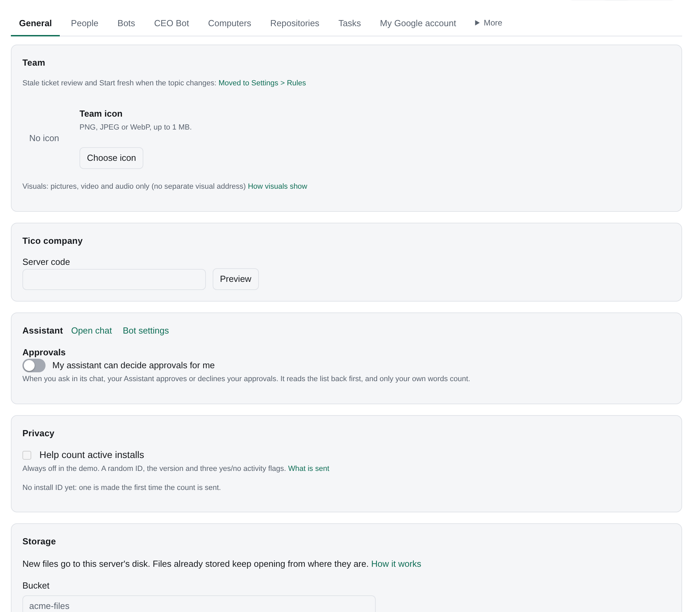

# Navigation

The current paths in Tico. Settings is under your email and opens on General; each tab has its own address,
shown in the address bar while the tab is open (`#/settings/people`, `#/settings/gateway`), to bookmark or share, and a tab you can't see opens General with **That page is for admins**.
Tools is in the sidebar.
Controls appear when your rights allow the action. A card you can read but cannot change names who can.
For example, Repositories says **Ask Ana Rivera to connect GitHub** when Ana owns the team.

**Picks and services** opens Gateway. **Key and connection** opens Models.

| To | Open |
|---|---|
| Give work or review a result | Tasks → New task, List, Board or Done |
| Talk to a bot about one task | Bot chat → tap the task's row ([Sessions](sessions.md)) |
| See or link a task's sessions | Task → Sessions +; ⋯ → Copy session ID |
| Add or edit a Routine | Automations → New automation ([Routines](routines.md)) |
| See what Tico runs on its own | Settings → System → What Tico runs on its own ([System routines](system-routines.md)) |
| Receive a webhook, or send events out | Settings → Webhooks → Incoming or Outgoing ([Webhooks](webhooks.md)) |
| Keep webhooks while the server is off | Settings → Webhooks → Through Tico Gateway |
| Stop a hosted server when idle | Settings → Computers → Sleep when idle ([Account](account.md#sleep-when-idle)) |
| See or change what wakes a bot | Automations → What wakes bots, or What wakes <bot> |
| Add, assign or set up a bot | Settings → Bots → Add from template; then the bot → Set up |
| Change Instructions | Bot → More → Instructions → Edit Instructions → Ask BotOps to change |
| Change model, effort, owners or status | Settings → Bots |
| Register or remove a Computer | Settings → Computers → Add computer; open a computer → Revoke computer |
| Add a subscription and give it to computers | Settings → Models → Add subscription; then Settings → Computers ([Subscriptions](computers.md#subscriptions)) |
| Sign a computer in to an AI tool | Settings → Computers → open a computer → Connections ([Computers](computers.md)) |
| Change company turn limits | Settings → Models → Limits |
| Check problems and recovery | Settings → Health |
| Store a Credential and grant it | Tools → Credentials → Add credential; then Access → Grant access |
| Connect or review a Tool | Tools; Slack channels are under Tools → Slack channels |
| Add or manage people and member rules | Settings → People |
| Connect your Google account | Settings → My Google account |
| Manage shared email and phone numbers | Settings → More → Email & Phone |
| Choose AI providers | Settings → Models |
| Connect the Tico AI Gateway | Settings → Models → Tico Gateway → Advanced ([Tico AI Gateway](ai-gateway.md)) |
| Connect your External agent | Connect an external agent beside your email |
| Review message work | Message bots → mailbox or channel |
| Read or write team knowledge | Docs → Internal docs; outside sources are Linked docs |
| Find a bot, human or page | ⌘K, or the search icon at the end of the sidebar's **Ask Tico** row (phone: the Search tab) |
| Find a file or page any bot made | Library → Files (`#/library/files`); search finds text inside ([Files](files.md#library--files)) |
| Open a page full size | Tap its card, or `#/page/<id>` ([Pages](pages.md)) |
| Read or write the team's strategy, publish a version | Strategy (`#/strategy`); the owner writes and publishes, the Strategy Bot proposes ([Strategy](strategy.md)); Lenses on that page run a framework against it ([Lenses](lenses.md)) |
| See the market map, or ask the Librarian about the market | Strategy → Market (`#/strategy/market`; `#/market` redirects there) |
| See growth ideas, tests, verdicts and channel economics | Growth (`#/growth`; This week, Channels, Learning and Go-to-market are its tabs) ([Growth](growth.md)) |
| Review goals and KPIs | Goals; a goal's **Bet** picker links it to a strategy bet |
| Add or edit a location, product or service, project, piece of equipment or due date | Operations → Locations, Products & services, Projects or Equipment (unreleased; [Operations](operations.md)) |
| Show or hide Operations or one of its tabs | Settings → General → Sidebar (unreleased; [Operations](operations.md)) |
| Contact support or continue a support conversation | Ask → **Loop in Support** (phone: the Ask tab), or any `#/support` link |

All four system bots appear as **Built-in** in Settings > Bots. Neither Assistant nor BotOps has a rail entry: **Ask**
(the sidebar's bottom row, ⌘J; the phone's middle tab) opens your Assistant over any page as **Tico Assistant**, `#/assistant`
opens it full page, and the Assistant hands BotOps what needs BotOps;
the Strategy Bot is on Goals and proposes Strategy, and Ask the Librarian is on Docs and on Strategy's Market tab. The Strategy Bot is at the top of the team chart; the other three stay out of it.
Inbox Manager and other repeating message work appear under **Message bots**.
An older app may show Instructions under the bot's Docs tab; the action is still **Edit Instructions**.
Removing a Computer revokes its registration and leaves its local files and bots in place.
See [Using Tico](using-tico.md), [Credentials](credential-vault.md) and [Updates](updates.md).

*Synthetic Acme example. Settings opens on General.*

## Tags

**Settings > Tasks** (under **Task tags**) lists templates and task tags and creates new ones. Task chips show the
label and metadata; open a chip in task details to see its checklist and related tasks. A
**Tag** filter narrows the task board by key. Templates have **Make a tag** to create a separate
checklist with its own metadata. Tag owners and task movers can tick and edit its notes.
