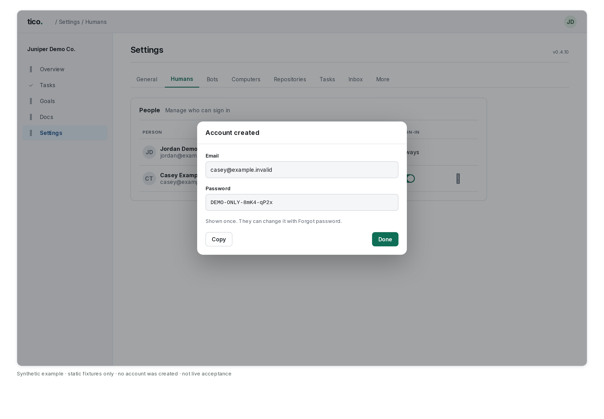

# People and access

Who is on the team, who may sign in and who owns the environment are settings in the app, not
files on the server. The owner manages them in **Settings > People**; nothing needs a restart.

## Roles

Every human on the team is an **Owner**, an **Admin** or a **Member**. Members can add teammates at the team's email domain and
create and manage their own bots; Admins manage humans, computers and every bot but the built-in ones; the Owner does
everything. The full rules, including per-bot See, Read and Write, are in [permissions](permissions.md).

## Settings > People

The page answers three things: how humans get here, who is here, and what each human may do.

Turning off **Can sign in** or removing an allowed domain asks you to confirm first.
Cancel keeps the current access. Sign-in switches show **Saved** on success; a refused change shows its reason under the control.

- **How humans join.** Pick **Add manually** or **Sync with directory**. There is no separate mode setting: a saved directory
  source means Sync, none means manual. Going back to manual turns the sync off; the humans it added stay.
  - **Add manually** is one row: an email and, optionally, a name. The human goes on the roster and the sign-in list at once.
    Type a domain instead (`partner.com` or `@partner.com`) to let anyone at it sign in.
  - **Sync with directory** is the source, its status and **Sync now** ([Directory sync](#directory-sync)). The "ask me first"
    number for humans a sync would mark as left is under **Options**.
- **Anyone at <domain> can sign in** (owner only). The domain is the owner's own when that is a work address, else the first
  allowed domain. On means the domain is in `allowed_domains`; off takes it out. Someone not on the roster whose verified sign-in
  is at an allowed domain or on the allowed list joins as a normal human on first sign-in (audit event `person.joined`).
- **Also allowed.** Anything else on the allow list (other domains, and addresses of humans not on the roster yet) is shown as
  chips the owner can remove. Nothing on the list is rewritten on upgrade: entries saved by an earlier release keep working
  exactly as before. The server still refuses a wildcard inside an address (`a*@example.com`), a malformed address and a public
  email domain such as gmail.com. Narrowing the list stops new humans; it does not remove anyone on the roster.
- **Each human** is one row: the role (**Owner** is fixed; the owner switches **Admin** and **Member**), a **Can sign in** switch
  (see [permissions](permissions.md)), and a ⋯ menu: **Send invite** (see [Invites](#invites)), **Can add bots** and **Can add humans** for a member, **Make owner** and
  **Mark as left** for the owner, and **Change my sign-in email** on the owner's own row ([below](#change-the-owners-sign-in-email)). Everything saves when it changes. Title and group are kept on the human but edited on
  their profile, not here.
- **Mark as left.** They drop off the team chart, their API tokens are revoked, and they can no longer sign in. **Restore** (under
  **Left**) brings them back (their old tokens stay revoked).
- **Remove** (under **Left**, owner only) deletes someone added by mistake for good, with their unused tokens, sent invites
  and allow-list address. Only a left human with no history can be removed: nothing they did (an event, a message, a task, an
  approval, a used token) or that names them anywhere else, and not synced from a directory. Anyone else stays as left
  (`Has history; stays as left`). The audit event `person.removed` keeps their name and email.
- **Bot limit per member**: 25 active bots by default. A team still on the old default of 5 is moved to 25 once on upgrade;
  a 5 someone set by changing it from another number, and any other number, stays.

## Transferring ownership

The owner picks an active human, ticks whether they stay an Admin, and types the new
owner's email to confirm. On commit the new owner is the owner at once, in the same transaction that
writes the `owner.transferred` audit event. The previous owner becomes a normal human. Owner-only
routes, the runner rule that only the owner's computers host any bot, setup's computer wiring,
the credential administrators (the owner and the Admins, when `TICO_CREDENTIAL_ADMINS` is unset), email and calendar defaults
all read the owner in force. A computer stays with the human who enrolled it: if a bot the new
owner owns was placed on the old owner's computer, reassign it in Settings > Computers.

## Change the owner's sign-in email

The owner can move to another sign-in address (a new Google account, say) and stay the same person: every task,
comment, approval, conversation, bot and role stays theirs. It is not a transfer, and no second person is made.

**First, set up the new address in Cloudflare Access.** Tico doesn't sign anyone in itself: Cloudflare Access (or
Cognito, or your OIDC provider) checks who you are, then tells Tico your address. Add the new address, or its Google
login method, to the Access application's policy. Then check it, one of two ways:

- **Tico would not let the new address in on its own** (it is not under **Also allowed**, and its domain is not one
  that **Anyone at <domain> can sign in** covers): in a private window, sign in to Tico with the new address. Tico's
  "not on the roster" page means Cloudflare let the address through; that is what you want for now.
- **Tico would let it in** (a new address at your own company's domain, usually): don't sign in to Tico with it yet.
  That sign-in would join the address as a second person, and Tico then refuses the change because the address
  belongs to someone else. Check it at Cloudflare instead, with the Access application's policy tester for the new
  address.

For the same reason, don't add the new address on this page or to the allow list first. If a second person did join
with the new address, first give that person another email nobody uses: ask BotOps (you confirm its card), or call
`POST /api/v2/access/humans/<their id>` with `{"email": ...}`. Then mark them as left and make the change below.

**Then change it.** Signed in with your current address, open **Settings > People**, open the ⋯ menu on your own row
and pick **Change my sign-in email**. Type the new address twice and confirm. Only the owner sees this, signed in as
themselves: not through an API token, BotOps or the Assistant. Behind Cloudflare Access you are signed out at once;
sign in again with the new address.

One transaction changes every copy of the address, or none of them if any step fails:

- the person's email on the roster and in `humans`, with the same id;
- the `owner` record: a new revision whose `history` keeps the old address;
- the allow list and the Admins, where the old address was on them;
- meetings filed for you, a meeting delivery you asked for, and your Granola connection.

The `owner.email_changed` audit event records who did it, when, the old and new addresses and the new revision.

**The old address stops signing in when you confirm. There is no grace window.** A window where both addresses sign
in as the owner would be a second key to the owner's account for as long as it lasts. The old address keeps working
right up to the change, and checking the new address first (above) is what stops a lockout. If something goes wrong
anyway, the command below gets you back in. The old address never joins as a new person, not even at an allowed
domain or from a directory sync or SCIM, so a stray sign-in with it can't split you in two. To give the old address to
someone else, add it on this page.

Things Tico doesn't change:

- **Mail.** A mailbox is a mail account, not a sign-in. Your archived mail stays under the old mailbox; the owner still
  sees every mailbox. If your mail also moved, reconnect Google mail. A message bot that reads your mail keeps reading the
  old mailbox: when it read it by your sign-in address, the change writes that mailbox into the bot's settings. Change
  its mailbox when your mail moves too.
- **Slack.** The Slack gateway matches the email on your Slack profile. Change it there to the new address too, or
  your Slack messages to bots are refused.
- **Server settings.** If `api.env` sets `TICO_CREDENTIAL_ADMINS` or `TICO_LOCAL_OWNER_EMAIL` to the old address,
  change it and restart. Restart a computer that imports meetings for you, so it posts under the new address.

**To change it back,** do the same with the old address (it must still be allowed in Cloudflare Access).

**Locked out?** On the server, run this. It needs no sign-in, prints what it would change, and changes nothing until you
add `--apply`. The running server picks it up on its next request, with no restart:

```sh
python -m backend.manage owner-email /data/hub.sqlite --to old@company.com           # shows the change
python -m backend.manage owner-email /data/hub.sqlite --to old@company.com --apply   # makes it
# Docker: docker compose exec server python -m backend.manage owner-email /data/hub.sqlite --to old@company.com
```

It runs the same checks and writes the same audit event as the app, with actor `host`. Don't edit the database by
hand.

## Where it is stored

Two revisioned records in `registry_metadata`, like the AI provider choice:

| Key | Holds |
| --- | --- |
| `owner` | the owner's email, revision, who changed it, earlier revisions (`history`), and the old addresses an email change retired (`retired`) |
| `access` | `allowed`, `allowed_domains`, `admins` (also as `bot_admins`), `member_bot_limit`, revision |

`TICO_OWNER_EMAIL` and `registry/hub-access.yaml` only seed them on the first boot (or when
upgrading a database that has neither). Once the records exist those settings are never read again, so
editing `api.env` or the file changes nothing. `private_owners` and `routing_permissions` in
`hub-access.yaml` are no longer read: who may see, read and write to each bot is set per bot in Settings > Bots
([permissions.md](permissions.md)).

## Add a human behind Cloudflare Access

To add a human teammate and let them sign in, open **Settings > People > Add manually**, enter their
email and save. Also allow that email in your Cloudflare Access policy.

### The identity proxy must agree

With `TICO_AUTH_PROXY=cloudflare` (Cloudflare Access) or `aws-alb` (Cognito) the proxy authenticates
humans before Tico sees them. Adding a human or an allowed domain here does not change that
policy: also allow the same addresses in the Access policy or the Cognito user pool, or the human is
stopped before they reach the app. Tico does not change that policy itself; after an add, Settings > People shows one line saying
so when either proxy is on.

## Invites

Plain **Add** sends no email. **Add and send invite** (in Settings > People, where this Tico can send invites) adds the
person and sends the invite in one click; if the invite can't go, the person stays added and their row says why.
**Send invite** (owners and admins, in a human's ⋯ menu; **Send invite again** once sent) and
**Invite** under **From your setup** (the owner, for the people a [company file](onboarding.md) names) do: the person gets
"You're invited to Tico" from Tico's own sign-in mail, the same sender as sign-in codes (login@tico.dev), with the address
to sign in at. Never the company's connected mailbox, and nothing the sender typed goes in it.

Only an install that signs in with Tico accounts can send one (the built-in sign-in, `TICO_AUTH_PROXY=oidc`, whose issuer
names `tico_invite_endpoint` in its discovery; hosted installs do). The install asks the issuer with its own client id and
secret (`POST /oauth2/invite`, `backend/invites.py`), so the secret only ever goes to the issuer it already signs in with.
A rehearsal (`TICO_REHEARSAL=1`) sends no invites: **Send invite** isn't offered and the API refuses with `rehearsal`.
Anywhere else, and whenever the mail does not go, the page says so in words and nothing is recorded: *This Tico doesn't sign
in with Tico accounts, so it can't email invites. Tell Dana to sign in at https://... with dana@...*, too many invites to
that address today (3 a day per address, 50 a day per install), or the mail could not be delivered. A sent invite is
recorded (`invites` in `GET /api/v2/access`, audit event `person.invited`) and the row says **Invited 2h ago**.
The time updates while the page stays open and when you return to the tab. Hover over it for the full date.
One click sends at most one email: a repeat of the same request (the page retrying a lost answer) never sends again,
and if Tico can't tell whether it went, it says so instead of sending; clicking again sends a new one.

Inviting a person from setup adds them to the roster and the sign-in list with that email first, and the Recruiting seats
the file put under them (which reported to the owner meanwhile) move under them, unless someone has moved a seat since. If
the invite then does not go, they stay added and **Invite** sends again.

### Create a password for a new teammate

Owners and admins can create a Tico account for someone who has no account yet.
**Create password** appears only when your Tico account sign-in service supports it, and never in a rehearsal.

1. Open **Settings > People**.
2. Find the teammate's row, such as Casey at `casey@example.invalid`. They need an email address and **Can sign in** enabled.
3. Open their ⋯ menu and choose **Create password**.
4. In **Account created**, press **Copy** to copy the email and password, then share them privately with Casey.
5. Press **Done** to close the dialog.



*Synthetic example. The email and password are fictional; no account was created.*

Casey can sign in to this Tico with that email and password. The password appears once; Tico keeps no copy to show again.
Casey chooses **Forgot password?** on the sign-in page to prove the email address and set their own password.
Until then, the account signs in only at this install.

If the dialog closes or the answer is lost, ask Casey to use **Forgot password?**; repeating the same request cannot reveal the password again.
If Casey already has a Tico account, use **Send invite** instead. A daily account limit means trying again tomorrow.
If **Create password** is absent, use **Send invite** where offered, or your sign-in provider's own accounts.

## API

`POST /api/v2/access/humans/{id}/invite` (owners and admins) and `POST /api/v2/setup/company/people/{key}/invite` with
`email` (the owner) send an invite ([above](#invites)); `POST /api/v2/access/humans/{id}/password` (owners and admins)
makes the account and answers its password once.
The sign-in issuer advertises `tico_accounts_endpoint` in discovery (`POST /oauth2/accounts`);
Tico uses the same client ID and secret as sign-in. The password stays out of the request cache, events, logs, and notifications.
The audit event `person.account_created` records only that the account was made.
`GET /api/v2/access` (owners and admins; it includes `home_domain`, `domain_sign_in` and `directory`, the saved sync
source), `POST /api/v2/access/humans`, `POST /api/v2/access/humans/{id}` (`role` owner only; `sign_in`, `create_bots`,
`add_people`, `left: false`), `PUT /api/v2/access/limits` (owners and admins), and owner only `PUT /api/v2/access/allow` (with
`expected_revision`), `POST /api/v2/access/owner` (with `expected_revision` and `confirm: true`), `POST /api/v2/access/owner/email`
(`email`, `confirm_email`, `expected_revision` and `confirm: true`; signed in as the owner, not with a token). Marking someone as left
uses `POST /api/v2/humans/{id}` with `left: true` (owner only); removing a left human with no history uses
`DELETE /api/v2/humans/{id}` (owner only; `removable` in `GET /api/v2/access` says whether the People tab offers it).

## Directory sync

Instead of adding humans one by one, the owner can sync them from the team's directory:
**Settings > People > Sync with directory**. Pick one source: Google Workspace or Microsoft Entra ID
(Tico reads the directory on a schedule) or SCIM (your identity provider pushes changes).

Everyone a sync adds joins the roster and **can sign in**, so scope it (group, organizational unit,
domain) to the humans who should use Tico.

### What a sync does

- Adds humans with name, email, title and manager (who they report to). Photos come from the
  same photo cache as the team chart: Workspace thumbnails and Entra profile photos are fetched
  for humans added or updated by a pull.
- Updates those fields for humans a sync created. The directory wins over hand edits to them.
- **Leavers are marked left, never deleted.** A suspended or archived Google user, a disabled Entra
  user, or (for a pull) someone who is no longer in scope is marked left: off the chart, API tokens
  and sessions ended, exactly as **Mark as left** does. If the directory turns them back on, a sync
  restores them, unless you marked them left by hand.
- **Never removes a human you added by hand**, and only fills blank fields on them (a title, a
  manager). Someone created by another source is treated the same way.
- **Never demotes or marks the owner as left**, even if the directory disables the owner's
  account. The preview lists them as protected.

### Preview, confirmation and the interval

Every pull starts as a dry run: **Sync now** shows what would be added, updated, restored and
marked left, and what is protected or skipped. Nothing changes until you press **Apply**. You must
tick a confirmation for the **first** sync, and for any sync that would mark **more than N humans as
left** (N is the "ask me first" number, default 10). The confirmation is for that exact list: if
the directory changes before you apply, Tico asks you to review again.

The interval (hourly, every 6 hours, daily, or off) runs the same pull in the background, but only
after the first sync was confirmed, and it applies only what needs no confirmation. A plan that
would exceed N leavers is held (audit event `directory.sync_held`, shown as "held for your
confirmation") until you press Sync now. Changing the source or the scope makes the next sync a
first sync again.

SCIM has no preview, because the identity provider decides each change. Creating the token and
selecting SCIM is the confirmation. The mass-leave guard applies as a rate limit: after N
deactivations in an hour, further ones get `429` with `Retry-After` and audit event
`directory.scim_guard` until the hour passes or you raise the limit.

### Audit events

`directory.configured`, `directory.scim_token_created`, `directory.person_added`,
`directory.person_updated`, `directory.person_left`, `directory.person_restored`,
`directory.synced` (one per sync, with counts and protected humans), `directory.sync_held`,
`directory.scim_guard`. Credentials never appear in an event. Actors are the owner for Sync now,
`directory` for the interval and `scim` for pushes.

### Google Workspace

Tico calls the Admin SDK Directory API `users.list` (and `groups.members.list` when you filter by
group) with read-only scopes. Google only lets an admin read users, so the service account acts as an
admin through domain-wide delegation. (Google's option of assigning an admin role directly to a
service account, with no delegation, is documented for the Groups APIs only, so it is not used for
users.)

1. In the [Google Cloud console](https://console.cloud.google.com), pick or create a project.
   **APIs & Services > Library**, search **Admin SDK API**, **Enable**.
2. **IAM & Admin > Service Accounts > Create service account.** It needs no Cloud roles. Open it,
   copy the **Unique ID** (a long number, the client ID), then **Keys > Add key > Create new key >
   JSON** and save the file. (If key creation is blocked, your organization policy
   `iam.disableServiceAccountKeyCreation` must allow it for this project.)
3. In the [Admin console](https://admin.google.com): **Security > Access and data control > API
   controls > Manage domain-wide delegation > Add new.** Enter the client ID and these OAuth
   scopes, comma-separated:
   `https://www.googleapis.com/auth/admin.directory.user.readonly`, and only if you will filter by
   group, `https://www.googleapis.com/auth/admin.directory.group.member.readonly`. **Authorize.**
4. Choose who Tico acts as. A dedicated admin user with a custom role limited to reading users
   (and groups) is better than a super admin: **Account > Admin roles > Create new role**, under
   Admin API privileges tick **Users > Read** (and **Groups > Read**), then assign it to that user.
5. In Tico: Source **Google Workspace**, paste the JSON key, enter that admin's email, and set the
   filter, then **Save** and **Sync now**. The key is stored encrypted and is never shown again.

Filter: **groups** are group email addresses (direct and nested user members),
**organizational units** are paths like `/Sales` (sub-units are included), **domains** limit by
email domain. A human in any listed group or unit is in scope, then the domain limit applies.
Empty means everyone. Suspended and archived users are leavers. Manager comes from the user's
`manager` relation.

### Microsoft Entra ID

Tico calls Microsoft Graph `GET /users` (with the manager expanded) using the client-credentials
flow, and `GET /groups/{id}/members/microsoft.graph.user` for a group filter.

1. In the [Entra admin center](https://entra.microsoft.com): **Entra ID > App registrations > New
   registration.** Name it, choose **Single tenant**, **Register.** Copy the **Application (client)
   ID** and **Directory (tenant) ID**.
2. **Certificates & secrets > New client secret.** Copy the secret **Value** now; it is shown once.
3. **API permissions > Add a permission > Microsoft Graph > Application permissions**, add
   **User.Read.All**, and **GroupMember.Read.All** only if you will filter by group. Then **Grant
   admin consent for your organization.**
4. In Tico: Source **Microsoft Entra ID**, enter the tenant, client ID and secret, set the filter,
   **Save**, **Sync now.**

Filter: **groups** are group object IDs (direct user members only; nested groups are not
expanded), **domains** limit by email domain. Disabled accounts (`accountEnabled: false`) are
leavers; guest users are ignored. The email is `mail`, or the user principal name when that is an
email address. Profile photos come from `/users/{id}/photo/$value`. Client secrets expire, so
note the date and create a new one before then.

### SCIM (Okta, Microsoft Entra provisioning, JumpCloud)

Select **SCIM**, **Create token** (shown once), and give the identity provider the **Base URL**
(`https://your-tico/scim/v2`) and the token as a bearer token. Tico implements SCIM 2.0 `Users`
(create, get, list with `filter=userName eq "..."`, `startIndex`/`count`, replace, patch,
delete), plus `ServiceProviderConfig`, `ResourceTypes` and `Schemas`. `Groups` is answered with an
empty list and refuses writes: turn group provisioning off. `userName` must be the human's email
address and cannot be changed; `active: false` marks them left; a `DELETE` does the same, never a
removal. A create for an email that already exists is `409`, as both vendors expect, and the
identity provider then looks the human up and updates them.

With `TICO_AUTH_PROXY=cloudflare` or `aws-alb`, the identity provider cannot sign in, so allow
`/scim/v2/*` through the proxy (a Cloudflare Access **Bypass** policy for that path, or an ALB
rule that skips Cognito for it). The bearer token is the only credential on that path.

**Okta:** **Applications > Browse App Catalog**, add **SCIM 2.0 Test App (Header Auth)**. On the
**Provisioning** tab choose **Configure API Integration**, tick **Enable API integration**, enter
the Base URL, set **Unique identifier field for users** to `userName`, tick **Push New Users** and
**Push Profile Updates**, and put the token in **Authorization** (if Tico answers 401, enter
`Bearer <token>`). **Test API Credentials**, **Save.** Under **To App**, enable **Create Users**,
**Update User Attributes** and **Deactivate Users.** Assign the humans or groups to sync. Do not
use **Push Groups.** Okta deactivates with `PATCH` and `active: false` and never sends `DELETE`.

**Microsoft Entra:** **Enterprise applications > New application > Create your own application**
("Integrate any other application you don't find in the gallery"). Open **Provisioning > Get
started**, set **Provisioning Mode** to **Automatic**, **Tenant URL** to the Base URL, **Secret
Token** to the token, **Test Connection** (it asks for a random user and expects an empty list),
then **Create.** In **Mappings**, open **Provision Microsoft Entra ID Groups** and set **Enabled**
to **No.** In **Provision Microsoft Entra ID Users**, keep `userName` (from the email or user
principal name, as an email address) as the matching attribute, keep `active`, `displayName`,
`title`, and add `manager` (to
`urn:ietf:params:scim:schemas:extension:enterprise:2.0:User:manager`) if you want the team chart.
**Users and groups:** assign who to provision (scope **Sync only assigned users and groups**),
then set **Provisioning Status** to **On.** Entra pushes changes about every 40 minutes.

### API

Owner only: `GET` and `PUT /api/v2/directory` (`PUT` takes `expected_revision`),
`POST /api/v2/directory/scim-token`, `POST /api/v2/directory/preview`,
`POST /api/v2/directory/sync` (`confirm` and `plan_hash` from the preview). Settings, one
encrypted credential per source (`directory_credentials`, sealed with the same key as the GitHub
App private key) and the last sync result are stored with the other access records.

On a local install, only the owner can sign in with the local token. Adding a human sends no email.
Sign-in access switches record who will have access once [a domain and sign-in are configured](install.md#add-a-domain-and-sign-in-later).
